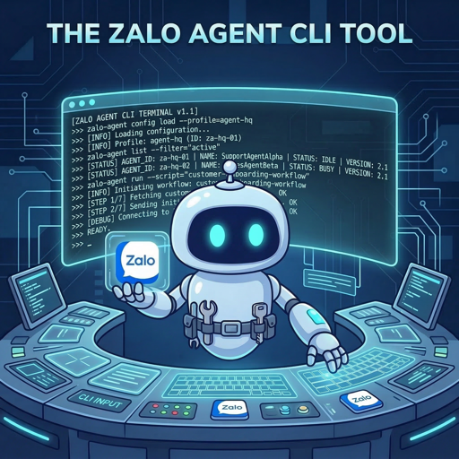

<p align="center">
  
</p>

# zalo-agent-cli

Công cụ CLI tự động hóa Zalo — đa tài khoản, proxy, chuyển khoản ngân hàng, thanh toán QR, Official Account API và ZBS Template Message, và MCP server cho AI agent.
Engine do dự án tự viết theo giao thức của Zalo (từ 3.0, không còn zca-js): mỗi request được dựng đúng định dạng Zalo yêu cầu, và engine theo sát giao thức hiện hành nên không phải chờ một thư viện bên thứ ba cập nhật.

[](https://creativecommons.org/licenses/by-nc-sa/4.0/)

**[Tiếng Việt](#bắt-đầu-nhanh)** | **[English](#english)**

> [!WARNING]
> Tool này sử dụng API Zalo **không chính thức** (giao thức riêng của Zalo, không có tài liệu công khai). Zalo không hỗ trợ và **tài khoản của bạn có thể bị khóa hoặc ban**. Tự chịu trách nhiệm. Không liên kết với Zalo hay VNG. Xem [DISCLAIMER.md](DISCLAIMER.md).

> [!IMPORTANT]
> **Zalo chỉ giữ một phiên đăng nhập web cho mỗi tài khoản — CLI (và server) này chính là phiên đó.**
> Quét QR đăng nhập Zalo trên trình duyệt ở nơi khác sẽ đăng xuất server ngay ở phía Zalo, kể cả khi không có tiến trình
> nào đang chạy: daemon đang chạy chuyển sang `signed_out` và chờ bạn thêm lại tài khoản bằng QR. Ngược lại,
> `zalo-agent login` đăng xuất Zalo trên trình duyệt. **Ứng dụng điện thoại và ứng dụng Zalo trên máy tính là các phiên
> riêng, chạy song song với server được** — muốn xem tin nhắn bên cạnh server thì dùng hai ứng dụng này, đừng dùng trình duyệt.
> Mỗi lần đăng nhập QR, điện thoại hiện thêm một mục trong danh sách thiết bị (các mục cũ của server bị đăng xuất),
> nhưng hàng đợi tin nhắn offline vẫn còn, vì CLI giữ nguyên mã thiết bị của tài khoản khi đăng nhập lại.
> Lệnh `oa` và `zbs` là ngoại lệ — chúng dùng **API chính thức** của Zalo OA và ZBS, không có rủi ro ban.

> [!TIP]
> **AI Agent Skill** — Dùng với OpenClaw, Claude Code, hoặc bất kỳ agent nào hỗ trợ SKILL.md:
> ```bash
> clawhub install zalo-agent          # OpenClaw (từ ClawHub registry)
> cp -r skill/ ~/.claude/skills/zalo-agent/   # Claude Code
> ```
> 23 nhóm lệnh · 315 lệnh · listen mode + webhook · 55+ ngân hàng VN · đa tài khoản + proxy
> Xem [skill/SKILL.md](skill/SKILL.md) · [Tham chiếu lệnh đầy đủ](skill/references/command-reference.md) · [Eval scenarios](skill/evals/)

> [!NOTE]
> **Zalo Official Account (OA) và ZBS** — API chính thức của Zalo OA và ZBS Template Message:
> ```bash
> zalo-agent oa init                                    # Setup wizard (interactive)
> zalo-agent oa init --app-id <ID> --secret <KEY> --skip-webhook  # Non-interactive (AI agent)
> zalo-agent oa whoami                                  # Xem thông tin OA
> zalo-agent oa msg text <user-id> "Xin chào"           # Gửi tin tư vấn
> zalo-agent zbs send 0901234567 <template-id> '{...}'   # Gửi tin template ZBS qua SĐT
> zalo-agent oa listen -p 3000 -s <oa-secret-key>        # Webhook listener
> ```
> OAuth login · tin tư vấn · người dùng · tag · bài viết · nhóm chat GMF · gọi thoại · tin template ZBS · webhook listener · multi-OA · VPS support
> Xem [docs/official-account.vi.md](docs/official-account.vi.md) · [English](docs/official-account.md)

> [!TIP]
> **MCP Server (AI Agent Integration)** — Model Context Protocol cho Claude Code và các MCP client:
> ```bash
> zalo-agent mcp start                                  # stdio (local Claude Code)
> zalo-agent mcp start --account <ID>                   # Ghim tài khoản (chạy nhiều tài khoản live cùng lúc)
> ZALO_MCP_AUTH_TOKEN=<token> zalo-agent mcp start --http 3847   # HTTP; token qua biến môi trường, không đặt trên dòng lệnh
> zalo-agent mcp wait -c my-bot --timeout 55 --json     # Zero-polling chờ tin nhắn mới qua CLI
> zalo-agent mcp mark-read <cursor> -c my-bot --json    # Đánh dấu đã đọc tới cursor qua CLI
> ```
> 36 tools: `zalo_get_messages` · `zalo_send_message` · `zalo_list_threads` · `zalo_search_threads` · `zalo_mark_read` · `zalo_get_history` · `zalo_view_media` · `zalo_react` · `zalo_undo` · `zalo_get_group_members` · `zalo_list_conversations` · `zalo_coverage` · `zalo_sync` · `zalo_sync_status` · `zalo_search_messages` · `zalo_lookup_user` · `zalo_forward_message` · `zalo_delete_message` · `zalo_reminder` · `zalo_note` · `zalo_poll` · `zalo_wait_for_message` · `zalo_label` · `zalo_friend` · `zalo_group` · `zalo_read` · `zalo_write` · `zalo_conversation` · `zalo_profile` · `zalo_auto_reply` · `zalo_quick_message` · `zalo_catalog` · `zalo_bank` · `zalo_cloud` · `zalo_sticker` · `zalo_link`

> [Sync qua MCP](docs/mcp-sync.vi.md) · [Ghim đa tài khoản live](docs/account-pinning.vi.md) · [Triển khai Production](docs/deployment.vi.md) · [Cấu hình](docs/configuration.vi.md).
> Hiện diện on-demand (server HTTP chỉ giữ socket khi có việc; `presence.mode: "always-on"` khi cần thời gian thực) · thread filter · noise reduction · tự tải media · thông báo qua nhóm Zalo · chạy song song nhiều tài khoản (`--account <ID>`)
> Xem [MCP Guide](skill/references/mcp-guide.md) · [INSTALLATION.vi.md](INSTALLATION.vi.md)

---

## Cài đặt

Yêu cầu **Node.js 22+** (22.19 trở lên).

```bash
npm install -g @ardennguyen/zalo-agent-cli
```

Muốn cài kèm MCP server dạng sandbox (khuyến nghị cho AI client) → xem [INSTALLATION.vi.md](INSTALLATION.vi.md) ([English](INSTALLATION.md)).

### Nâng cấp từ 2.x lên 3.0

3.0 thay zca-js bằng engine riêng; cách chạy CLI, MCP server và wrapper không đổi. **Trước lệnh 3.0 đầu tiên, hãy sao lưu thư mục `~/.zalo-agent-cli`** (lúc đó vẫn là dữ liệu chưa mã hóa): các lệnh 3.0 mã hóa thông tin đăng nhập, `zalo.db` và media ngay khi mở tới chúng (lệnh đầu tiên đã niêm phong phiên đăng nhập), và việc này chỉ đi một chiều — 2.5.9 không đọc lại được. Đừng bao giờ chạy cùng lúc hai bản sao của một phiên đăng nhập (bản sao lưu và bản đã nâng cấp): chúng sẽ đá nhau ra. Các bước đầy đủ: [INSTALLATION.vi.md](INSTALLATION.vi.md#nâng-cấp-từ-259-lên-30). Các thay đổi phá vỡ tương thích:

- **Dữ liệu trên đĩa được mã hóa.** `zalo.db` là SQLCipher: `sqlite3`, DB Browser hay bot mở thẳng file sẽ không đọc được nữa — dùng `zalo-agent db query`/`db export` hoặc các MCP tool.
- **Lệnh phá hủy cần `--yes`.** `msg undo`/`delete`, `group leave`, `friend remove`, `conv delete`, `logout`, `account remove`, `account export`… thiếu `--yes` thì không gửi gì và thoát với mã 2; `--dry-run` cho xem trước. Script cần thêm `--yes`.
- **MCP:** các thao tác tương ứng cần `confirm: true`; `confirmMode` của từng triển khai quyết định ai xác nhận (`agent` mặc định, `human` hỏi người dùng qua MCP elicitation hoặc một trang duyệt dùng một lần, `off`). Mỗi id có một tên: `msgId` (không còn `id`/`messageId`), `userId` (không còn `uid`); `threadType` là `"dm"` hoặc `"group"`; mọi id là chuỗi. Các tool mới, `zalo_friend`, `zalo_group` và `zalo_send_message` từ chối tham số không nhận.
- **Hiện diện on-demand là mặc định** của `mcp start --http` và `listen --daemon`: socket chỉ mở khi có việc và tạm nghỉ sau 5 phút rảnh; tin đến lúc nghỉ được lấy lại từ hàng đợi offline của Zalo ở lần kết nối sau (`catchUp: true`). Cần webhook thời gian thực thì đặt `presence.mode: "always-on"`. MCP qua stdio và `listen` chạy foreground vẫn luôn kết nối.
- **Daemon on-demand bị phiên khác chiếm tài khoản thì nhường (`yielded`)** thay vì thoát: mọi yêu cầu bị từ chối với `YIELDED` cho tới khi bạn chạy `zalo-agent presence resume --yes`. Chế độ always-on vẫn thoát với mã 3.
- **Bị Zalo từ chối đăng nhập (ví dụ vì ai đó đăng nhập Zalo trên trình duyệt) thì daemon vẫn chạy ở trạng thái `signed_out`** và chờ thêm lại tài khoản bằng QR, không còn thoát với mã 4; muốn giữ mã 4 thì đặt `ZALO_EXIT_ON_SIGNED_OUT=1`.
- **Rời nhóm (hoặc bị xóa, bị chặn, nhóm bị giải tán) thì lịch sử nhóm trên máy bị xóa**, như ứng dụng Zalo; `groups.onLeave: "keep"` giữ lại.
- **`senderName` giờ ưu tiên tên gợi nhớ (alias)** mà chủ tài khoản đặt; tên Zalo gốc nằm ở `senderZaloName`.
- **`ZALO_QR_FLOW=legacy` đã bị bỏ** — xóa khỏi môi trường hoặc `.env`.
- **Official Account:** `oa msg` chỉ gửi tin tư vấn; tin giao dịch và truyền thông (`-m transaction|promotion`, Zalo đã dừng trên OA API từ 01/03/2026) chuyển sang nhóm lệnh mới `zbs` (`zbs send`, `zbs uid`). `oa store`, `oa menu`, `oa msg list` và `oa msg status` (thay bằng `zbs status`) đã bị bỏ; vài tùy chọn đổi tên theo tài liệu của Zalo (`oa msg image --url`/`--attachment-id`, `oa msg file --token`, `oa follower update` dùng flag theo tên).
- **`logout` đăng xuất thiết bị** ở phía Zalo; `--keep-session` giữ cách cũ.
- **Lệnh thất bại thoát với mã 1** (trước đây phần lớn thoát với mã 0). Mã thoát: 0 thành công, 1 thất bại, 2 cần xác nhận (`--yes`), 3 daemon always-on bị kick (phiên khác chiếm tài khoản), 4 Zalo liên tục từ chối phiên đăng nhập đã lưu (với daemon: chỉ khi `ZALO_EXIT_ON_SIGNED_OUT=1`). Với `--json`, lỗi là `{"error": …}`, và stdout luôn là một object hoặc mảng JSON (không còn `""` hay `null`).
- Wrapper `@ardennguyen/zalo-mcp` 2.1.0 cần engine 3.0.0.

Chi tiết: [CHANGELOG.md](CHANGELOG.md).

## Bắt đầu nhanh

### 1. Đăng nhập

```bash
zalo-agent login
```

Quét QR bằng **Zalo app > Quét mã QR** (không dùng camera thường). QR cũng xem được trên trình duyệt tại `http://localhost:18927/qr` (chỉ trên máy này; `--qr-url` mở cho mạng LAN, `--public-url` cho một reverse proxy). Thông tin đăng nhập lưu tại `~/.zalo-agent-cli/` (quyền 0600, được mã hóa trên đĩa).

Nếu khi xác nhận trên điện thoại bạn tick ô **"Đồng bộ tin nhắn"**, `login` khôi phục lịch sử ngay, không cần chạm thêm; nếu không, nó in lệnh `zalo-agent sync --from <ngày>` để lấy phần máy này còn thiếu. `--no-sync` chỉ báo mà không khôi phục, `--verbose` liệt kê những gì nó đã đọc. Đăng nhập lại bằng QR giữ nguyên mã thiết bị của tài khoản, nên hàng đợi tin offline của Zalo vẫn còn.

### 2. Tìm bạn bè

```bash
zalo-agent friend search "Phúc"
```

### 3. Lắng nghe tin nhắn (lấy thread ID)

```bash
zalo-agent listen
```

Mỗi tin nhắn đến sẽ hiện `threadId`. Dùng `--json` để lấy dạng JSON.

### 4. Gửi tin nhắn

```bash
# Gửi cho cá nhân
zalo-agent msg send <THREAD_ID> "Xin chào!"

# Gửi vào nhóm
zalo-agent msg send <THREAD_ID> "Xin chào nhóm!" -t 1
```

---

## Danh sách lệnh

Tất cả lệnh hỗ trợ `--json`. Tài liệu đầy đủ: **[Wiki](https://github.com/ardennguyen/zalo-agent-cli/wiki)** · [Tham chiếu lệnh đầy đủ](skill/references/command-reference.md)

| Nhóm lệnh | Số lệnh | Mô tả | Docs |
|------------|:---:|--------|------|
| *(top-level)* | 11 | `login`, `logout`, `status`, `whoami`, `update`, `sync`, `sync-mobile`, `sync-media`, `sync-reactions`, `sync-boards`, `sync-cloud` | [Đăng nhập & Đăng xuất](https://github.com/ardennguyen/zalo-agent-cli/wiki/%C4%90%C4%83ng-Nh%E1%BA%ADp-&-%C4%90%C4%83ng-Xu%E1%BA%A5t) |
| `msg` | 27 | Gửi tin nhắn, hình, file, voice, video, sticker, link, thẻ chuyển khoản, QR, thu hồi, lịch sử, tìm kiếm, mở media | [Tin nhắn](https://github.com/ardennguyen/zalo-agent-cli/wiki/Tin-Nh%E1%BA%AFn) |
| `friend` | 26 | Danh sách, tìm, thêm, xóa, chặn, biệt danh, gợi ý | [Bạn bè](https://github.com/ardennguyen/zalo-agent-cli/wiki/B%E1%BA%A1n-B%C3%A8) |
| `group` | 35 | Tạo, đổi tên, thành viên, cài đặt, link, ghi chú, lời mời | [Nhóm & Cộng đồng](https://github.com/ardennguyen/zalo-agent-cli/wiki/Nh%C3%B3m) |
| `conv` | 22 | Tắt thông báo, ghim, lưu trữ, ẩn hội thoại, tự xóa, xoá bộ nhớ đệm cục bộ (`forget`) | [Hội thoại](https://github.com/ardennguyen/zalo-agent-cli/wiki/H%E1%BB%99i-Tho%E1%BA%A1i) |
| `account` | 12 | Đa tài khoản & proxy, thiết bị đã liên kết, gói zBusiness/zCloud và dung lượng trên máy, xuất phiên đăng nhập (`export --yes`), xóa tài khoản, mã hóa dữ liệu trên đĩa (`security status\|migrate\|rekey\|provider`) | [Tài khoản](https://github.com/ardennguyen/zalo-agent-cli/wiki/T%C3%A0i-Kho%E1%BA%A3n) |
| `profile` | 14 | Xem/cập nhật hồ sơ, ảnh đại diện, quyền riêng tư | [Hồ sơ](https://github.com/ardennguyen/zalo-agent-cli/wiki/H%E1%BB%93-S%C6%A1) |
| `poll` | 7 | Tạo, bỏ phiếu, đóng khảo sát | [Khảo sát](https://github.com/ardennguyen/zalo-agent-cli/wiki/Kh%E1%BA%A3o-S%C3%A1t) |
| `reminder` | 6 | Tạo, sửa, xóa nhắc nhở | [Nhắc nhở](https://github.com/ardennguyen/zalo-agent-cli/wiki/Nh%E1%BA%AFc-Nh%E1%BB%9F) |
| `auto-reply` | 4 | Quản lý trả lời tự động | [Trả lời tự động](https://github.com/ardennguyen/zalo-agent-cli/wiki/Tr%E1%BA%A3-L%E1%BB%9Di-T%E1%BB%B1-%C4%90%E1%BB%99ng) |
| `quick-msg` | 6 | Tin nhắn nhanh đã lưu, bật/tắt tính năng | [Tin nhắn nhanh](https://github.com/ardennguyen/zalo-agent-cli/wiki/Tin-Nh%E1%BA%AFn-Nhanh) |
| `read` | 2 | Các endpoint chỉ-đọc của Zalo chưa có lệnh riêng: sticker, GIF, hạng hồ sơ, danh sách chặn, biệt danh… (chỉ đọc, không thay đổi gì) | [Tham chiếu lệnh](skill/references/command-reference.md) |
| `write` | 2 | Các endpoint thay đổi trạng thái của Zalo chưa có lệnh riêng: ghim, RSVP nhắc hẹn, thu hồi nhiều tin… (`--dry-run` để xem yêu cầu, `--yes` mới gửi thật) | [Tham chiếu lệnh](skill/references/command-reference.md) |
| `label` | 2 | Nhãn hội thoại | [Nhãn](https://github.com/ardennguyen/zalo-agent-cli/wiki/Nh%C3%A3n) |
| `catalog` | 11 | zBusiness — danh mục sản phẩm | [zBusiness](https://github.com/ardennguyen/zalo-agent-cli/wiki/zBusiness) |
| `bank` | 5 | Tài khoản ngân hàng đã lưu, danh sách ngân hàng được hỗ trợ | [Ngân hàng](https://github.com/ardennguyen/zalo-agent-cli/wiki/Ng%C3%A2n-H%C3%A0ng) |
| `cloud` | 4 | Chỉ mục zCloud cục bộ: tổng quan, kế hoạch dọn dẹp, dọn dẹp (`apply --yes`), tải một mục về | [Tham chiếu lệnh](skill/references/command-reference.md) |
| `db` | 6 | Cơ sở dữ liệu tin nhắn đã mã hóa: truy vấn SQL chỉ-đọc (`query`), sao lưu mã hóa (`backup`), xuất bản sao (`export`: mã hóa bằng mật khẩu, hoặc `--plaintext` cần `--yes`), kiểm tra toàn vẹn (`verify`), dung lượng và hạn mức (`usage`), dọn theo hạn mức/thời hạn lưu (`purge`); chat ẩn chỉ hiện khi có mã PIN | [Bộ nhớ đệm & Đồng bộ](https://github.com/ardennguyen/zalo-agent-cli/wiki/B%E1%BB%99-Nh%E1%BB%9B-%C4%90%E1%BB%87m-&-%C4%90%E1%BB%93ng-B%E1%BB%99) |
| `listen` | 1 | Lắng nghe real-time, webhook, JSONL, ghi vào cache cục bộ | [Lắng nghe](https://github.com/ardennguyen/zalo-agent-cli/wiki/L%E1%BA%AFng-Nghe) |
| `fleet` | 8 | Chạy nhiều tài khoản trên một máy: bảng cổng, một bảng trạng thái, khởi động/dừng/khởi động lại theo lô (qua systemd khi có unit), dọn dữ liệu theo lịch (`purge`), sinh file systemd/Caddy cho VPS (`generate`), API vòng đời tài khoản kèm thêm tài khoản bằng QR (`serve`) | [Tham chiếu lệnh](skill/references/command-reference.md) |
| `policy` | 4 | Chính sách runtime đổi được khi server đang chạy (`get`, `set`, `unset`) và token của admin API (`token --rotate`) | [Cấu hình](docs/configuration.vi.md) |
| `presence` | 4 | Socket của daemon theo hiện diện on-demand: trạng thái, thức ngay, tạm nghỉ ngay, lấy lại tài khoản sau khi nhường (`resume --yes`) | [Tham chiếu lệnh](skill/references/command-reference.md) |
| `mcp` | 8 | MCP server (`start`, `wait`, `mark-read`, bốn lệnh `webhook` và `approver` đặt mật khẩu người duyệt) — 36 tools cho AI agent + zero-polling CLI | [MCP Server](https://github.com/ardennguyen/zalo-agent-cli/wiki/MCP-Server-(VN)) |
| **`oa`** | **70** | **Zalo Official Account API — OAuth, tin tư vấn, người dùng, tag, bài viết, nhóm chat GMF, gọi thoại, webhook** | **[Official Account](https://github.com/ardennguyen/zalo-agent-cli/wiki/Official-Account-(VN))** |
| **`zbs`** | **18** | **ZBS Template Message — template, gửi tin qua SĐT (hash, RSA, journey) hoặc UID, trạng thái, quota, chất lượng** | **[Official Account](https://github.com/ardennguyen/zalo-agent-cli/wiki/Official-Account-(VN))** |

Xem thêm: [Đa tài khoản & Proxy](https://github.com/ardennguyen/zalo-agent-cli/wiki/%C4%90a-T%C3%A0i-Kho%E1%BA%A3n-&-Proxy) · [Cài đặt VPS](https://github.com/ardennguyen/zalo-agent-cli/wiki/C%C3%A0i-%C4%90%E1%BA%B7t-VPS) · [Thẻ chuyển khoản & QR](https://github.com/ardennguyen/zalo-agent-cli/wiki/Th%E1%BA%BB-Chuy%E1%BB%83n-Kho%E1%BA%A3n-&-QR) · [Bộ nhớ đệm & Đồng bộ](https://github.com/ardennguyen/zalo-agent-cli/wiki/B%E1%BB%99-Nh%E1%BB%9B-%C4%90%E1%BB%87m-&-%C4%90%E1%BB%93ng-B%E1%BB%99) · [Bảo mật](https://github.com/ardennguyen/zalo-agent-cli/wiki/B%E1%BA%A3o-M%E1%BA%ADt)

---

## Tính năng

- Đăng nhập QR qua HTTP server tự động (browser + terminal), báo ngay khi bị **từ chối trên điện thoại** thay vì treo tới khi mã hết hạn; trang QR báo đăng nhập thành công hay thất bại, và mã hết hạn có nút "Lấy mã mới"
- Đa tài khoản với proxy riêng biệt (1:1), device fingerprint riêng cho từng tài khoản; chạy **nhiều tài khoản live đồng thời** (mỗi tài khoản một tiến trình `mcp start` hoặc `listen` kèm `--account <ID>`, và truyền `--account <ID>` / `ZALO_ACCOUNT` trên mọi lệnh CLI mà không ghi đè `accounts.json`)
- **315 lệnh** phủ hết tính năng Zalo cá nhân, cùng API chính thức OA và ZBS
- **Zalo Official Account (OA) API và ZBS Template Message** — OAuth login, tin tư vấn, người dùng, tag, bài viết, nhóm chat GMF, gọi thoại, tin template qua SĐT hoặc UID, webhook listener, multi-OA
- **MCP server** (stdio + HTTP/HTTPS + OAuth 2.0) — 36 tools cho Claude Code, Gemini và các MCP client: đọc, chờ tin nhắn đến (`zalo_wait_for_message`), gửi (văn bản, link preview, danh thiếp, vào My Documents, đánh dấu Quan trọng/Khẩn cấp), tìm kiếm tin nhắn trong cache, tra cứu người dùng, gắn/gỡ nhãn hội thoại (`zalo_label`), quản lý bạn bè và lời mời kết bạn (`zalo_friend`), quản trị nhóm đầy đủ (`zalo_group`), cài đặt hội thoại (`zalo_conversation`), hồ sơ (`zalo_profile`), trả lời tự động, tin nhắn nhanh, catalog, tài khoản ngân hàng, chỉ mục zCloud, sticker và link, thả cảm xúc, thu hồi, chuyển tiếp, xóa tin, nhắc hẹn, ghi chú/ghim tin, bình chọn, xem thành viên nhóm, liệt kê hội thoại gần đây và kiểm tra độ đầy đủ của cache; mọi lệnh CLI của tài khoản cá nhân đều có hành động MCP tương ứng
- **Dữ liệu được mã hóa trên đĩa** — thông tin đăng nhập và các file nhỏ được niêm phong, `zalo.db` và hàng đợi webhook là SQLCipher v4, media tải về được mã hóa; khóa nằm trong bộ cung cấp khóa của máy (DPAPI, keychain, Secret Service, systemd-creds, KMS hoặc file passphrase). Mỗi tin nhắn có **row MAC** để phát hiện chỉnh sửa (`db verify`). Bot đọc dữ liệu qua `db query` / `db export` (chat ẩn chỉ khi có PIN) hoặc các MCP tool — xem [docs/security.vi.md](docs/security.vi.md)
- **Hiện diện on-demand** — `mcp start --http` và `listen --daemon` chỉ giữ socket khi có việc (tool call, chờ tin, lease của CRM, lệnh CLI chuyển qua daemon) rồi tạm nghỉ; tin đến lúc nghỉ được lấy lại từ hàng đợi offline của Zalo. `presence.mode: "always-on"` cho thời gian thực, `presence status|wake|park|resume`, sự kiện `account_state`; bị phiên khác chiếm thì nhường (`YIELDED`), bị đăng xuất thì vẫn chạy (`SIGNED_OUT`) để thêm lại bằng QR
- **Chính sách runtime và admin API** — `confirmMode`, chat ẩn, link media, webhook, hạn mức, thời hạn lưu, hiện diện… đổi được khi server đang chạy (`zalo-agent policy set`, file thả vào, hoặc `/zalo/admin/policy` với credential admin riêng mà agent không bao giờ có), theo tầng tenant < user < tài khoản
- **Hạn mức dung lượng kiểu zCloud** — vượt hạn mức vẫn lưu tiếp, gửi sự kiện `storage_quota` (webhook, `listen`, MCP) và chỉ xóa (media cũ trước) sau **45 ngày** ân hạn; quy tắc thời hạn lưu `retention.*`; `db usage`, `db purge`, `fleet purge` cho timer
- **Xuất dữ liệu cho CRM** — `POST /zalo/admin/export/<ownId>` tạo file xuất mã hóa bằng mật khẩu của người dùng (hoặc plaintext khi xác nhận) qua link tải có hạn; chat ẩn chỉ có khi chủ tài khoản nhập PIN trên trang bảo mật. CLI: `db export --password`
- **Trang duyệt dùng một lần** cho `confirmMode: "human"` và PIN chat ẩn, link media có hạn (`inline` / `link` / `tempfile`), tất cả dựng từ một địa chỉ công khai `publicUrl`
- **Tên gợi nhớ (alias) trước tiên ở mọi nơi** — mọi output gọi một người theo tên chủ tài khoản đặt cho họ, như ứng dụng Zalo (`senderAlias`, `senderZaloName` đi kèm); đổi alias trên thiết bị nào cũng tới daemon trong vài giây (log của daemon ghi `aliases: N changed`)
- **Rời nhóm thì xóa lịch sử nhóm trên máy**, như ứng dụng Zalo (sự kiện `group_gone`); `groups.onLeave: "keep"` giữ lại
- **Bộ nhớ đệm cục bộ (SQLite mã hóa)** — `listen` ghi mọi tin nhắn vào `zalo.db`, `msg history` đọc từ cache, `sync` (hoặc `sync-mobile`) khôi phục toàn bộ lịch sử từ điện thoại vào `zalo.db` (giải mã transfer-sync-v2; xác nhận một lần trên điện thoại), mặc định lấy **toàn bộ** lịch sử (không còn mốc chặn 2024-01-01); thêm `--days <n>` hoặc `--from <YYYY-MM-DD>` nếu chỉ cần một khoảng. Dọn dẹp: `sync-media --prune <days|all>` giải phóng dung lượng nhưng giữ nguyên nội dung tin nhắn, `--prune-orphans` nhắm vào hội thoại tài khoản không còn, và `conv forget` xoá hẳn bản sao cục bộ của một hội thoại — không cái nào gửi gì tới Zalo. Luồng đồng bộ chỉ mang **liên kết** media chứ không mang file, nên sau khi lưu tin nhắn, `sync-mobile` **tự động tải media về** (thêm `--messages-only` nếu chỉ muốn tin nhắn); `sync-media` chạy lại/tiếp tục bước tải này, không cần xác nhận trên điện thoại. Ghi chú, tin ghim, bình chọn và nhắc hẹn nằm ngoài luồng tin nhắn — dùng `sync-boards`
- Tự động tải media (ảnh/audio/video) — một downloader duy nhất cho `listen`, `msg history`, `mcp start` và các lệnh sync, lưu vào `~/.zalo-agent-cli/accounts/<id>/media/<threadId>/` (hoặc tách riêng credentials, database `zalo.db`, media và OA sang các ổ đĩa/mount khác nhau qua `--credentials-dir`, `--data-dir`, `--media-dir`, `--oa-dir` / biến môi trường `ZALO_*_DIR` trong `~/.zalo-agent-cli/.env`; nếu dùng kèm `zalo-mcp`, chỉ nên giữ cấu hình PORT trong `zalo-mcp/.env` và đặt toàn bộ đường dẫn lưu trữ vào `<CONFIG_DIR>/.env`)
- Thẻ chuyển khoản (55+ ngân hàng VN) & QR VietQR
- Lắng nghe real-time với webhook & lưu JSONL local. Webhook **bền vững**: mỗi sự kiện ghi xuống đĩa rồi mới gửi, đúng thứ tự, thử lại khi bên nhận hỏng, sống sót qua khởi động lại (`mcp webhook status`)
- **Vận hành nhiều tài khoản**: `/health`, `/ready`, `/status` và `/metrics` (Prometheus), `fleet status|start|stop|restart|purge|generate|serve`, mức log + xoay vòng `daemon.log`, `ZALO_START_JITTER` / `ZALO_LOGIN_SLOTS` / `ZALO_CONNECT_SLOTS` — xem [docs/deployment.vi.md](docs/deployment.vi.md) §4.7–4.8 và [bộ cấu hình mẫu theo từng trường hợp](docs/config-samples/use-cases/) (máy cá nhân, LAN, VPS, backend CRM, SaaS với KMS)
- Hàng đợi offline của Zalo tính theo thiết bị: đăng nhập lại bằng QR giữ nguyên mã thiết bị; độ phủ của cache không bao giờ tính từ trước khi thiết bị này bắt đầu dùng (`deviceSince`), và khi Zalo báo tràn hàng đợi, tin nhóm được bù từ kho tin trên cloud (sự kiện `queue_overflow`)
- Tin nhắn **Markdown** được chuyển thành định dạng thật của Zalo (đậm, nghiêng, gạch đầu dòng, tiêu đề) — `zalo_send_message` mặc định, `msg send --markdown`
- `logout` hủy phiên **phía server** thật sự; `logout --purge` / `account remove` xóa sạch dữ liệu cục bộ
- Output `--json` cho mọi lệnh — scripting & AI agents
- Credentials lưu cục bộ với quyền 0600, được niêm phong trên đĩa; `account export` ghi phiên đăng nhập ra file rõ chỉ khi có `--yes`
- **Dual mode**: interactive (con người) + non-interactive (AI agents, CI/CD)

## Tài liệu

| Tài liệu | Nội dung |
|----------|----------|
| [INSTALLATION.vi.md](INSTALLATION.vi.md) ([EN](INSTALLATION.md)) | Cài đặt `zalo-mcp` wrapper, cấu hình MCP client, thiết lập OA |
| [docs/official-account.vi.md](docs/official-account.vi.md) ([EN](docs/official-account.md)) | Tham chiếu đầy đủ lệnh OA và ZBS (song ngữ VN / EN) |
| [docs/deployment.vi.md](docs/deployment.vi.md) ([EN](docs/deployment.md)) | Hướng dẫn triển khai production (một socket, nhiều bot, HTTPS, OAuth 2.0, systemd/Docker) |
| [docs/configuration.vi.md](docs/configuration.vi.md) ([EN](docs/configuration.md)) | Mọi biến môi trường, khóa `mcp-config.json` / `storage.json`, chính sách runtime, hạn mức, hiện diện on-demand, `groups.onLeave` và các cách cấu hình khuyến nghị |
| [docs/config-samples/use-cases/](docs/config-samples/use-cases/) | Bộ file cấu hình đầy đủ cho từng trường hợp: máy cá nhân (stdio), LAN qua HTTP, VPS vài tài khoản, backend CRM, SaaS với KMS (README song ngữ) |
| [docs/security.vi.md](docs/security.vi.md) ([EN](docs/security.md)) | Mã hóa dữ liệu trên đĩa: những gì được niêm phong, bộ cung cấp khóa (DPAPI, systemd-creds, KMS, passphrase), lớp dkey, nâng cấp từ 2.x, row MAC, file xuất mã hóa bằng mật khẩu, sao lưu và xử lý sự cố |
| [skill/SKILL.md](skill/SKILL.md) | Skill cho AI agent |
| [skill/references/command-reference.md](skill/references/command-reference.md) | Tham chiếu lệnh đầy đủ (nguồn chuẩn) |
| [skill/references/mcp-guide.md](skill/references/mcp-guide.md) | Hướng dẫn MCP server (tiếng Việt) |
| [skill/references/oa-command-reference.md](skill/references/oa-command-reference.md) | Tham chiếu lệnh OA và ZBS cho agent |
| [skill/references/login-flow.md](skill/references/login-flow.md) | Các cách đăng nhập (QR, proxy, credentials) |
| [skill/references/listen-mode-guide.md](skill/references/listen-mode-guide.md) | Vận hành listener và webhook |
| [tests/README.md](tests/README.md) | Cách chạy và viết test: bộ offline, E2E phân tầng + checklist thủ công |
| [DISCLAIMER.md](DISCLAIMER.md) | Điều khoản đầy đủ và cảnh báo rủi ro |
| [AGENTS.md](AGENTS.md) | Quy tắc dự án cho AI coding agent |
| [Wiki](https://github.com/ardennguyen/zalo-agent-cli/wiki) | Tài liệu công khai, song ngữ EN + VN |

## Giấy phép

zalo-agent-cli © 2026 Arden Nguyen Duc Huy được cấp phép theo [CC BY-NC-SA 4.0](https://creativecommons.org/licenses/by-nc-sa/4.0/). Xem [LICENSE](LICENSE) và [NOTICE](NOTICE). Điều khoản đầy đủ và cảnh báo rủi ro nằm trong [DISCLAIMER.md](DISCLAIMER.md).

- **Miễn phí cho mục đích phi thương mại**: cá nhân, học thuật, nghiên cứu. **Không cấp phép cho mục đích thương mại** — ví dụ dùng trong sản phẩm thương mại, để cung cấp dịch vụ có thu phí, hoặc trong hoạt động kinh doanh của một công ty. Muốn xin giấy phép thương mại, hãy [mở một issue](https://github.com/ardennguyen/zalo-agent-cli/issues).
- **Ghi công**: khi chia sẻ dự án này hoặc một phần của nó (nguyên bản hay đã sửa đổi, kể cả bên trong dự án khác), hãy ghi công theo mẫu trong [NOTICE](NOTICE), nêu rõ bạn có sửa đổi hay không, và dẫn link giấy phép.
- **Chia sẻ tương tự (ShareAlike)**: bản sửa đổi được chia sẻ phải dùng CC BY-NC-SA 4.0 (hoặc phiên bản mới hơn, hoặc giấy phép tương thích do Creative Commons liệt kê).
- Các thông báo giấy phép MIT mà dự án phải giữ nằm trong [NOTICE](NOTICE).
- Các phiên bản phát hành trước thay đổi này (2.0.0 trở về trước) được phát hành theo giấy phép MIT và giữ nguyên các điều khoản đó.

---

## English

CLI tool for Zalo automation — multi-account, proxy support, bank transfers, QR payments, the Official Account API and ZBS Template Message, and an MCP server for AI agents.
Its engine is this project's own implementation of Zalo's protocol (since 3.0, no zca-js): requests are built in the wire format Zalo expects, and the engine tracks the current protocol instead of waiting for a third-party library.

> [!IMPORTANT]
> **Zalo keeps one web login per account — this CLI (and its server) is that login.**
> A QR login into Zalo in a browser anywhere else signs the server out at Zalo, instantly, even with nothing
> running: a running daemon goes `signed_out` and waits for the account to be added again by QR. The
> reverse is also true: `zalo-agent login` signs Zalo in the browser out. **The phone app and the Zalo desktop app
> are separate logins that run beside the server** — use them to read along, never a browser.
> Each QR login adds a new entry to the phone's device list (the server's older entries show as logged
> out), but Zalo's offline queue survives, because the CLI keeps the account's device id across re-logins.

> [!TIP]
> **AI Agent Skill** — Use with OpenClaw, Claude Code, or any SKILL.md-compatible agent:
> ```bash
> clawhub install zalo-agent                    # OpenClaw (from ClawHub registry)
> cp -r skill/ ~/.claude/skills/zalo-agent/     # Claude Code
> ```
> 23 command groups · 315 commands · listen mode + webhook · 55+ VN banks · multi-account + proxy
> See [skill/SKILL.md](skill/SKILL.md) · [Full command reference](skill/references/command-reference.md) · [Eval scenarios](skill/evals/)

> [!NOTE]
> **Zalo Official Account (OA) and ZBS** — Zalo's official OA API and ZBS Template Message:
> ```bash
> zalo-agent oa init                                    # Setup wizard (interactive)
> zalo-agent oa init --app-id <ID> --secret <KEY> --skip-webhook  # Non-interactive (AI agent)
> zalo-agent oa whoami                                  # OA profile
> zalo-agent oa msg text <user-id> "Hello"              # Send a consultation message
> zalo-agent zbs send 0901234567 <template-id> '{...}'   # Send a ZBS template message by phone
> zalo-agent oa listen -p 3000 -s <oa-secret-key>        # Webhook listener
> ```
> OAuth login · consultation messages · users · tags · articles · GMF group chats · voice calls · ZBS template messages · webhook listener · multi-OA · VPS support
> See [docs/official-account.md](docs/official-account.md) · [Tiếng Việt](docs/official-account.vi.md)

> [!TIP]
> **MCP Server (AI Agent Integration)** — Model Context Protocol support for Claude Code and MCP clients:
> ```bash
> zalo-agent mcp start                                  # stdio (local Claude Code)
> zalo-agent mcp start --account <ID>                   # Pin account (run multiple live accounts at once)
> ZALO_MCP_AUTH_TOKEN=<token> zalo-agent mcp start --http 3847   # HTTP; token in the environment, never on the command line
> zalo-agent mcp wait -c my-bot --timeout 55 --json     # Zero-polling wait for next message via CLI
> zalo-agent mcp mark-read <cursor> -c my-bot --json    # Advance consumer read cursor via CLI
> ```
> 36 tools: `zalo_get_messages` · `zalo_send_message` · `zalo_list_threads` · `zalo_search_threads` · `zalo_mark_read` · `zalo_get_history` · `zalo_view_media` · `zalo_react` · `zalo_undo` · `zalo_get_group_members` · `zalo_list_conversations` · `zalo_coverage` · `zalo_sync` · `zalo_sync_status` · `zalo_search_messages` · `zalo_lookup_user` · `zalo_forward_message` · `zalo_delete_message` · `zalo_reminder` · `zalo_note` · `zalo_poll` · `zalo_wait_for_message` · `zalo_label` · `zalo_friend` · `zalo_group` · `zalo_read` · `zalo_write` · `zalo_conversation` · `zalo_profile` · `zalo_auto_reply` · `zalo_quick_message` · `zalo_catalog` · `zalo_bank` · `zalo_cloud` · `zalo_sticker` · `zalo_link`

> [MCP sync](docs/mcp-sync.md) · [Multi-account pinning](docs/account-pinning.md) · [Production deployment](docs/deployment.md) · [Configuration](docs/configuration.md).
> On-demand presence (an HTTP server holds the socket only while there is work; `presence.mode: "always-on"` for real time) · thread filter · noise reduction · media auto-download · Zalo-group notifications · concurrent multi-account (`--account <ID>`)
> See [MCP Guide](skill/references/mcp-guide.md) · [INSTALLATION.md](INSTALLATION.md)

### Quick Start

Requires **Node.js 22+** (22.19 or later).

```bash
npm install -g @ardennguyen/zalo-agent-cli
zalo-agent login                           # 1. Login via QR
zalo-agent friend search "Name"            # 2. Find a friend
zalo-agent listen                          # 3. Listen for threadId
zalo-agent msg send <THREAD_ID> "Hello!"   # 4. Send a message
```

Scan the QR with **Zalo app > QR scanner** (not the regular camera); the page is also at `http://localhost:18927/qr` (this machine only; `--qr-url` offers it to the LAN, `--public-url` to a reverse proxy). If you tick **"Sync messages"** on the phone when you confirm, `login` restores the history at once with no further tap; if not, it prints the `zalo-agent sync --from <date>` run that fetches what this machine lacks. `--no-sync` only reports, `--verbose` lists what it read. A QR re-login keeps the account's device id, so Zalo's offline queue survives it.

For the sandboxed MCP-server install (recommended for AI clients), see [INSTALLATION.md](INSTALLATION.md) ([Tiếng Việt](INSTALLATION.vi.md)).

### Upgrading from 2.x

3.0 replaces zca-js with the project's own engine; how you run the CLI, the MCP server and the wrapper does not change. **Before the first 3.0 command, back up `~/.zalo-agent-cli`** (still plaintext at that point): 3.0 commands encrypt the saved login, `zalo.db` and the media as they open them (the very first one seals the login), and that is one-way — 2.5.9 cannot read them back. Never run two copies of one login at once (the backup and the upgraded home): they kick each other off. The full steps: [INSTALLATION.md](INSTALLATION.md#upgrading-from-259-to-30). The breaking changes:

- **Data on disk is encrypted.** `zalo.db` is SQLCipher: `sqlite3`, DB Browser or a bot that opens the file directly can no longer read it — use `zalo-agent db query` / `db export` or the MCP tools.
- **Destructive commands need `--yes`.** `msg undo`/`delete`, `group leave`, `friend remove`, `conv delete`, `logout`, `account remove`, `account export`, … send nothing without it and exit 2; `--dry-run` previews. Scripts add `--yes`.
- **MCP:** the matching actions need `confirm: true`; each deployment's `confirmMode` decides who confirms (`agent` by default, `human` asks the user through MCP elicitation or a one-time approve page, `off`). Every id has one name: `msgId` (not `id`/`messageId`), `userId` (not `uid`); `threadType` is `"dm"` or `"group"`; every id is a string. The new tools, `zalo_friend`, `zalo_group` and `zalo_send_message` refuse an input they do not take.
- **On-demand presence is the default** for `mcp start --http` and `listen --daemon`: the socket opens only while there is work and parks after 5 idle minutes; what arrives meanwhile comes back from Zalo's offline queue on the next connect (`catchUp: true`). For real-time webhooks set `presence.mode: "always-on"`. stdio MCP and a foreground `listen` stay connected.
- **An on-demand daemon whose account another session takes yields** (`yielded`) instead of exiting: every request is refused with `YIELDED` until you run `zalo-agent presence resume --yes`. Always-on still exits 3.
- **A login Zalo keeps refusing (for example after a Zalo login in a browser) leaves the daemon up, `signed_out`**, waiting for the account to be added again by QR, instead of exiting 4; `ZALO_EXIT_ON_SIGNED_OUT=1` keeps exit 4.
- **Leaving a group (or being removed or blocked, or a disband) deletes the group's local history**, as Zalo's own apps do; `groups.onLeave: "keep"` keeps it.
- **`senderName` is now alias first** (the name the account owner set); the Zalo name itself is `senderZaloName`.
- **`ZALO_QR_FLOW=legacy` is removed** — take it out of your environment or `.env`.
- **Official Account:** `oa msg` sends consultation messages only; transaction and promotion messages (`-m transaction|promotion`, stopped by Zalo on the OA API on 01/03/2026) move to the new `zbs` group (`zbs send`, `zbs uid`). `oa store`, `oa menu`, `oa msg list` and `oa msg status` (replaced by `zbs status`) are removed; some options are renamed to match Zalo's docs (`oa msg image --url`/`--attachment-id`, `oa msg file --token`, `oa follower update` takes named flags).
- **`logout` signs the device out** at Zalo; `--keep-session` keeps the old behavior.
- **A command that fails exits 1** (before, most exited 0). Exit codes: 0 done, 1 failed, 2 confirmation needed (`--yes`), 3 an always-on daemon was kicked (another session took the account), 4 Zalo keeps refusing the saved login (for a daemon, only with `ZALO_EXIT_ON_SIGNED_OUT=1`). With `--json` a failure is `{"error": …}`, and stdout is always one JSON object or array (never `""` or `null`).
- Wrapper `@ardennguyen/zalo-mcp` 2.1.0 requires engine 3.0.0.

Details: [CHANGELOG.md](CHANGELOG.md).

### Commands

Full docs: **[Wiki](https://github.com/ardennguyen/zalo-agent-cli/wiki)** · [Full command reference](skill/references/command-reference.md)

| Group | Commands | Description | Docs |
|-------|:---:|-------------|------|
| *(top-level)* | 11 | `login`, `logout`, `status`, `whoami`, `update`, `sync`, `sync-mobile`, `sync-media`, `sync-reactions`, `sync-boards`, `sync-cloud` | [Login & Logout](https://github.com/ardennguyen/zalo-agent-cli/wiki/Login-&-Logout) |
| `msg` | 27 | Text, images, files, voice, video, stickers, links, bank cards, QR, recall, history, search, open media | [Messages](https://github.com/ardennguyen/zalo-agent-cli/wiki/Messages) |
| `friend` | 26 | List, find, add, remove, block, alias, recommendations | [Friends](https://github.com/ardennguyen/zalo-agent-cli/wiki/Friends) |
| `group` | 35 | Create, rename, members, settings, links, notes, invites | [Groups](https://github.com/ardennguyen/zalo-agent-cli/wiki/Groups) |
| `conv` | 22 | Mute, pin, archive, hidden, auto-delete, forget local cache | [Conversations](https://github.com/ardennguyen/zalo-agent-cli/wiki/Conversations) |
| `account` | 12 | Multi-account & proxy, linked devices, zBusiness/zCloud plans and this machine's storage, login export (`export --yes`), account removal, encryption at rest (`security status\|migrate\|rekey\|provider`) | [Accounts](https://github.com/ardennguyen/zalo-agent-cli/wiki/Accounts) |
| `profile` | 14 | Profile, avatar gallery, privacy | [Profile](https://github.com/ardennguyen/zalo-agent-cli/wiki/Profile) |
| `poll` | 7 | Create, vote, lock polls | [Polls](https://github.com/ardennguyen/zalo-agent-cli/wiki/Polls) |
| `reminder` | 6 | Create, edit, remove reminders | [Reminders](https://github.com/ardennguyen/zalo-agent-cli/wiki/Reminders) |
| `auto-reply` | 4 | Auto-reply rules | [Auto-Reply](https://github.com/ardennguyen/zalo-agent-cli/wiki/Auto-Reply) |
| `quick-msg` | 6 | Saved quick messages, the feature's on/off switch | [Quick Messages](https://github.com/ardennguyen/zalo-agent-cli/wiki/Quick-Messages) |
| `read` | 2 | Zalo's read-only endpoints with no command of their own: stickers, GIFs, profile rank, block list, nicknames… (reads only, changes nothing) | [Command reference](skill/references/command-reference.md) |
| `write` | 2 | Zalo's state-changing endpoints with no command of their own: pins, reminder RSVP, multi-recall… (`--dry-run` shows the request, `--yes` sends it) | [Command reference](skill/references/command-reference.md) |
| `label` | 2 | Conversation labels | [Labels](https://github.com/ardennguyen/zalo-agent-cli/wiki/Labels) |
| `catalog` | 11 | zBusiness catalogs & products | [Catalog](https://github.com/ardennguyen/zalo-agent-cli/wiki/Catalog) |
| `bank` | 5 | Saved bank accounts, supported banks | [Bank](https://github.com/ardennguyen/zalo-agent-cli/wiki/Bank) |
| `cloud` | 4 | The local zCloud index: summary, cleanup plan, the cleanup (`apply --yes`), download one item | [Command reference](skill/references/command-reference.md) |
| `db` | 6 | The encrypted message database: read-only SQL (`query`), encrypted backup (`backup`), copies (`export`: password-encrypted, or `--plaintext` with `--yes`), integrity check (`verify`), storage and quota (`usage`), quota/retention purge (`purge`); hidden chats only with the PIN | [Local Cache & Sync](https://github.com/ardennguyen/zalo-agent-cli/wiki/Local-Cache-&-Sync) |
| `listen` | 1 | Real-time listener, webhook, JSONL, local cache writes | [Listener](https://github.com/ardennguyen/zalo-agent-cli/wiki/Listener) |
| `fleet` | 8 | Run many accounts on one machine: port table, one status table, batched start/stop/restart (through systemd when a unit runs the account), a purge for a timer (`purge`), the VPS's systemd/Caddy files (`generate`), the account-lifecycle API with QR add (`serve`) | [Command reference](skill/references/command-reference.md) |
| `policy` | 4 | The runtime policy a running server takes without a restart (`get`, `set`, `unset`) and the admin API's token (`token --rotate`) | [Configuration](docs/configuration.md) |
| `presence` | 4 | The daemon's socket under on-demand presence: status, wake now, park now, take the account back after a yield (`resume --yes`) | [Command reference](skill/references/command-reference.md) |
| `mcp` | 8 | MCP server (`start`, `wait`, `mark-read`, the four `webhook` commands and `approver` for the approver password) — 36 tools for AI agents + zero-polling CLI | [MCP Server](https://github.com/ardennguyen/zalo-agent-cli/wiki/MCP-Server) |
| **`oa`** | **70** | **Zalo Official Account API — OAuth, consultation messages, users, tags, articles, GMF group chats, voice calls, webhook** | **[Official Account](https://github.com/ardennguyen/zalo-agent-cli/wiki/Official-Account)** |
| **`zbs`** | **18** | **ZBS Template Message — templates, sends by phone number (hashed, RSA, journey) or UID, status, quota, quality** | **[Official Account](https://github.com/ardennguyen/zalo-agent-cli/wiki/Official-Account)** |

See also: [Multi-Account & Proxy](https://github.com/ardennguyen/zalo-agent-cli/wiki/Multi-Account-&-Proxy) · [VPS Setup](https://github.com/ardennguyen/zalo-agent-cli/wiki/VPS-Setup) · [Bank Card & QR Payments](https://github.com/ardennguyen/zalo-agent-cli/wiki/Bank-Card-&-QR-Payments) · [Local Cache & Sync](https://github.com/ardennguyen/zalo-agent-cli/wiki/Local-Cache-&-Sync) · [Security](https://github.com/ardennguyen/zalo-agent-cli/wiki/Security)

### Features

- QR login over an auto-started HTTP server (browser + terminal), reporting a **decline on the phone** immediately instead of hanging until the code expires; the QR page says whether the login succeeded or failed, and an expired code has a "Get a new code" button
- Multi-account with a dedicated proxy (1:1) and a per-account device fingerprint; run **multiple live accounts simultaneously** (one `mcp start` or `listen` process per account with `--account <ID>`, plus `--account <ID>` / `ZALO_ACCOUNT` on any CLI command without mutating `accounts.json`)
- **315 commands** covering the personal-account Zalo surface plus the official OA and ZBS APIs
- **Zalo Official Account (OA) API and ZBS Template Message** — OAuth login, consultation messages, users, tags, articles, GMF group chats, voice calls, template messages by phone number or UID, webhook listener, multi-OA
- **MCP server** (stdio + HTTP/HTTPS + OAuth 2.0) — 36 tools for Claude Code, Gemini and other MCP clients: read, wait for incoming messages (`zalo_wait_for_message`), send (text, local file/image attachments, link previews, contact cards, to My Documents too, marked Important/Urgent), search cached messages, look up users, manage conversation labels (`zalo_label`), friends and friend requests (`zalo_friend`), full group administration (`zalo_group`), conversation settings (`zalo_conversation`), the profile (`zalo_profile`), auto-replies, quick messages, the catalog, bank accounts, the zCloud index, stickers and links, react, recall, forward, delete, reminders, group notes/pins, group polls, list a group's members, list recent conversations, and check how complete the cache is; every personal CLI command has an MCP action
- **Data encrypted at rest** — the saved login and the small files are sealed, `zalo.db` and the webhook outbox are SQLCipher v4, downloaded media is encrypted; the keys stay with the machine's key provider (DPAPI, the keychain, Secret Service, systemd-creds, a KMS or a passphrase file). Every message carries a **row MAC** for tamper evidence (`db verify`). Bots read through `db query` / `db export` (hidden chats only with the PIN) or the MCP tools — see [docs/security.md](docs/security.md)
- **On-demand presence** — `mcp start --http` and `listen --daemon` hold the socket only while something needs it (a tool call, a wait, a CRM lease, a CLI request routed to the daemon) and then park; what arrives meanwhile comes back from Zalo's offline queue. `presence.mode: "always-on"` for real time, `presence status|wake|park|resume`, `account_state` events; another session taking the account makes it yield (`YIELDED`), a revoked login leaves it up (`SIGNED_OUT`) to be added again by QR
- **Runtime policy and the admin API** — `confirmMode`, hidden chats, media links, the webhook, quotas, retention, presence… change while the server runs (`zalo-agent policy set`, a dropped file, or `/zalo/admin/policy` with its own admin credential that no agent ever holds), layered tenant < user < account
- **Storage quotas, the zCloud way** — over a limit, caching goes on, `storage_quota` events go out (webhook, `listen`, MCP), and only after a **45-day** grace period is anything deleted (oldest media first); `retention.*` rules; `db usage`, `db purge`, `fleet purge` for a timer
- **Export for a CRM** — `POST /zalo/admin/export/<ownId>` builds an export encrypted under the user's password (or plaintext when confirmed) behind an expiring download link; hidden chats only when the owner types the PIN on the secure page. CLI: `db export --password`
- **One-time approve pages** for `confirmMode: "human"` and the hidden-chat PIN, expiring media links (`inline` / `link` / `tempfile`), all built from one public address, `publicUrl`
- **Alias first, everywhere** — every output names a person by the alias the account owner set, as Zalo's own apps do (`senderAlias`, `senderZaloName` beside it); an alias changed on any device reaches the daemon within seconds (the daemon log says `aliases: N changed`)
- **Leaving a group deletes its local history**, as Zalo's own apps do (a `group_gone` event); `groups.onLeave: "keep"` keeps it
- **Local encrypted SQLite cache** — `listen` writes every message to `zalo.db`, `msg history` reads from it, and `sync` (or `sync-mobile`) restores full history from the phone into `zalo.db` (transfer-sync-v2 decrypt; one confirmation on the phone), defaulting to **all** history (the old 2024-01-01 floor is gone), with `--days <n>` or `--from <YYYY-MM-DD>` to narrow it. Housekeeping: `sync-media --prune <days|all>` reclaims disk while keeping message text, `--prune-orphans` targets conversations the account no longer has, and `conv forget` removes a conversation's local copy entirely — none of which contact Zalo. The sync stream carries media **links**, not files, so a `sync-mobile` run **downloads its attachments automatically** once the messages are stored (`--messages-only` skips it); `sync-media` re-runs or resumes that fetch on its own, with no phone confirmation. Notes, pinned messages, polls and reminders live outside the message stream — `sync-boards` fetches those
- Automatic media download — one downloader shared by `listen`, `msg history`, `mcp start` and the sync commands, saving to `~/.zalo-agent-cli/accounts/<id>/media/<threadId>/` (or separate credentials, `zalo.db`, media, and OA credentials onto independent volumes/mounts via `--credentials-dir`, `--data-dir`, `--media-dir`, `--oa-dir` / `ZALO_*_DIR` in `~/.zalo-agent-cli/.env`; when using `zalo-mcp`, keep `zalo-mcp/.env` for PORT settings only and place all storage/engine settings in `<CONFIG_DIR>/.env`)
- Bank cards (55+ VN banks) and VietQR payment images
- Real-time listener with webhook forwarding and local JSONL archival. The webhook is **durable**: each event is written to disk first, then delivered in order, retried while the receiver is down, and kept across restarts (`mcp webhook status`)
- **Running many accounts**: `/health`, `/ready`, `/status` and `/metrics` (Prometheus), `fleet status|start|stop|restart|purge|generate|serve`, log levels and `daemon.log` rotation, `ZALO_START_JITTER` / `ZALO_LOGIN_SLOTS` / `ZALO_CONNECT_SLOTS` — see [docs/deployment.md](docs/deployment.md) §4.7–4.8 and the [complete config set per use case](docs/config-samples/use-cases/) (desktop, LAN, VPS, CRM backend, SaaS with KMS)
- Zalo's offline queue is per device: a QR re-login keeps the device id; cache coverage never starts before this device came into use (`deviceSince`), and when Zalo reports a queue overflow the groups are repaired from their cloud message store (a `queue_overflow` event)
- **Markdown** messages become real Zalo formatting (bold, italic, bullets, headings): the default in `zalo_send_message`, `msg send --markdown` on the CLI
- `logout` performs a real **server-side** session invalidation; `logout --purge` / `account remove` wipe all local data
- `--json` output on every command — scripting and AI agents
- Credentials stored locally with 0600 permissions and sealed at rest; `account export` writes the login out in plaintext only with `--yes`
- **Dual mode**: interactive (human) and non-interactive (AI agents, CI/CD)

### Documentation

| Document | Contents |
|----------|----------|
| [INSTALLATION.md](INSTALLATION.md) ([VI](INSTALLATION.vi.md)) | `zalo-mcp` wrapper install, MCP client config, OA setup |
| [docs/official-account.md](docs/official-account.md) ([VI](docs/official-account.vi.md)) | Full OA and ZBS command reference (bilingual EN / VN) |
| [docs/deployment.md](docs/deployment.md) ([VI](docs/deployment.vi.md)) | Production deployment guide (one socket, many bots, HTTPS, OAuth 2.0, systemd/Docker) |
| [docs/configuration.md](docs/configuration.md) ([VI](docs/configuration.vi.md)) | Every environment variable, `mcp-config.json` / `storage.json` key, the runtime policy, quotas, on-demand presence, `groups.onLeave`, and the recommended setups |
| [docs/config-samples/use-cases/](docs/config-samples/use-cases/) | A complete config set per use case: desktop (stdio), LAN over HTTP, a VPS with a few accounts, a CRM backend, SaaS with KMS (bilingual READMEs) |
| [docs/security.md](docs/security.md) ([VI](docs/security.vi.md)) | Encryption at rest: what is sealed, key providers (DPAPI, systemd-creds, KMS, passphrase), the dkey layer, upgrading from 2.x, row MACs, the password-encrypted export file, backups and incident steps |
| [skill/SKILL.md](skill/SKILL.md) | AI agent skill |
| [skill/references/command-reference.md](skill/references/command-reference.md) | Exhaustive command reference (source of truth) |
| [skill/references/mcp-guide.md](skill/references/mcp-guide.md) | MCP server guide (Vietnamese) |
| [skill/references/oa-command-reference.md](skill/references/oa-command-reference.md) | OA and ZBS reference for agents |
| [skill/references/login-flow.md](skill/references/login-flow.md) | Login methods (QR, proxy, credentials file) |
| [skill/references/listen-mode-guide.md](skill/references/listen-mode-guide.md) | Listener and webhook operation |
| [tests/README.md](tests/README.md) | How to run and write the tests: offline suite, tiered live E2E, manual checklist |
| [DISCLAIMER.md](DISCLAIMER.md) | Full terms and risk warning |
| [AGENTS.md](AGENTS.md) | Project rules for AI coding agents |
| [Wiki](https://github.com/ardennguyen/zalo-agent-cli/wiki) | Public docs, bilingual EN + VN |

---

## License

zalo-agent-cli © 2026 Arden Nguyen Duc Huy is licensed under [CC BY-NC-SA 4.0](https://creativecommons.org/licenses/by-nc-sa/4.0/). See [LICENSE](LICENSE) and [NOTICE](NOTICE). See [DISCLAIMER.md](DISCLAIMER.md) for full terms and risk warnings.

- **Free for non-commercial use** (personal, academic, research). **Commercial use is not licensed** — for example in a commercial product, to provide paid services, or in a company's business operations. To request a commercial license, [open an issue](https://github.com/ardennguyen/zalo-agent-cli/issues).
- **Credit required:** if you share this project or any part of it, as-is or modified (including inside another project), credit it as shown in [NOTICE](NOTICE), say whether you made changes, and link to the license.
- **ShareAlike:** shared modifications must be released under CC BY-NC-SA 4.0 (or a later version, or a compatible license listed by Creative Commons).
- The MIT notices this project must keep are in [NOTICE](NOTICE).
- Versions published before this change (2.0.0 and earlier) were released under the MIT License and keep those terms.
