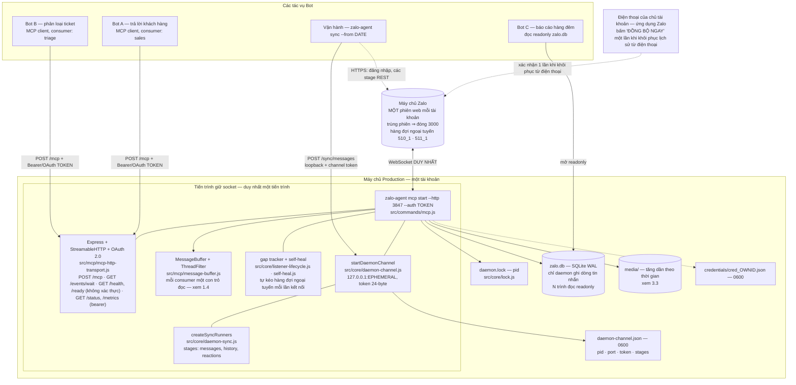

# Triển khai Production — `zalo-agent-cli` + `zalo-mcp` làm autobot thông minh

[English](deployment.md)

**Trạng thái:** đã xác minh lại trên `zalo-agent-cli` `2.5.1`, kèm phần bổ sung của 2.5.3 (`zalo_friend`, `zalo_group`, `--webhook-secret`) và phần ghi log daemon của 2.5.4 (tiến trình từng giai đoạn, nghẽn event loop, giới hạn tra cứu) đã đối chiếu với mã nguồn (25 MCP tools, HTTPS gốc `--cert`/`--key`, máy chủ ủy quyền OAuth 2.0 / 2.1 tích hợp sẵn, webhook có chữ ký HMAC trên cả `listen` lẫn `mcp start`, long-polling 0% CPU qua `GET /events/wait` + `zalo_wait_for_message`, và quản lý tiến trình nền `-d, --daemon` / `--stop` / `--status`) cùng `zalo-mcp` `2.2.0+`. Viết lần đầu ngày 2026-09-29.
**Giấy phép:** từ bản 2.0.1 phần mềm này được cấp phép theo CC BY-NC-SA 4.0; việc sử dụng trong hoạt động kinh doanh của doanh nghiệp cần giấy phép thương mại riêng (xem [NOTICE](../NOTICE)).
**Đối tượng đọc:** người trực tiếp vận hành hệ thống này trên máy chủ và nhận cảnh báo khi dịch vụ dừng.

**Tài liệu liên quan:**
- Đồng bộ theo yêu cầu chủ tài khoản qua MCP (`zalo_sync` & `zalo_sync_status`): [Tiếng Việt](mcp-sync.vi.md) / [English](mcp-sync.md).
- Ghim đa tài khoản (`--account <ID>` / `ZALO_ACCOUNT`): [Tiếng Việt](account-pinning.vi.md) / [English](account-pinning.md).

Mọi khẳng định kiến trúc bên dưới đều được đối chiếu tới file trong `src/`, hoặc (đối với bề mặt lệnh) tới [`skill/references/command-reference.md`](../skill/references/command-reference.md) — tài liệu thắng thế bất cứ khi nào hai tài liệu mâu thuẫn nhau. Phần [Phụ lục](#phụ-lục--tự-đo-đạc-lại-mọi-thông-số) liệt kê các lệnh để bạn tự đo trên máy chủ của mình.

Hai quy ước dùng xuyên suốt tài liệu:

- `<ownId>` là mã số Zalo (numeric own-id) của tài khoản. Tuyệt đối không ghi ID thật vào file cấu hình được commit, vào issue hay ticket.
- Các khối cảnh báo phân biệt rõ giữa tính năng đã có và đề xuất thiết kế:
  - `> [!NOTE]` — đề xuất thiết kế hoặc ghi chú kiến trúc.
  - `> [!WARNING]` — hành vi thực tế hiện tại cần lưu ý để tránh lỗi vận hành.
  - `> [!CAUTION]` — thao tác có thể gây mất dữ liệu hoặc khiến tài khoản bị khóa/ban.

---

## 0. Bản tóm tắt ngắn gọn

**Mô hình triển khai (Topology).** Chỉ chạy **đúng một** tiến trình giữ kết nối WebSocket cho mỗi tài khoản Zalo: `zalo-agent mcp start --http <port> --auth <token>` (hoặc kèm `--cert`/`--key` cho HTTPS). Tiến trình đó giữ WebSocket duy nhất được phép của tài khoản, giữ `daemon.lock`, công bố `daemon-channel.json`, và là tiến trình duy nhất ghi thêm dòng tin nhắn vào `zalo.db` khi đang chạy: tin nhắn trực tiếp (live), luồng tự bù khoảng hở (self-heal) từ hàng đợi ngoại tuyến của Zalo, tiến trình khôi phục `zalo-agent sync` và lệnh `msg history` đều chạy bên trong nó. Mọi tác vụ bot là **client** của tiến trình này: các MCP client gọi qua `POST /mcp` (giao thức HTTP/HTTPS hoàn toàn phi trạng thái cho phép nhiều client gọi đồng thời, và mỗi bot giữ con trỏ đọc riêng bằng tham số `consumer`), và các lệnh CLI ngắn hạn chuyển tiếp những tác vụ cần socket vào daemon qua kênh loopback. Không có bot nào tự mở WebSocket thứ hai.

**Ràng buộc lớn nhất.** Zalo chỉ cho phép một phiên web trên mỗi tài khoản; phiên trùng lặp sẽ bị đóng với mã `3000`, và cả `listen` lẫn `mcp start` đều coi đó là lỗi nghiêm trọng và thoát (`process.exit(1)`). Mở một tab trình duyệt Zalo Web cũng tính là một phiên. Đây là quy tắc từ phía máy chủ Zalo, không thể cấu hình bỏ qua.

**Những gì nhiều bot dùng chung một server có sẵn hôm nay.** Nhiều bot có thể dùng chung một server an toàn cho cả việc đọc lẫn gửi: `zalo_mark_read` chỉ dịch chuyển con trỏ của đúng `consumer` đang gọi và không xóa bất kỳ tin nhắn nào khỏi bộ đệm. Về chiều nhận tin (inbound), bot có thể dùng long-polling 0% CPU (`zalo_wait_for_message` hoặc `GET /events/wait`), nhận webhook đẩy (`-w, --webhook <url>` kèm `--webhook-secret`), hoặc polling theo con trỏ (`zalo_get_messages`). Hỗ trợ xác thực đa client qua OAuth 2.0 (`oauth.clients[]`) và Bearer token. Xem §1.4.

**Wrapper chỉ chạy đúng phiên bản engine mà nó cài đặt.** Một thư mục cài đặt `zalo-mcp` chạy phiên bản `@ardennguyen/zalo-agent-cli` nằm trong `node_modules/` của nó; lệnh `update` của wrapper sẽ cài `@ardennguyen/zalo-agent-cli@latest`. Trên máy chủ, bạn có thể dùng `zalo-mcp` hoặc cài đặt trực tiếp engine `@ardennguyen/zalo-agent-cli`.

**Lựa chọn LLM backend.** Đánh giá thực tế (không phải phép đo từ mã nguồn): Claude qua API trong một tổ chức (organization) thuộc sở hữu của công ty là lựa chọn tốt nhất cho luồng hội thoại tiếng Việt giao tiếp với khách hàng. Xem §6 để biết lý do chi tiết và giải pháp thay thế cho từng loại tác vụ.

---

## 1. Bài toán cốt lõi: một socket, nhiều bot

### 1.1 Ràng buộc trong mã nguồn

| Thực tế | Vị trí trong code |
|---|---|
| Một phiên web mỗi tài khoản; phiên trùng bị đóng với mã `3000` | `AGENTS.md` §13; `const CLOSE_DUPLICATE = 3000;` ở cả hai điểm vào, chú thích "fatal, do not retry" trong `src/commands/mcp.js` |
| `listen` thoát khi gặp `3000` | `src/commands/listen.js`, handler `closed` trong `attachAllHandlers`: `error("Another Zalo Web session opened. Listener stopped."); process.exit(1);` |
| `mcp start` thoát khi gặp `3000` | `src/commands/mcp.js`, handler `closed` trong `attachListenerHandlers`: `dropLock();` (dừng channel, nhả lock), in `[mcp] Duplicate Zalo Web session detected. Exiting.` rồi `process.exit(1);` |
| `listen` và `mcp start` loại trừ lẫn nhau | Cả hai đều gọi `acquireLock(accountDir)` trước khi mở cơ sở dữ liệu và thoát ngay nếu không lấy được khóa |
| Khóa là file PID được tạo nguyên tử (atomic) | `src/core/lock.js` `acquireLock`: `fs.writeFileSync(lockPath, process.pid.toString(), { flag: "wx" })`, tự thu hồi khóa cũ nếu kiểm tra `isProcessAlive` (`process.kill(pid, 0)`) thấy tiến trình đã chết |

Vì vậy, quyết định triển khai đầu tiên là bắt buộc: **bạn chỉ có duy nhất một tiến trình giữ socket cho mỗi tài khoản, và đó là `listen` hoặc `mcp start`, không bao giờ chạy cả hai cùng lúc.**

> [!WARNING]
> `listen` và `mcp start` là hai điểm vào của cùng một socket, và `AGENTS.md` §13 coi mọi sự bất đối xứng về lưu trữ/bù khoảng hở giữa chúng là lỗi. Tuy nhiên, chúng phục vụ các giao diện tiêu thụ khác nhau:
>
> | Tính năng | `listen` | `mcp start` |
> |---|---|---|
> | Bề mặt 25 MCP tools (`src/mcp/mcp-tools.js`) | không | **có** |
> | HTTP / HTTPS `/health`, `/ready`, `/status`, `/metrics`, `/events/wait`, các endpoint OAuth 2.0 | không | **có** (khi có `--http`) |
> | Đẩy sự kiện qua `-w, --webhook <url>` + `--webhook-secret <secret>` | **có** | **có** |
> | Lưu trữ JSONL (`--save <dir>`) | **có** | không |
> | In sự kiện ra stdout (`--events`, `--filter`, `--no-self`), `--auto-accept` | **có** | không |
> | Thông báo cho chủ tài khoản (`notify.*`, xem §7.2) | không | **có** |
> | Theo dõi khoảng hở kết nối (`sync_gaps`) | có | có (`createGapTracker` trong `src/core/listener-lifecycle.js`) |
> | Tự động bù khoảng hở (self-heal) từ hàng đợi ngoại tuyến mỗi lần kết nối (`--no-self-heal` để tắt) | có | có |
> | Gửi báo nhận `delivered` (`--no-delivered-receipts` để tắt); cập nhật trạng thái đã đọc từ thiết bị khác | có | có |
> | Kênh daemon loopback (`/send-attachments`, `/sync/messages`, `/sync/reactions`, `/sync/history`, `/stop`) | có | có |
> | Quản lý daemon chạy nền (`-d, --daemon`, `--stop`, `--status`) | có | có (`-d` cần `--http`) |
> | Luồng ghi log | thông báo ra stdout, chẩn đoán `[listen]` ra stderr | toàn bộ ra stderr |
>
> Chọn `mcp start` khi dùng MCP bots (kèm hỗ trợ webhook và long-polling), hoặc chọn `listen` khi chỉ cần đẩy toàn bộ các loại sự kiện ra webhook/JSONL thuần CLI.

> [!NOTE]
> **Các MCP tools của `mcp start` tự động đi theo phiên đăng nhập mới sau khi re-login.** Khi socket đóng (với bất kỳ mã nào khác `3000`), tiến trình tự xử lý bên trong: `clearSession()`, sau đó `autoLogin()` tạo đối tượng API `zca-js` mới (`loginWithCredentials` trong `src/core/zalo-client.js`). Các handler của listener, self-heal, daemon channel, trình tải media và cả 25 MCP tools đều đi qua `liveApi(getApi)` (`src/core/live-api.js`) nên luôn gọi đúng phiên hiện hành. Trong vài giây đang re-login, lệnh gọi tool sẽ báo `"The Zalo session is logging in again after a dropped connection; try again in a few seconds."`

### 1.2 Bản chất của `daemon-channel.js`

`src/core/daemon-channel.js` là **một máy chủ HTTP loopback do tiến trình giữ socket vận hành để phục vụ các tiến trình khác cần dùng socket nhưng không được phép tự mở socket mới:**

- `startDaemonChannel({ getApi, accountDir, onLog, runners, lock })` lắng nghe tại `server.listen(0, "127.0.0.1")`: cổng ngẫu nhiên (ephemeral), chỉ trên loopback, không bao giờ mở ra `0.0.0.0`.
- Ghi file `daemon-channel.json` (`{ pid, port, token, stages }`) với quyền `{ mode: 0o600 }`. Token dài 24 byte ngẫu nhiên (`randomBytes(24).toString("hex")`), truyền trong thân JSON và được kiểm tra bằng `timingSafeEqual`.
- Năm route `POST`: `/send-attachments`, `/sync/messages`, `/sync/reactions`, `/sync/history` và `/stop` (dùng cho lệnh dừng an toàn `--stop`). `/sync/history` phục vụ `msg history` khi daemon đang chạy: daemon tải và ghi vào DB, còn tiến trình CLI chỉ hiển thị kết quả (`src/core/history-fetch.js`).
- `getDaemonChannel(accountDir)` đọc thông tin kênh và **xóa ngay lập tức nếu `process.kill(pid, 0)` báo PID không còn sống**, tránh việc kết nối vào cổng chết.
- `createStageLock()` đảm bảo tại một thời điểm chỉ có một stage chạy trên socket. Nếu một stage khác đang chạy, yêu cầu mới nhận mã `409` kèm tên stage đang bận và thời điểm bắt đầu.
- Tiến trình đồng bộ truyền luồng NDJSON qua kết nối chunked: `{"t":"event"}` cho mỗi bước tiến độ, `{"t":"ping"}` mỗi 20 giây, và kết thúc bằng `{"t":"done"}` hoặc `{"t":"error"}`.

### 1.3 Mô hình này có mở rộng cho N consumer được không?

**Với chiều gửi đi (outbound): Có.**

- Giao thức MCP HTTP hoàn toàn **phi trạng thái (stateless)**: mỗi yêu cầu `POST /mcp` đều được xử lý độc lập, cho phép nhiều bot gọi song song.
- Các route trên kênh loopback là request/response (`/send-attachments`) hoặc thực thi tuần tự qua khóa stage (`/sync/*`).

**Với chiều nhận tin (inbound): Hỗ trợ cả long-polling 0% CPU, webhook push và cursor polling.**

| Cơ chế | Số consumer | Dùng được với `mcp start`? | Đánh giá thực tế |
|---|---|---|---|
| MCP tool `zalo_wait_for_message` hoặc `GET /events/wait?timeout=300&since=<cursor>` | N | **có** | Long-polling 0% CPU: trả về ngay lập tức (`0 ms`) nếu trong buffer đã có tin mới hơn `since`, hoặc chờ đến khi có tin nhắn tiếp theo. `limit` (1–100, mặc định 1) trả về tối đa chừng đó tin trong một lần gọi và `settle` (ms) chờ nốt phần còn lại của một đợt tin: xả một đống tồn chỉ tốn một lần gọi cho mỗi `limit` tin thay vì mỗi tin một lần |
| Polling `zalo_get_messages` qua `POST /mcp`, mỗi bot một tên `consumer` | N | **có** | Hoạt động tốt: mỗi consumer có con trỏ đọc riêng (§1.4a). Buffer nằm trong RAM và giới hạn bởi `limits.bufferMaxSize` / `limits.bufferMaxAge` |
| `listen` hoặc `mcp start` `-w, --webhook <url> [--webhook-secret <secret>]` | **1** URL | **có** | Hộp thư đi bền vững (`webhook-outbox.db` trong thư mục tài khoản): ghi xuống đĩa trước, giao theo thứ tự và ít nhất một lần, 10 giây mỗi POST, thử lại với thời gian chờ tăng dần (1 giây nhân đôi đến 5 phút) khi bên nhận hỏng, chuyển vào dead-letter khi bên nhận trả 400 / 413 / 422 hoặc sau 24 giờ (`ZALO_WEBHOOK_MAX_AGE`), có thể gộp nhiều sự kiện mỗi POST (`ZALO_WEBHOOK_BATCH_SIZE`). Hỗ trợ ký `Authorization: Bearer <secret>` + `X-Zalo-Signature: sha256=<hmac>`. Các tin nhắn do self-heal khôi phục cũng được đẩy kèm `catchUp: true`. Xem tồn đọng: `zalo-agent mcp webhook status` |
| `listen --save <dir>` JSONL | N trình đọc | **không** | Ghi nối tiếp từng sự kiện vào một file cho mỗi `threadId`. Rất tốt để lưu trữ kiểm toán (audit) |
| Đọc trực tiếp `zalo.db` ở chế độ chỉ đọc (`readonly`) | N | **có** | SQLite WAL cho phép nhiều trình đọc đồng thời cùng với một trình ghi duy nhất, chứa toàn bộ lịch sử kể cả những tin đã rời khỏi buffer trong RAM |

### 1.4 Nhiều bot trên một server: những gì đã có và những gì cần lưu ý

**(a) Con trỏ đọc riêng cho từng consumer (`src/mcp/message-buffer.js`, `src/mcp/mcp-tools.js`):**

- `zalo_get_messages`, `zalo_list_threads` và `zalo_mark_read` nhận tham số tùy chọn `consumer`: chuỗi từ 1 đến 64 ký tự thuộc `A–Z a–z 0–9 . _ : @ -`. Nếu bỏ qua, mặc định là `default`.
- `zalo_mark_read` chỉ đẩy con trỏ của đúng consumer đó tiến lên (không bao giờ lùi) và **không xóa tin nhắn nào**; tin nhắn chỉ rời khỏi buffer khi vượt quá `bufferMaxSize` mỗi hội thoại (mặc định 500) hoặc cũ hơn `bufferMaxAge` (mặc định `2h`).

Những điểm cần lưu ý:

1. **Con trỏ là toàn cục trên mọi hội thoại (`_globalCursor`).** Khi một consumer gọi `zalo_mark_read` tại một giá trị cursor, mọi tin nhắn có cursor `<=` giá trị đó ở tất cả các hội thoại đều được tính là đã đọc đối với consumer đó.
2. **Tên consumer là tự khai báo.** Dùng để phối hợp giữa các bot nội bộ chứ không phải rào chắn phân quyền.
3. **Lưu tối đa 256 consumer trong bộ nhớ (`MAX_CONSUMERS`).**
4. **Buffer chỉ nằm trong RAM.** Khi khởi động lại daemon, buffer và các con trỏ trong RAM sẽ trống, nhưng toàn bộ tin nhắn đã được lưu bền vững trong `zalo.db` trước khi đưa vào buffer.

### 1.5 Chuyện gì xảy ra nếu có hai tiến trình cùng ghi vào cơ sở dữ liệu?

1. **`daemon.lock` bảo vệ chống mở WebSocket thứ hai**, trong khi các lệnh đồng bộ qua socket và `msg history` tự động định tuyến qua daemon đang chạy.
2. **SQLite WAL điều phối truy cập đĩa.** Nhiều tiến trình **đọc (`readonly`)** cùng lúc hoàn toàn an toàn. Nhưng nếu một tiến trình bên ngoài giữ khóa ghi quá 5 giây (`busy_timeout` mặc định của `better-sqlite3`), tiến trình daemon có thể gặp lỗi `SQLITE_BUSY` hoặc bị nghẽn vòng lặp sự kiện (event loop), dẫn đến trễ nhịp keepalive của WebSocket Zalo.

> [!CAUTION]
> **Quy tắc cho mọi tiến trình ngoài daemon giữ socket:** luôn mở `zalo.db` với `new Database(path, { readonly: true })` (hoặc `sqlite3 -readonly`). Nếu bot của bạn cần ghi trạng thái riêng, hãy ghi vào một file cơ sở dữ liệu riêng của bot.

---

## 2. Kiến trúc tham chiếu



---

## 3. Định cỡ phần cứng và hệ điều hành

### 3.1 Node.js và hệ điều hành

- **Node.js 22.19 trở lên.**
- **Linux (x64 hoặc arm64) hoặc Windows/macOS.** Trên Linux, `systemd` giúp quản lý khởi động lại, nhật ký và tín hiệu dừng; ngoài ra bạn cũng có thể dùng trực tiếp cờ chạy nền `-d, --daemon`, `--status`, `--stop` tích hợp sẵn trên mọi hệ điều hành.
- Engine đóng gói sẵn bản vá `zca-js` bên trong tarball (`"bundleDependencies": ["zca-js"]`), và `better-sqlite3` biên dịch/tải binary gốc khi cài đặt.

### 3.2 CPU và RAM

| Thông số | Tối thiểu | Khuyến nghị | Lý do |
|---|---|---|---|
| vCPU | 2 | 4 | Quá trình khôi phục lịch sử giải mã (`libzproto` WASM), giải nén Zstd và ghi hàng loạt trên cùng vòng lặp sự kiện phục vụ socket |
| RAM | 1 GB | 2–4 GB | `ThreadNameCache.init()` nạp danh sách nhóm và bạn bè lúc khởi động; `MessageBuffer` giữ tối đa 500 tin mỗi hội thoại trong 2 giờ; đỉnh RAM rơi vào lúc chạy `sync` lịch sử lớn |
| Swap | — | Có, ≥1 GB | Tránh bị OOM kill gây gián đoạn kết nối ngoài ý muốn |

> [!CAUTION]
> **Không chạy chung một mô hình LLM cục bộ chỉ dùng CPU (như Ollama không có GPU) trên cùng máy chủ với tiến trình giữ socket.** Việc chiếm dụng 100% CPU sẽ làm nghẽn vòng lặp sự kiện của Node và làm rớt kết nối WebSocket Zalo.

### 3.3 Dung lượng đĩa — thư mục media chiếm phần lớn dung lượng

Số liệu đo thực tế trên một tài khoản sau **36 ngày** vận hành liên tục:

| Thành phần | Dung lượng đo được | Tốc độ tăng ước tính |
|---|---|---|
| `media/` | ~1.6 GB (~830 tệp) | **~44 MB/ngày**, ~1.3 GB/tháng, **~16 GB/năm** mỗi tài khoản |
| Kích thước tệp media trung bình | ~1.9 MB | — |
| `zalo.db` | ~11 MB cho ~14.000 tin nhắn | **~800 bytes/tin nhắn** |
| `zalo.db-wal` | ~4 MB | Tự động checkpoint theo mặc định của SQLite |

Khuyến nghị dung lượng đĩa: **tối thiểu 40 GB** (nếu có lịch dọn dẹp media định kỳ) hoặc **100 GB+** (nếu lưu nhiều tài khoản hoặc giữ media lâu dài).

Công cụ dọn dẹp media có sẵn và không gửi bất kỳ yêu cầu nào tới Zalo:

```bash
zalo-agent sync-media --prune 90 --dry-run   # xem trước những tệp sẽ xóa
zalo-agent sync-media --prune 90             # xóa tệp media đã tải cũ hơn 90 ngày (giữ nguyên văn bản trong zalo.db)
zalo-agent sync-media --prune all            # xóa toàn bộ tệp media đã tải
zalo-agent sync-media --prune-orphans        # xóa media của các hội thoại tài khoản không còn tham gia
```

> [!WARNING]
> **Media mặc định nằm tại `accounts/<ownId>/media/<threadId>/` (hoặc `--media-dir` / `ZALO_MEDIA_DIR`, hoặc `media.downloadDir` trong `mcp-config.json`).** Một thư mục media tùy chỉnh nằm ngoài `accounts/<ownId>/` sẽ **không** bị xóa khi chạy `logout --purge`, `account remove` hay `logout --delete-history`. Nếu bạn cấu hình thư mục media riêng, hãy chủ động xóa thư mục đó khi gỡ bỏ tài khoản.

### 3.4 Disk I/O cho SQLite WAL

- **Bắt buộc dùng ổ SSD/NVMe cục bộ cho `~/.zalo-agent-cli/`.** Không đặt cơ sở dữ liệu SQLite WAL trên ổ mạng (NFS, SMB/CIFS, EFS).
- Giữ `zalo.db`, `zalo.db-wal` và `zalo.db-shm` trên cùng một phân vùng đĩa.

---

## 4. Cài đặt và vận hành

### 4.1 Cài đặt và đăng nhập

Xem [`INSTALLATION.vi.md`](../INSTALLATION.vi.md) / [`INSTALLATION.md`](../INSTALLATION.md) để cài đặt qua wrapper `zalo-mcp`, hoặc cài trực tiếp engine:

```bash
npm view @ardennguyen/zalo-agent-cli versions
sudo npm install -g @ardennguyen/zalo-agent-cli@<version>
command -v zalo-agent
```

Đăng nhập lần đầu **bằng tài khoản người dùng chạy dịch vụ (không chạy từ shell root/Administrator)**:

```bash
sudo -u zalo -H zalo-agent login
sudo -u zalo -H zalo-agent status
```

Mã QR được lưu tại `~/.zalo-agent-cli/qr.png` và phục vụ tại **`http://127.0.0.1:18927/qr` (chỉ loopback)**. Từ máy trạm, bạn có thể tạo đường hầm SSH: `ssh -L 18927:127.0.0.1:18927 <host>`, sau đó mở `http://localhost:18927/qr` và quét bằng ứng dụng Zalo.

Phương án không cần quét QR trên server: trên máy đã đăng nhập, chạy `zalo-agent account export` để xuất file thông tin phiên (quyền `0600`), chuyển file qua kênh mã hóa lên server và chạy `zalo-agent login --credentials <file>`, sau đó xóa file tạm và chạy `zalo-agent logout --no-remote` trên máy cũ.

### 4.2 Chạy nền (`-d, --daemon`) hoặc qua `systemd`

**Cách 1: Dùng trình quản lý daemon tích hợp sẵn (Linux, macOS, Windows):**

```bash
# Khởi chạy ngầm trong nền (tự động kiểm tra daemon.lock và daemon-channel.json)
zalo-agent mcp start --account <ownId> --http 3100 --host 0.0.0.0 \
  --cert /path/to/fullchain.pem --key /path/to/privkey.pem -d

# Kiểm tra trạng thái và dừng an toàn
zalo-agent mcp start --account <ownId> --status
zalo-agent mcp start --account <ownId> --stop
```

**Cách 2: Dùng `systemd` trên Linux (`/etc/systemd/system/zalo-mcp.service`):**

```ini
[Unit]
Description=Zalo MCP server (socket holder for one Zalo account)
Documentation=https://github.com/ardennguyen/zalo-agent-cli
After=network-online.target
Wants=network-online.target
StartLimitIntervalSec=600
StartLimitBurst=5

[Service]
Type=simple
User=zalo
Group=zalo
WorkingDirectory=/home/zalo
UMask=0077

EnvironmentFile=/etc/zalo-agent/mcp.env
Environment=NODE_ENV=production
Environment=ZALO_AGENT_NO_UPDATE_CHECK=1

ExecStartPre=/usr/bin/test -n "${ZALO_MCP_AUTH_TOKEN}"
ExecStart=/usr/bin/zalo-agent mcp start --http ${ZALO_MCP_HTTP_PORT} --host 127.0.0.1

# QUAN TRỌNG: SIGINT là tín hiệu dừng chuẩn mà `mcp start` và `listen` bắt để ghi nhận
# `lastConnectedAt`, xả các biên nhận delivered và xóa sạch `daemon.lock` + `daemon-channel.json`.
KillSignal=SIGINT
TimeoutStopSec=30

Restart=always
RestartSec=15

StandardOutput=journal
StandardError=journal
SyslogIdentifier=zalo-mcp

NoNewPrivileges=yes
PrivateTmp=yes
ProtectSystem=strict
ProtectHome=read-only
ReadWritePaths=/home/zalo/.zalo-agent-cli
ProtectKernelTunables=yes
ProtectControlGroups=yes
RestrictSUIDSGID=yes
LockPersonality=yes

[Install]
WantedBy=multi-user.target
```

`/etc/zalo-agent/mcp.env` (quyền `0600`):

```ini
ZALO_MCP_HTTP_PORT=3847
ZALO_MCP_AUTH_TOKEN=<64 ký tự hex từ lệnh: openssl rand -hex 32>
```

> [!TIP]
> Truyền token qua biến môi trường `ZALO_MCP_AUTH_TOKEN` (hoặc `ZALO_MCP_AUTH_TOKEN_<ownId>` trong `~/.zalo-agent-cli/.env` / `EnvironmentFile`) giúp giữ bí mật token, không để lộ trên dòng lệnh `ps` / `/proc/<pid>/cmdline` như khi truyền trực tiếp `--auth <token>`.

### 4.3 Nhật ký (Logs) và các dòng cần chú ý

- **Mức log.** `--log-level` / `ZALO_LOG_LEVEL[_<ownId>]` là `error`, `warn`, `info` (mặc định) hoặc `debug`. `debug` thêm các dòng tăng theo lưu lượng: một dòng cho mỗi HTTP request (kèm địa chỉ và user agent của bên gọi), một dòng cho mỗi tin nhắn daemon xử lý (`[mcp] Buffered …`; ở `listen` là mọi dòng sự kiện, có cả nội dung tin nhắn). Ở mức `info` các dòng này không được ghi, nên log của một daemon bận chỉ nói về thay đổi trạng thái và nội dung tin nhắn riêng tư không lọt vào log. Các dòng còn lại được phân loại theo câu chữ (lỗi hoặc từ chối là `error`, `WARNING` / `⚠` là `warn`). Daemon chạy nền ghi qua bộ lọc này vào `daemon.log`; chạy foreground chỉ lọc stderr khi có yêu cầu mức hoặc định dạng. Tiến trình chỉ *khởi chạy* `-d` không bao giờ bị lọc.
- **Dấu thời gian, JSON.** Mỗi dòng `daemon.log` bắt đầu bằng thời gian ISO. `ZALO_LOG_FORMAT=json` ghi mỗi dòng một đối tượng JSON (`{"ts","level","account","msg"}`) cho công cụ thu log.
- **Xoay vòng (rotation).** `daemon.log` xoay theo dung lượng, `daemon.log` → `daemon.log.1` → … → `daemon.log.<keep>`: `ZALO_LOG_MAX_SIZE` (mặc định `50m`, tối thiểu `4k`) và `ZALO_LOG_KEEP` (mặc định 3; 0 là bắt đầu lại từ đầu). File mới mở đầu bằng dòng `log rotated`. Trên Windows việc đổi tên có thể bị từ chối khi có chương trình khác (`tail`, trình soạn thảo) đang mở file; daemon khi đó tiếp tục ghi vào file cũ và thử lại sau thêm một megabyte.

| Dòng log | Ý nghĩa | Hành động cần làm |
|---|---|---|
| `[mcp] Duplicate Zalo Web session detected. Exiting.` (`listen`: `Another Zalo Web session opened. Listener stopped.`) | Có người mở Zalo Web trên trình duyệt hoặc một tiến trình khác chiếm phiên | Đóng phiên kia trước khi khởi động lại |
| `[mcp] Re-login retry failed: <reason>. Exiting.` | Tự đăng nhập lại sau khi rớt mạng thất bại cả 2 lần (5 giây và 30 giây). Nếu kèm `"This session was revoked"` nghĩa là phiên đã bị thu hồi | Nếu bị thu hồi: chạy lại `zalo-agent login`. Nếu do mạng: `systemd` sẽ tự khởi động lại |
| `[mcp] Re-login successful. Restarting listener...` | Tự đăng nhập lại thành công sau khi rớt kết nối | Hệ thống sẽ tự ghi nhận khoảng hở và chạy self-heal |
| `[mcp] Daemon channel unavailable: <reason>` | Không mở được kênh loopback `startDaemonChannel` | Khởi động lại tiến trình |
| `[mcp] self-heal: recovered N message(s) (…); covered since <time>; closed N gap(s).` | Đã tự động kéo xong tin nhắn bị lỡ từ hàng đợi ngoại tuyến của Zalo | Không cần làm gì thêm trừ khi có dòng `stays pending` theo sau |
| `[mcp] self-heal: … stays pending (…) — close it with: zalo-agent sync --from <date>` | Khoảng thời gian mất kết nối vượt quá phạm vi hàng đợi ngoại tuyến của Zalo | Chạy lệnh `zalo-agent sync --from <date>` được in ra (hoặc `zalo_sync`) và bấm xác nhận trên điện thoại (§4.5) |
| `[mcp] message not stored: <reason>` | Một tin nhắn trực tiếp không ghi được vào SQLite | Kiểm tra ngay dung lượng đĩa hoặc tiến trình tranh chấp khóa ghi (§1.5) |
| `[mcp] Connection closed (code: N). Re-login in 5s... (reconnect #N; socket was up 37m00s; stage in progress: messages for 5m00s; …)` | Socket bị đóng. Phần trong ngoặc cho biết socket đã sống bao lâu, giai đoạn sync nào đang giữ nó và tiến trình có bị nghẽn không. Mã 1006 không có khung đóng và Zalo không đề nghị thử lại | Khoảng hở được ghi nhận khi socket trở lại và self-heal kéo bù. Dòng `blocked` ngay trước đó (bên dưới) chỉ ra lỗi nằm ở tiến trình này chứ không phải mạng |
| `[mcp] [sync:messages] started (days=90 …)`, rồi `+4m05s progress: batch 3/50 — …` theo từng giai đoạn, `still running: +…, last progress … ago` mỗi phút, và `finished in …` hoặc `failed after …: <thông điệp> (code N)` | Một giai đoạn sync do daemon chạy (`zalo-agent sync`, `msg history`, tool `zalo_sync`) ghi ra đúng thứ `zalo-agent sync` in khi chạy trực tiếp. Tin nhắn live đến trong lúc đó được gộp (`stored N live event(s)`) | Dòng `still running` mà "last progress" cứ tăng là đang đứng, không phải đang làm việc |
| `[mcp] event loop was blocked for 6.2s while the messages stage was running: …` | Tiến trình quá bận (giải mã và ghi một lượng lớn tin nhắn) nên không trả lời được socket | Có thể kéo theo close 1006 vì ping của socket không được trả lời. Chia khoảng thời gian (`--days`, `--from`) thành các lần chạy ngắn hơn để mỗi lần nhỏ hơn |
| `[mcp] [sync:messages] the socket was lost mid-stage; waiting up to 120s for the daemon to reconnect`, rồi `the daemon reconnected after …s; resuming the stage` hoặc `did not reconnect within 120s; the stage ends with what it has` | Restore mất socket. Daemon tự đăng nhập lại; giai đoạn chỉ chờ rồi yêu cầu lại các batch chưa về (tối đa 3 lần mỗi restore). Zalo có thể yêu cầu thêm một lần chạm trên điện thoại | Nếu kết thúc với "what it has", chạy `zalo-agent sync --from <date>` cho phần còn lại |
| `[mcp] user-info: batch 3/12 (100 id(s)) failed: code N: <thông điệp của Zalo> [looks like a rate limit]`, rồi `waiting …ms, then retrying` và `stopped after batch … (Zalo is limiting these lookups)` | Zalo từ chối tra cứu hồ sơ (tên người gửi không phải bạn bè). Tiến trình chờ, thử lại rồi dừng thay vì lặp lại lỗi cho mọi batch; các tên chưa lấy được giữ nguyên là id đến lần restore sau | Gửi dòng `code N: …` nếu còn lặp lại. `ZALO_SYNC_NAME_REFRESH_MAX` (mặc định 500) giới hạn số tên DM không phải bạn bè được làm mới mỗi restore |

### 4.4 Bảo trì định kỳ (Scheduled maintenance)

Tạo timer `systemd` chạy vào giờ thấp điểm để dọn các tệp media cũ (ví dụ giữ 90 ngày):

```ini
# /etc/systemd/system/zalo-media-prune.service
[Service]
Type=oneshot
User=zalo
UMask=0077
Environment=ZALO_AGENT_NO_UPDATE_CHECK=1
ExecStart=/usr/bin/zalo-agent sync-media --prune 90
```

```ini
# /etc/systemd/system/zalo-media-prune.timer
[Timer]
OnCalendar=Sun 03:00
Persistent=true
[Install]
WantedBy=timers.target
```

### 4.5 Khởi động lại mà không mất tin nhắn

- Mọi khoảng thời gian socket ngắt kết nối (từ 1 giây trở lên) đều được ghi vào bảng `sync_gaps`.
- Ngay khi kết nối lại và hoàn tất bắt tay xác thực (cmd 1), tiến trình tự động chạy **self-heal** (`src/core/self-heal.js`): hỏi các hàng đợi ngoại tuyến của Zalo (`510_1` cho 1-1, `511_1` cho nhóm) để lấy toàn bộ tin nhắn phát sinh sau tin mới nhất đang có trong `zalo.db`, không cần chạm vào điện thoại.
- Nếu khoảng gián đoạn quá dài khiến hàng đợi ngoại tuyến không còn giữ đủ tin, phần còn thiếu sẽ giữ trạng thái `pending` và in ra đúng lệnh `zalo-agent sync --from <YYYY-MM-DD>` cần chạy. Khi bạn chạy lệnh đó, quá trình khôi phục sẽ đi qua kênh loopback của daemon đang chạy mà **không cần dừng daemon**.

### 4.6 Sao lưu (Backup)

Sao lưu toàn bộ thư mục `~/.zalo-agent-cli/` và giữ nguyên phân quyền file (`0600` cho `accounts.json` và `credentials/cred_<ownId>.json`). `accounts.json` được ghi nguyên tử dưới khóa `accounts.json.lock` (bỏ qua file khóa này khi sao lưu) và bản trước đó được giữ ở `accounts.json.bak`; `accounts/<ownId>/webhook-outbox.db` chứa các sự kiện đang chờ gửi tới webhook nên cần sao lưu cùng tài khoản:

- Loại trừ `qr.png`, `daemon.lock` và `daemon-channel.json` (các file trạng thái runtime tạm thời).
- Để sao lưu `zalo.db` an toàn khi daemon đang chạy, hãy dùng `sqlite3 zalo.db ".backup /path/out.db"` thay vì copy trực tiếp file đang ghi.
- Luôn mã hóa bản sao lưu vì bên trong chứa thông tin phiên đăng nhập và toàn bộ lịch sử tin nhắn.

### 4.7 Giám sát (Monitoring)

Một daemon tự báo cáo tình trạng theo bốn cách. Ba cách đầu là route HTTP của `mcp start --http`; cách xem bằng CLI dùng được cả cho `listen` (không có cổng HTTP) — `src/core/daemon-health.js`.

| Route | Xác thực | Trả lời |
|---|---|---|
| `GET /health` | không | Còn sống hay không: `status` (luôn `"ok"` khi Express còn trả lời), `uptime`, `threads`, và socket: `socket` (`starting`, `up`, `down`, `stopping`) cùng `ready` |
| `GET /ready` | không | **200 chỉ khi socket Zalo đang kết nối**, ngược lại 503 kèm `{ready, socket}`: dành cho load balancer hoặc bộ giám sát cần ngừng giao việc cho tài khoản đang offline |
| `GET /status` | bearer | Toàn bộ thông tin dưới đây, dạng JSON |
| `GET /metrics` | bearer | Cũng thông tin đó dạng văn bản Prometheus: `zalo_up`, `zalo_socket_*`, `zalo_last_event_age_seconds`, `zalo_webhook_*`, `zalo_coverage_gaps_pending`, `zalo_buffer_*`, `zalo_process_*`, `zalo_eventloop_lag_*` |
| `zalo-agent mcp start --status` / `listen --status` | cục bộ | Cùng bản chụp đó, in ra (`--json` cho script) |

`/status` gồm: socket (trạng thái, đã bao lâu, số lần kết nối lại, mã đóng gần nhất), tuổi của sự kiện và tin nhắn gần nhất, số tin đến và số sự kiện theo loại, số khoảng hở chưa khôi phục, stage đồng bộ đang chạy, hộp thư đi webhook (đang chờ, dead-letter, chờ lâu nhất, lỗi gần nhất, đã giao), bộ đệm live, bộ nhớ, độ trễ event loop, và danh sách `warnings` kèm `status: "degraded"` khi có điều cần chú ý (socket mất từ 2 phút, tồn đọng webhook quá 5 phút, có dead-letter, khoảng hở chưa khôi phục, treo từ 3 giây).

```bash
curl -s http://127.0.0.1:3847/health
# {"status":"ok","uptime":123,"threads":5,"socket":"up","ready":true}
curl -s -o /dev/null -w '%{http_code}\n' http://127.0.0.1:3847/ready          # 200, hoặc 503 khi socket đang mất
curl -s -H "Authorization: Bearer $ZALO_MCP_AUTH_TOKEN" http://127.0.0.1:3847/metrics | head
```

Cấu hình scrape Prometheus và luật cảnh báo có trong [`config-samples/monitoring/`](config-samples/monitoring/): một job cho mỗi tài khoản (mỗi daemon có token riêng) và mười luật: không truy cập được, socket mất, kết nối lại liên tục, tài khoản đang kết nối nhưng im lặng, tồn đọng webhook, dead-letter, khoảng hở chưa khôi phục, event loop bị treo, bộ nhớ, và vừa khởi động lại. **Đừng công bố `/metrics` hay `/status` qua reverse proxy**; hãy scrape từ bên trong mạng.

> [!NOTE]
> **`status: "ok"` trong `/health` chỉ là liveness.** Nó vẫn `ok` khi socket đang mất. Hãy đọc `socket` / `ready`, hoặc dùng `/ready`.

> [!WARNING]
> **Daemon đang chạy chưa chắc là tài khoản khỏe.** Các route trên đã bao phủ socket, webhook và khoảng hở. Hãy cảnh báo thêm các điểm sau:
>
> 1. Trạng thái tiến trình (`systemctl is-active zalo-mcp` hoặc `zalo-agent mcp start --status`).
> 2. Các dòng lỗi nghiêm trọng trong log (§4.3).
> 3. Thời điểm tin nhắn mới nhất trong `zalo.db`:
>    ```bash
>    sqlite3 -readonly ~/.zalo-agent-cli/accounts/<ownId>/zalo.db \
>      "select (strftime('%s','now')*1000 - max(timestamp))/60000 from messages;"
>    ```
> 4. Số khoảng hở đang chờ xử lý (`zalo_coverage` hoặc `select count(*) from sync_gaps where status='pending';`).

---

### 4.8 Nhiều tài khoản: các lệnh fleet

Một tài khoản là một daemon (§1), nên một trăm tài khoản là một trăm daemon, mỗi cái có port, token và unit riêng. `zalo-agent fleet` làm những việc người vận hành thường phải tự viết script (`src/core/fleet.js`, `src/commands/fleet.js`):

| Lệnh | Tác dụng |
|---|---|
| `fleet generate --out <dir> [--base-port N] [--domain <host>] [--user --home --bin]` | Ghi systemd template unit, `common.env`, mỗi tài khoản một `accounts/<id>.env` chứa port và **token 256-bit tự sinh** (quyền `600`, không bao giờ in ra), bảng port, và nếu có `--domain` thì cả Caddyfile phục vụ mọi tài khoản dưới `/a/<id>/` và trả 404 cho `/metrics`, `/status`. File đã có không bị ghi đè (`--force` thay các file không chứa bí mật; token đang dùng được giữ trừ khi `--rotate-tokens`). Cùng các file với `docs/config-samples/`; một test giữ hai bên khớp nhau. |
| `fleet ports [--base N]` | Port của từng tài khoản, lưu trong `fleet.json`. Port gán một lần và không bao giờ đổi; tài khoản mới lấy port trống thấp nhất. |
| `fleet status [accounts…] [--check] [--json]` | Một bảng cho mọi tài khoản, hỏi qua kênh loopback của từng daemon (không cần port hay token): trạng thái, pid, socket và tuổi của nó, sự kiện gần nhất, hàng đợi webhook và dead-letter, khoảng hở, bộ nhớ. Trạng thái: `ok`, `degraded` (có cảnh báo: tồn đọng, dead-letter, khoảng hở), `starting`, `down` (socket mất từ 3 phút, `--down-for`), `unresponsive` (có daemon giữ khóa nhưng không trả lời), `stopped`. `--check` thoát mã 1 trừ khi mọi tài khoản đều `ok` hoặc `degraded`. |
| `fleet start [accounts…] [--batch 5] [--stagger 15] [--env-dir <dir>] [--listen] [--dry-run]` | Khởi động các daemon chưa chạy, **theo từng lô được xáo trộn** và nghỉ giữa các lô, để các tài khoản được cài cùng lúc không đăng nhập cùng lúc. `--env-dir` cấp cho mỗi daemon file `<id>.env` riêng (token, webhook) mà không đặt bí mật lên dòng lệnh. |
| `fleet restart [accounts…] [--unhealthy] [--all]` | Dừng rồi khởi động các tài khoản được nêu, hoặc với `--unhealthy` chỉ những tài khoản `down` hoặc `unresponsive` (khởi động lại không sửa được bên nhận webhook nên tồn đọng được để yên). `fleet restart` trần không khởi động lại gì cả. |
| `fleet stop [accounts…]` | Tắt êm từng daemon. |

Dưới systemd, unit đã rải thời điểm khởi động (`sleep $((RANDOM % 30))`) và tự khởi động lại daemon chết; `fleet start`/`restart` dành cho máy không có systemd (server Windows, container, laptop) và cho việc chủ động khởi động lại một phần đội tài khoản. `fleet status --check` hợp với cron; Prometheus (§4.7) hợp với cảnh báo.

---

## 5. Bảo mật (Security)

### 5.1 Rủi ro khóa tài khoản — hãy thiết kế sẵn phương án dự phòng

1. **Không bao giờ dùng tài khoản Zalo cá nhân chính cho autobot.** Hãy dùng một tài khoản chuyên biệt và gán proxy cố định riêng (`1:1`).
2. **Sử dụng Official Account API (`oa …`) khi bài toán phù hợp**: API chính thức v3.0 dùng OAuth 2.0, lưu thông tin xác thực riêng tại `~/.zalo-agent/oa-credentials.json`, hoàn toàn không có rủi ro bị khóa tài khoản.
3. **Giới hạn tốc độ gửi tin (rate-limit) ở tầng bot.** Không để vòng lặp lỗi của bot bắn hàng trăm tin nhắn liên tiếp vào một nhóm.

### 5.2 Bảo vệ dữ liệu lưu trữ trên đĩa

- Giữ quyền `0600` cho `accounts.json`, `credentials/cred_<ownId>.json` và `daemon-channel.json`; đặt `UMask=0077` cho tiến trình dịch vụ.
- Bật mã hóa toàn bộ ổ đĩa (Full-Disk Encryption) trên máy chủ và mã hóa các bản sao lưu.
- Để kết thúc hoàn toàn một phiên đăng nhập từ phía máy chủ Zalo khi ngừng sử dụng máy chủ, ngoài việc chạy `zalo-agent logout --purge`, hãy mở ứng dụng Zalo trên điện thoại và gỡ phiên Web khỏi danh sách thiết bị đã đăng nhập.

### 5.3 Xác thực MCP (Bearer Token, OAuth 2.0 / 2.1 và TLS/HTTPS)

- Khi mở kết nối qua mạng (`--host 0.0.0.0`), **bắt buộc** phải cấu hình xác thực (`--auth <token>` / `ZALO_MCP_AUTH_TOKEN[_<ownId>]` và/hoặc OAuth 2.0 `oauth.clients[]`) và bật HTTPS (`--cert <fullchain.pem> --key <privkey.pem>` hoặc qua reverse proxy).
- Trên máy chủ không có giao diện đồ họa, hãy đặt `"media": {"autoOpen": false}` trong `mcp-config.json` để `zalo_view_media` chỉ tải và trả về đường dẫn file trên server chứ không gọi trình xem ảnh của hệ điều hành.

### 5.4 Chủ quyền dữ liệu (Data residency)

Mọi lệnh gọi gửi nội dung hội thoại từ `zalo.db` sang mô hình AI đều là một lần truyền dữ liệu. Đảm bảo sử dụng tài khoản/tổ chức API thuộc sở hữu của doanh nghiệp với chính sách bảo mật dữ liệu rõ ràng, không dùng API key cá nhân cho dữ liệu công ty.

---

## 6. Đánh giá các lựa chọn LLM Backend

Bảng dưới đây là đánh giá thực tế cho bài toán hội thoại công việc tiếng Việt (xen lẫn thuật ngữ sản phẩm/kỹ thuật Anh–Việt):

| Tiêu chí | Claude — Anthropic API | Claude Code | Gemini — Vertex AI / Google | OpenClaw | Ollama + OpenWebUI |
|---|---|---|---|---|---|
| **Bản chất** | Model API | Agentic harness trên cùng mô hình Claude | Model API trên Google Cloud | Cổng định tuyến agent tự host | Runtime chạy mô hình mở tại chỗ |
| **Chất lượng tiếng Việt** | **Tốt nhất cho tiếng Việt công việc**: xưng hô (`anh/chị/em`), ngữ cảnh lịch sự và thuật ngữ pha trộn VN/EN | Cùng mô hình, cùng chất lượng | **Rất tốt**, cạnh tranh trực tiếp ở hầu hết tác vụ phản hồi khách hàng | Phụ thuộc vào mô hình phía sau | **Yếu hơn rõ rệt** ở các mô hình nhỏ 7B–14B khi trả lời trực tiếp khách hàng |
| **Khuyến nghị sử dụng** | **Luồng bot chính giao tiếp khách hàng** (qua tổ chức API của công ty) | Tự động hóa vận hành/dev hoặc trợ lý cá nhân | Phân loại, tóm tắt, định tuyến lưu lượng lớn hoặc kết nối qua Gemini Connected Apps (OAuth 2.0) | Điều phối nhiều mô hình | Chỉ chạy trên máy có GPU riêng cho tác vụ phân loại nội bộ hoặc ẩn danh hóa dữ liệu nhạy cảm (PII redaction) trước khi gửi ra ngoài |

---

## 7. Mô hình vận hành "Autobot thông minh"

### 7.1 Tri thức (Knowledge) nằm ở đâu?

`zalo-agent-cli` là tầng truyền dẫn và bộ nhớ đệm tin nhắn Zalo. Tầng tri thức nằm ở phía bot (consumer) với 3 lớp:

1. **Bộ nhớ hội thoại (`zalo.db`):** tra cứu qua `zalo_search_messages`, `zalo_get_history`, `zalo_list_conversations`, hoặc truy vấn SQL chỉ đọc.
2. **Tài liệu nghiệp vụ / SOP / bảng giá:** lưu ở thư mục riêng của bot (tuyệt đối **không** đặt bên trong `~/.zalo-agent-cli/` để tránh bị xóa khi chạy `logout --purge`).
3. **Quy tắc cố định trong System Prompt:** thông tin công ty, người phụ trách chuyển tiếp (escalation), giờ làm việc, quy tắc từ chối trả lời khi không chắc chắn.

### 7.2 Kiểm soát phạm vi hoạt động của bot

1. **Giới hạn hội thoại được phép đọc:** cấu hình `watchThreads` trong `mcp-config.json` (hoặc theo từng tài khoản trong `accounts["<ownId>"].watchThreads`).
2. **Tôn trọng trạng thái người thật đã xử lý:** kiểm tra `readOnZalo` trên tin nhắn hoặc `readState` trên hội thoại để biết người dùng đã trực tiếp xem/xử lý trên điện thoại hay chưa.
3. **Đặt ngưỡng kiểm duyệt và giới hạn tốc độ gửi (rate-limit)** trước khi gọi `zalo_send_message`.
4. **Đặt tên `consumer` riêng cho từng bot** khi nhiều bot cùng đọc từ một MCP server.

---

## Phụ lục — Tự đo đạc lại mọi thông số

```bash
# Kiểm tra yêu cầu phiên bản Node.js
node -p "require('./package.json').engines.node"

# Kiểm tra phiên bản engine đang chạy trong zalo-mcp và trên npm
node -p "require('./node_modules/@ardennguyen/zalo-agent-cli/package.json').version"
npm view @ardennguyen/zalo-agent-cli versions
npm view @ardennguyen/zalo-mcp version dependencies

# Đo dung lượng đĩa của từng tài khoản (Linux/macOS)
du -sh ~/.zalo-agent-cli/accounts/<ownId>/media
find ~/.zalo-agent-cli/accounts/<ownId>/media -type f | wc -l
ls -l  ~/.zalo-agent-cli/accounts/<ownId>/zalo.db*

# Thống kê nội dung cache và khoảng hở (chế độ chỉ đọc)
sqlite3 -readonly ~/.zalo-agent-cli/accounts/<ownId>/zalo.db "
  select (select count(*) from messages)                                  as messages,
         (select count(*) from threads)                                   as threads,
         (select count(*) from messages where localPath is not null)      as media_rows,
         (select count(*) from messages where mediaPrunedAt is not null)  as media_pruned,
         (select count(*) from sync_gaps)                                 as gaps_total,
         (select count(*) from sync_gaps where status='pending')          as gaps_pending,
         (select (max(timestamp)-min(timestamp))/86400000 from messages)  as span_days;"

# Kiểm tra trạng thái daemon và health check
zalo-agent mcp start --account <ownId> --status
curl -s http://127.0.0.1:3847/health
```
