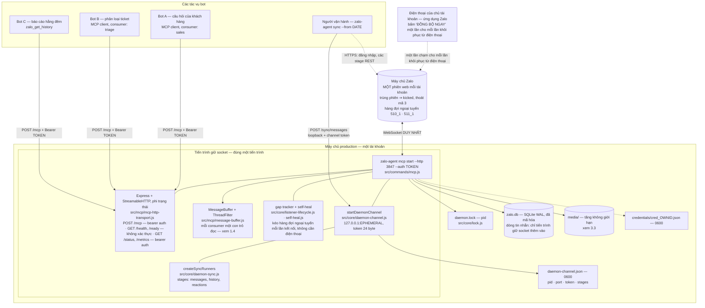
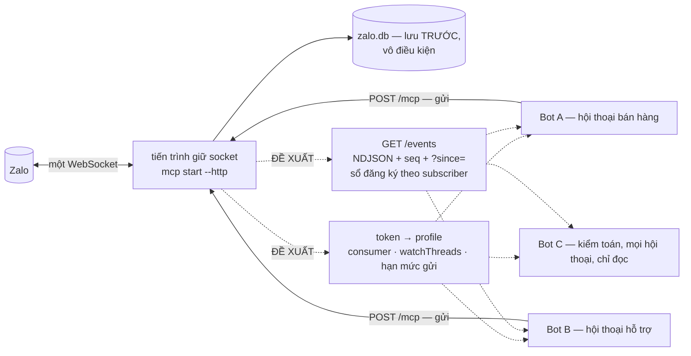

# Triển khai Production — `zalo-agent-cli` + `zalo-mcp` làm autobot thông minh

[English](deployment.md)

**Trạng thái:** cập nhật cho `zalo-agent-cli` `3.0.0` và `zalo-mcp` `2.1.0`: lớp giao thức Zalo Web riêng của engine (không còn zca-js), 36 MCP tool, cơ chế xác nhận trước thao tác phá hủy (`--yes` trên CLI, `confirm` và `confirmMode` qua MCP), các dòng log của bộ giám sát socket, khôi phục theo từng đợt với ba lần kết nối lại, đăng nhập QR chính thức cùng tệp thiết bị tin cậy, HTTPS gốc `--cert`/`--key`, máy chủ ủy quyền OAuth 2.0 / 2.1 tích hợp sẵn, webhook có chữ ký trên cả `listen` lẫn `mcp start`, long-polling 0% CPU qua `GET /events/wait` + `zalo_wait_for_message`, và vòng đời chạy nền `-d, --daemon` / `--stop` / `--status`. Viết lần đầu ngày 2026-09-29.
**Giấy phép:** từ bản 2.0.1 phần mềm này được cấp phép theo CC BY-NC-SA 4.0; việc sử dụng trong hoạt động kinh doanh của doanh nghiệp cần giấy phép thương mại riêng (xem [NOTICE](../NOTICE)).
**Đối tượng đọc:** người vận hành hệ thống này trên máy chủ và bị gọi dậy khi nó ngừng chạy.

**Tài liệu liên quan:**
- Đồng bộ theo yêu cầu chủ tài khoản qua MCP (`zalo_sync` & `zalo_sync_status`): [English](mcp-sync.md) / [Tiếng Việt](mcp-sync.vi.md).
- Ghim đa tài khoản (`--account <ID>` / `ZALO_ACCOUNT`): [English](account-pinning.md) / [Tiếng Việt](account-pinning.vi.md).

**Bắt đầu từ một tình huống sử dụng.** Mỗi thư mục trong [`config-samples/use-cases/`](config-samples/use-cases/) là một bộ tệp hoàn chỉnh, được `tests/unit/config-samples.test.js` giữ khớp từng byte với các khối dựng sẵn và với `fleet generate`, kèm README chạy được bằng tiếng Anh và tiếng Việt:

| Tình huống | Thư mục |
|---|---|
| a. Một người trên máy để bàn, MCP qua stdio (Claude Desktop, Claude Code) | [a-desktop-stdio](config-samples/use-cases/a-desktop-stdio/README.vi.md) |
| b. Một máy chủ MCP HTTP trên máy để bàn hoặc trong mạng LAN, chạy như dịch vụ Windows hoặc launchd agent | [b-desktop-lan-http](config-samples/use-cases/b-desktop-lan-http/README.vi.md) |
| c. Một VPS Linux, một người quản trị, vài tài khoản (systemd, Caddy, bộ cung cấp khóa passphrase, `za`) | [c-vps-few-accounts](config-samples/use-cases/c-vps-few-accounts/README.vi.md); chuyển tài khoản từ một thư mục cấu hình Windows 2.5.9: [MIGRATE.vi.md](config-samples/use-cases/c-vps-few-accounts/MIGRATE.vi.md) |
| d. Các tài khoản làm backend cho một CRM (webhook, phê duyệt, admin API, bộ điều khiển fleet) | [d-crm-backend](config-samples/use-cases/d-crm-backend/README.vi.md) |
| e. Một host SaaS với mỗi tenant một khóa KMS (một thiết kế để bắt đầu) | [e-saas-kms](config-samples/use-cases/e-saas-kms/README.vi.md) |

Mọi khẳng định kiến trúc bên dưới đều được đối chiếu tới một file trong `src/`, hoặc (đối với bề mặt lệnh) tới [`skill/references/command-reference.md`](../skill/references/command-reference.md), tài liệu thắng thế bất cứ khi nào hai tài liệu mâu thuẫn nhau. Số dòng trỏ tới `9e47020` (vài commit trước tag `2.0.0`) và sẽ lệch dần; tên hàm và handler ghi bên cạnh thì không. Các con số lấy từ `package.json`, lockfile, mã nguồn, npm registry, hoặc một thư mục tài khoản được đo một lần (có ghi chú ở chỗ dùng). Phần [Phụ lục](#phụ-lục--tự-đo-đạc-lại-mọi-thông-số) liệt kê các lệnh để bạn tự đo. Câu nào là đánh giá chứ không phải điều mã nguồn cho thấy (các bảng định cỡ, và toàn bộ §6) đều nói rõ như vậy. Với codebase này, câu trả lời chung chung kiểu "bot nhắn tin thường hoạt động thế nào" hay sai, nên tài liệu này tránh nó.

Hai quy ước dùng xuyên suốt tài liệu:

- `<ownId>` là mã số Zalo (numeric own-id) của tài khoản. Không bao giờ ghi ID thật vào file cấu hình được commit, vào issue hay ticket.
- Các khối cảnh báo vạch ranh giới giữa những gì đã có hôm nay và những gì chưa có:
  - `> [!NOTE]` — một đề xuất thiết kế. **Chưa được triển khai. Đừng lập kế hoạch như thể nó đã có.**
  - `> [!WARNING]` — một hành vi thực tế, hiện hành, sẽ gây rắc rối cho bạn.
  - `> [!CAUTION]` — thao tác làm mất dữ liệu hoặc khiến tài khoản bị khóa.

---

## 0. Bản tóm tắt ngắn gọn

**Mô hình triển khai (Topology).** Chỉ chạy **đúng một** tiến trình giữ socket cho mỗi tài khoản Zalo: `zalo-agent mcp start --account <ownId>`, cổng và bearer token đọc từ biến môi trường của nó (không bao giờ dùng `--auth <token>` trên dòng lệnh, nơi `ps` nhìn thấy). Tiến trình đó giữ WebSocket duy nhất được phép của tài khoản, giữ `daemon.lock`, công bố `daemon-channel.json`, và là tiến trình duy nhất ghi thêm dòng tin nhắn vào `zalo.db` khi đang chạy: tin nhắn trực tiếp (live), luồng tự bù khoảng hở từ hàng đợi ngoại tuyến của Zalo, một lần khôi phục `zalo-agent sync` và một lần tải `msg history` đều chạy bên trong nó. Mọi tác vụ bot là **client** của tiến trình này: các MCP client gọi qua `POST /mcp` (giao thức HTTP là phi trạng thái nên nhiều client gọi đồng thời được, và mỗi bot giữ con trỏ đọc riêng bằng cách truyền tên `consumer`), và các lệnh CLI chạy một lần chuyển mọi thứ cần socket cho daemon qua kênh loopback của nó. Không bot nào tự mở WebSocket.

**Ràng buộc lớn nhất.** Zalo chỉ cho phép một phiên web trên mỗi tài khoản; phiên trùng lặp bị đóng với mã `3000`, và cả `listen` lẫn `mcp start` đều coi đó là điểm kết thúc: chúng nhả khóa và thoát với mã `3`, không kết nối lại, vì hai client cùng kết nối lại sẽ đá nhau mãi. Một phiên đăng nhập mà Zalo liên tục từ chối (ba lần bị từ chối liên tiếp) kết thúc daemon với mã `4`. Một tab trình duyệt chạy Zalo Web cũng tính. Đây không phải thông số chỉnh được. Zalo cũng chỉ giữ **một lần đăng nhập web cho mỗi tài khoản**, và máy chủ chính là lần đăng nhập đó: đăng nhập QR vào Zalo Web sẽ đăng xuất máy chủ (lần đăng nhập kế tiếp của nó bị từ chối, thoát mã `4`), còn **điện thoại và ứng dụng Zalo PC là các lần đăng nhập riêng, tồn tại song song với nó**. Hãy dặn người dùng giữ điện thoại hoặc Zalo PC bên cạnh máy chủ, không bao giờ dùng Zalo Web.

**Những gì nhiều bot có hôm nay.** Chúng có thể dùng chung một máy chủ an toàn cho cả việc đọc lẫn gửi: `zalo_mark_read` chỉ dịch chuyển con trỏ của đúng consumer đang gọi và không xóa gì. Những gì chưa có: đẩy sự kiện đến (bot phải poll), mọi định danh hay phạm vi theo từng bot (một bearer token, tên consumer tự khai báo, một bộ lọc hội thoại cho mỗi tiến trình), và mọi giới hạn số tin gửi đi. Xem §1.4.

**Wrapper chỉ chạy mã này ở đúng phiên bản nó ghim.** Một bản cài `zalo-mcp` chạy phiên bản engine mà `package.json` của wrapper ghi; `1.0.16` ghim `2.0.0` (phát hành 2026-10-13), và lệnh `update` của nó cài `@ardennguyen/zalo-agent-cli@latest`. Bản wrapper cũ hơn ghim engine cũ hơn và không có hành vi 2.0.0 nào mô tả ở đây (§4.1). Trên máy chủ, cài engine trực tiếp vẫn là cách tốt hơn.

**LLM backend.** Một đánh giá, không phải phép đo: Claude qua API, trong một tổ chức (organization) thuộc sở hữu của công ty, cho luồng tiếng Việt giao tiếp với khách hàng. Xem §6 để biết lý do, và nên dùng gì thay thế cho từng loại tác vụ.

---

## 1. Bài toán khó: một socket, nhiều bot

### 1.1 Ràng buộc, trong mã nguồn

| Thực tế | Vị trí |
|---|---|
| Một phiên web mỗi tài khoản; phiên trùng (khung `cmd 3000`, khung `error_code 600` hoặc HTTP 600) là điểm kết thúc | `AGENTS.md` §13; bộ giám sát socket (`src/zalo/socket.js`) vào trạng thái cuối `kicked` và không kết nối lại gì |
| `listen` thoát với mã `3` khi bị đá | `src/commands/listen.js`, callback `onKicked` nó đưa cho socket host (`src/core/socket-host.js`): `dropLock()` (dừng channel, nhả khóa), rồi `process.exit(EXIT_CODE.KICKED)` |
| `mcp start` thoát với mã `3` khi bị đá | `src/commands/mcp.js`, cùng callback `onKicked`: `dropLock();` rồi `process.exit(EXIT_CODE.KICKED);` |
| Cả hai thoát với mã `4` khi Zalo liên tục từ chối phiên đăng nhập đã lưu | callback `onRevoked` của socket host, sau ba lần đăng nhập bị từ chối liên tiếp; đăng nhập thất bại vì không có mạng thì được hỏi lại, chậm dần, bao lâu cũng được |
| `listen` và `mcp start` loại trừ lẫn nhau | Cả hai gọi `acquireLock(accountDir)` trước khi mở cơ sở dữ liệu (`listen.js:86`, `mcp.js:136`) và thoát khi không lấy được |
| Khóa là một file PID được tạo nguyên tử | `src/core/lock.js` `acquireLock`: `fs.writeFileSync(lockPath, process.pid.toString(), { flag: "wx" })`, thu hồi PID cũ qua `isProcessAlive` (`process.kill(pid, 0)`) |

Vì vậy quyết định triển khai đầu tiên là bắt buộc: **bạn có một tiến trình giữ socket, và nó là `listen` hoặc `mcp start`, không bao giờ cả hai.**

> [!WARNING]
> `listen` và `mcp start` là hai điểm vào của cùng một socket, và `AGENTS.md` §13 coi mọi sự bất đối xứng giữa chúng là lỗi. Chúng giữ cùng một cách ghi sổ, nhưng không phục vụ cùng những thứ, và khác biệt đó quyết định cách bạn triển khai:
>
> | | `listen` | `mcp start` |
> |---|---|---|
> | Bề mặt MCP tool (36 tool trong `src/mcp/mcp-tools.js`) | không | **có** |
> | HTTP / HTTPS `/health`, `/ready`, `/status`, `/metrics`, `/events/wait`, các endpoint OAuth 2.0 | không | **có** (chỉ với `--http`) |
> | Đẩy ra ngoài qua `-w, --webhook <url>` + `--webhook-secret <secret>` | **có** | **có** |
> | Lưu trữ JSONL `--save <dir>` | **có** | không |
> | In sự kiện (`--events`, `--filter`, `--no-self`), `--auto-accept` | **có** | không |
> | Thông báo cho chủ tài khoản (`notify.*`, xem §7.2) | không | có |
> | Theo dõi khoảng hở (`sync_gaps`) | có, viết trực tiếp trong `listen.js` | có, `createGapTracker` trong `src/core/listener-lifecycle.js` |
> | Tự bù từ hàng đợi ngoại tuyến của Zalo mỗi lần kết nối (`--no-self-heal` để tắt) | có | có |
> | Báo nhận delivered (`--no-delivered-receipts` để tắt); trạng thái đã đọc do thiết bị khác báo | có | có |
> | Kênh daemon (`/send-attachments`, `/sync/messages`, `/sync/reactions`, `/sync/history`, `/stop`) | có | có |
> | Vòng đời daemon chạy nền (`-d, --daemon`, `--stop`, `--status`) | có | có (`-d` cần `--http`) |
> | Các dòng của chính nó đi đâu | thông báo ra stdout, chẩn đoán `[listen]` ra stderr | toàn bộ ra stderr |
>
> `tests/unit/listener-lifecycle-rules.test.js` giữ cả hai theo cùng quy tắc khoảng hở (mỗi bên dựng một `SyncManager` và ghi một khoảng hở lúc khởi động), và `tests/unit/self-heal-wiring.test.js` chạy các kiểm tra nối dây trên cả hai file. Vì vậy phát hiện mất tin không còn là lý do để chọn bên nào: chọn `mcp start` cho bot MCP (và webhook push / long-polling), `listen` cho bên tiêu thụ webhook hoặc JSONL chỉ dùng CLI.

> [!NOTE]
> **Các tool của `mcp start` đi theo lần đăng nhập lại.** Một socket mà bộ giám sát không giữ sống được trên phiên của nó (Zalo từ chối phiên, hoặc sau 8 lần thử liên tiếp vẫn không có socket dùng được) được socket host xử lý ngay trong tiến trình: `clearSession()`, rồi đăng nhập, tạo một đối tượng API mới (`loginWithCredentials` trong `src/core/zalo-client.js`). Các handler của listener, self-heal, kênh daemon và việc tải media đi theo đối tượng mới qua `getApi()`, và 36 tool cùng bộ thông báo cũng vậy: chúng nhận `liveApi(getApi)` (`src/core/live-api.js`), đọc phiên hiện hành ở mỗi lần gọi. Trước bản sửa của 2.0.0, chúng nhận đối tượng lúc khởi động một lần duy nhất, nên sau dòng `Re-login successful` chúng vẫn gọi vào phiên đã bị thay, và việc quét socket của `zalo_get_history` lật trang trên một listener đã đóng. Trong lúc đang đăng nhập lại, một lần gọi tool thất bại với "The Zalo session is logging in again after a dropped connection; try again in a few seconds."

### 1.2 `daemon-channel.js` thực chất là gì

`src/core/daemon-channel.js` là **một máy chủ HTTP loopback mà tiến trình giữ socket chạy thay cho các tiến trình cần socket nhưng không được tự mở.** Hình dạng của nó:

- `startDaemonChannel({ getApi, accountDir, onLog, runners, lock })` lắng nghe bằng `server.listen(0, "127.0.0.1")`: một cổng tạm (ephemeral), chỉ trên loopback, không bao giờ `0.0.0.0`. Chú thích trong mã nói lý do: các endpoint này gửi tin nhắn dưới danh nghĩa tài khoản đã đăng nhập và khôi phục lịch sử của nó.
- Nó ghi `daemon-channel.json` (`{ pid, port, token, stages }`) với `{ mode: 0o600 }`. Token là `randomBytes(24).toString("hex")`, đi trong thân JSON của request, và được so bằng `tokenMatches`: kiểm tra độ dài, rồi `timingSafeEqual`.
- Năm route, đều là `POST`: `/send-attachments`, `/sync/messages`, `/sync/reactions`, `/sync/history`, và `/stop` (cho việc tắt daemon êm bằng `--stop`). Mọi thứ khác là 404 trước khi đọc thân, và thân trên 64 KB bị cắt. `/sync/history` là thứ `msg history` dùng khi có daemon: daemon tải và ghi, CLI chỉ hiển thị (`src/core/history-fetch.js`).
- `getDaemonChannel(accountDir)` là hàm tìm kiếm. Nó đọc file mô tả và **xóa ngay nếu `process.kill(pid, 0)` báo pid không còn**, để một daemon đã chết không khiến mọi lần gửi sau quay số vào một cổng chết.
- `getSyncChannel(accountDir, stage)` thêm một kiểm tra năng lực dựa trên mảng `stages` được công bố, liệt kê các runner daemon đã nối (`messages`, `history` và `reactions` từ `createSyncRunners` trong `src/core/daemon-sync.js`). Một daemon khởi động trước khi có định tuyến sync công bố một channel hợp lệ không có stage nào. Hỏi file mô tả chứ không thăm dò route, vì thăm dò nghĩa là gửi đi một thứ gì đó.
- `createStageLock()` cho phép một stage tại một thời điểm trên socket. Các route giữ nó, và hai việc daemon tự chạy cũng vậy: luồng tự bù (§4.5), vốn chờ đến lượt, và phương án dự phòng phía máy chủ của `zalo_get_history`, vốn trả lời "A <stage> stage is running on this socket. Try again when it finishes." thay vì chờ sau một lần khôi phục. Route nào thấy khóa đã bị giữ thì trả `409` kèm stage đang bận và thời điểm bắt đầu.
- Một stage truyền NDJSON ngược lại qua phản hồi chunked: `{"t":"event"}` cho mỗi callback tiến độ, `{"t":"ping"}` mỗi 20 giây, rồi `{"t":"done"}` hoặc `{"t":"error"}`. Client bỏ cuộc sau 90 giây không có dòng nào. Client bỏ đi không hủy stage, vì lần khôi phục đã đang ghi tin nhắn thật.

Hai quy tắc thiết kế mang tính chịu lực:

1. **`getApi` là một hàm, không bao giờ là một đối tượng `api` bị giữ lại.** Khi đăng nhập lại, daemon dựng một api mới; một lần upload đậu trong `ctx.uploadCallbacks` của api cũ không bao giờ được giải quyết và lần gửi treo mãi. Channel, các stage runner và các MCP tool (`liveApi(getApi)`) đều theo quy tắc này (§1.1).
2. **Channel là một tầng truyền tải và không import gì ngoài node builtins.** `tests/unit/daemon-channel.test.js` bắt buộc điều này. Thân của các stage nằm trong `src/core/daemon-sync.js` và được tiêm vào dưới dạng `runners`, vì `msg send` import channel cho `sendViaDaemon`, và import SyncV2 ở đó sẽ kéo bộ giải mã, bộ tải tài nguyên CDN và các lệnh ghi cơ sở dữ liệu của nó vào mọi lần gửi tin.

Ngữ nghĩa lỗi khác nhau một cách có chủ ý giữa hai hàm hỗ trợ phía client, và bạn cần biết cái nào là cái nào khi đọc log:

- `sendViaDaemon()`: **mọi** lỗi đều trả `null`, đưa bên gọi sang đường tự mở socket. Daemon không với tới được thì quay về hành vi cũ.
- `syncViaDaemon()`: chỉ trường hợp "không có daemon nào cả" (không có file mô tả, hoặc pid đã chết) mới trả `null`. Một pid còn sống mà cổng từ chối kết nối trả `{ok: false, disconnected: true, …}`, vì **tiến trình đó vẫn giữ WebSocket**, và bên gọi nào "quay về" sẽ đá nó ra. Sự bất đối xứng đó chính là toàn bộ tính an toàn.

### 1.3 Mô hình này có tổng quát cho N consumer không?

**Với việc gửi đi (outbound): có.**

- Tầng truyền MCP HTTP là **phi trạng thái**: `new StreamableHTTPServerTransport({ sessionIdGenerator: undefined })`, với một `McpServer` và transport mới cho mỗi `POST /mcp`, đóng khi `res.on("close")` (`src/mcp/mcp-http-transport.js`). Không có gì trên đường đó gắn với từng client, nên nhiều bot có thể POST đồng thời. Một lần thăm dò trên mã này xác nhận rằng một POST `tools/call` là một lần gọi trọn vẹn, không cần `initialize` trước; client phải gửi `Accept: application/json, text/event-stream` (nếu không transport trả `406`) và nhận phản hồi dưới dạng một dòng SSE `data:`. §4.7 dùng điều này để giám sát.
- Các route của channel là request/response (`/send-attachments`) hoặc một job truyền luồng duy nhất (`/sync/*`). Không có gì trong `startDaemonChannel` gắn một route với một bên gọi. Khóa stage tuần tự hóa các stage sync, và đó là đúng: chạy việc xả reaction song song với lần khôi phục đã được đo là làm mất socket (close 1006 ở batch 0 trên 5, ở cả hai lần thử thật; chú thích trong `startDaemonChannel` và ghi chú thứ tự trong `src/commands/sync.js`). Bên gọi thứ hai nhận một `409` rõ ràng nêu stage đang bận và thời điểm bắt đầu, không bị treo.
- Việc tìm daemon là một file có pid, nên bao nhiêu trình đọc trên máy cũng tìm được daemon mà không cần phối hợp.

**Với sự kiện đến (inbound): long-polling 0% CPU, webhook push và polling theo con trỏ đều hoạt động hôm nay.** Mọi route của kênh loopback (`daemon-channel.js`) đều do bên gọi khởi xướng, còn `mcp start` cung cấp `zalo_wait_for_message`, `GET /events/wait`, `-w, --webhook <url>`, và `zalo_get_messages`.

Những gì có hôm nay cho chiều đến, và cái giá của từng cái:

| Cơ chế | Consumer | Dùng với `mcp start`? | Đánh giá thẳng thắn |
|---|---|---|---|
| MCP tool `zalo_wait_for_message` hoặc `GET /events/wait?timeout=300&since=<cursor>` | N | **có** | Long-poll 0% CPU: trả về ngay (`0 ms`) nếu trong buffer đã có tin sau `since`, nếu không thì chờ đến tin được theo dõi kế tiếp. `limit` (1–100, mặc định 1) trả về tối đa chừng đó tin trong một lần gọi và `settle` (ms) chờ nốt phần còn lại của một đợt tin: xả tồn đọng chỉ tốn một lần gọi cho mỗi `limit` tin thay vì mỗi tin một lần |
| Polling `zalo_get_messages` qua `POST /mcp`, mỗi bot một tên `consumer` | N | **có** | Hoạt động: mỗi consumer có con trỏ đọc riêng (§1.4a). Buffer chỉ nằm trong bộ nhớ và bị giới hạn bởi `limits.bufferMaxSize` và `limits.bufferMaxAge`; khởi động lại là trống |
| `listen` hoặc `mcp start` `-w, --webhook <url> [--webhook-secret <secret>]` | **1** URL | **có** | Hộp thư đi bền vững (`webhook-outbox.db` trong thư mục tài khoản, được mã hóa khi lưu như `zalo.db`): ghi xuống đĩa trước, giao theo thứ tự và ít nhất một lần, 10 giây mỗi POST, thử lại với thời gian chờ tăng dần (1 giây nhân đôi đến 5 phút) khi bên nhận hỏng, chuyển vào dead-letter khi gặp 400 / 413 / 422 hoặc sau 24 giờ (`ZALO_WEBHOOK_MAX_AGE`), có thể gộp lô (`ZALO_WEBHOOK_BATCH_SIZE`). Ký tùy chọn `Authorization: Bearer <secret>` + `X-Zalo-Signature: sha256=<hmac>`. Tin nhắn do self-heal khôi phục cũng được POST, kèm `catchUp: true`. Tồn đọng: `zalo-agent mcp webhook status` |
| `listen --save <dir>` JSONL | N trình đọc đuôi | **không** | `appendFileSync` cho mỗi sự kiện, một file cho mỗi `threadId`, có cả tin được khôi phục. Một dấu vết kiểm toán tốt; một bus kém |
| `zalo-agent --json db query "<SQL>"` (trước đây: đọc trực tiếp `zalo.db`) | N | **không** | Từ 3.0.0 file được mã hóa (SQLCipher, [security.vi.md](security.vi.md)): `sqlite3`, `better-sqlite3` và DB Browser gặp `file is not a database`. `db query` chạy một câu lệnh chỉ đọc cho bot (kết nối chỉ đọc với `query_only`; từ chối lệnh ghi, `ATTACH` và các pragma khóa; mặc định 1000 dòng), song song với daemon đang chạy. Chat ẩn bị loại ra, trừ khi có `--include-hidden` và mã PIN chat ẩn (nhập ở dấu nhắc, hoặc `--pin-stdin`). Với công cụ BI: `db export --out <file> --plaintext --yes`, một bản chụp đã giải mã mà mọi công cụ SQLite đều mở được (chat ẩn cũng bị loại ra như vậy). Hoặc các MCP tool: `zalo_get_history` / `zalo_search_messages` |

Sau một lần rớt kết nối, self-heal chuyển những gì nó khôi phục được vào buffer MCP qua cùng bộ lọc theo dõi và lọc nhiễu, gắn cờ `catchUp: true` (`onRecovered` trong `mcp.js`), nên bot đang poll thấy tin bị lỡ như khi thấy chúng trực tiếp, trừ giới hạn loại bỏ ở §1.4a.

### 1.4 Nhiều bot trên một máy chủ: những gì đã có, và những gì còn thiếu

**(a) Con trỏ đọc riêng cho từng consumer: có từ 2.0.0.** (`src/mcp/message-buffer.js`, `src/mcp/mcp-tools.js`)

- `zalo_get_messages`, `zalo_list_threads` và `zalo_mark_read` nhận tham số tùy chọn `consumer`: 1 đến 64 ký tự thuộc `A–Z a–z 0–9 . _ : @ -`. Bên gọi không đặt tên thì đọc dưới tên `default`.
- `zalo_mark_read` chỉ dịch con trỏ của đúng consumer đó, không bao giờ lùi, và **không xóa gì**; nó trả về `marked` và `readCursor` mới. Tin nhắn chỉ rời buffer do bị loại bỏ: vượt quá `bufferMaxSize` mỗi hội thoại (mặc định 500), hoặc cũ hơn `bufferMaxAge` (mặc định `2h`).
- `zalo_get_messages` với `since: 0` bắt đầu sau con trỏ đọc của consumer; `since` ghi rõ thì được dùng đúng như vậy. `zalo_list_threads` đếm `unread` theo từng consumer.

Những điểm vẫn gây rắc rối:

1. **Con trỏ là toàn cục trên mọi hội thoại.** Mỗi tin trong buffer nhận số kế tiếp của một dãy số chung toàn tiến trình (`_globalCursor`). Vì vậy đánh dấu đã đọc tại một con trỏ trả về từ lần đọc một hội thoại cũng đánh dấu đã đọc các tin trong buffer của consumer đó ở *các hội thoại khác*. Bot poll theo từng hội thoại nên dùng mỗi hội thoại một tên consumer, hoặc poll không có `threadId`.
2. **Tên consumer là tự khai báo, không được xác thực.** Ai có bearer token cũng đọc được dưới tên, hoặc đẩy con trỏ của, bất kỳ consumer nào. Tên dùng để phối hợp các bot hợp tác với nhau; chúng không cô lập các bot.
3. **Nhớ tối đa 256 consumer** (`MAX_CONSUMERS`). Quá mức đó, consumer lâu nhất chưa đánh dấu đọc gì bị quên; con trỏ của nó về 0 và nó thấy lại những tin còn trong buffer. Bị trùng, chứ không mất.
4. **Chỉ trong bộ nhớ.** Khởi động lại làm trống buffer và mọi con trỏ. Tin nhắn vẫn còn trong `zalo.db`, vì handler tin nhắn lưu trước khi lọc hay đưa vào buffer ("Persist FIRST and unconditionally" trong `mcp.js`). Bot không được bỏ sót gì qua các lần khởi động lại thì đọc `zalo.db` (§1.5) hoặc `zalo_get_history`, không chỉ buffer.
5. **Việc loại bỏ so theo dấu thời gian của chính tin nhắn** (`normalizeMessage` lấy `data.ts`), và chạy mỗi khi có tin được đưa vào hội thoại đó. Consumer poll thưa hơn `bufferMaxAge` sẽ lỡ những gì đã quá hạn. Sau một lần gián đoạn dài hơn `bufferMaxAge`, tin bù cũ hơn mức đó bị loại ngay khi được đưa vào, nên bot chỉ thấy phần gần đây của khoảng thời gian qua `zalo_get_messages`; phần còn lại nằm trong `zalo.db`.

> [!NOTE]
> **(b) Đẩy sự kiện đến. Đề xuất, chưa triển khai trong `2.0.0`.** Thêm một route NDJSON `GET /events` vào `daemon-channel.js`, theo đúng khung `/sync/*` đang dùng: `{"t":"event"}` cho mỗi tin, `{"t":"ping"}` mỗi 20 giây, và một `seq` tăng đơn điệu trên mỗi dòng để consumer kết nối lại có thể hỏi `?since=<seq>`. Handler tin nhắn của tiến trình giữ socket sẽ ghi tới mọi subscriber đang mở sau khi `storeLiveMessage()` trả về, không bao giờ trước đó, để việc lưu không bao giờ phụ thuộc vào việc có ai đăng ký hay không, đúng quy tắc handler hiện tại đã theo. Giữ channel là tầng truyền tải: sổ đăng ký subscriber thuộc về daemon, và route chỉ nhận các writer được tiêm vào, đúng như `runners` được tiêm bây giờ.

**(c) Định danh, xác thực và lọc theo từng consumer: vẫn chỉ có một giá trị.**

- Một bearer token (`--auth <token>`), so trong một middleware, với `/health` được miễn. Không có khái niệm client *nào* đã gọi, và tên `consumer` không gắn với token (điểm 2 ở trên).
- Một `ThreadFilter`, dựng một lần từ `config.watchThreads` và dùng chung cho cả tiến trình. Một bot bán hàng và một bot nhân sự trên cùng tài khoản thấy cùng những hội thoại.
- Ba khóa cấu hình và một phương thức không làm gì trong production. Giá trị mặc định của `mcp-config.json` có `mode: "manual"`, mà không gì trong `src/` đọc; `triggerKeywords: ["@bot"]`, mà `ThreadFilter.isTrigger()` của nó chỉ được gọi trong `tests/unit/thread-filter.test.js`; và `limits.autoDigestThreshold`, chỉ xuất hiện trong giá trị mặc định. `ZaloNotifier.setAgentConnected()` không bao giờ được gọi ngoài test của nó, nên `_agentConnected` luôn là `false`. Đừng thiết kế cơ chế định tuyến dựa trên các khóa đó mà tin rằng chúng có tác dụng.

> [!NOTE]
> **Đề xuất: một bảng token→profile.** `{ token, name, watchThreads[], canSend, sendsPerMinute }` cho mỗi bot, với tên consumer lấy từ token khớp thay vì từ request, `ThreadFilter` dựng theo từng request từ profile của bên gọi, và việc gửi được kiểm tra theo hạn mức của profile. Đó là một thay đổi thật sự trong `mcp-http-transport.js`, `mcp-tools.js` và `message-buffer.js`; hãy dự trù công sức tương xứng.

### 1.5 Điều gì hỏng nếu hai consumer cùng ghi vào cơ sở dữ liệu

> [!NOTE]
> **Từ 3.0.0 `zalo.db` được mã hóa** (SQLCipher v4 dưới khóa data của tài khoản, [security.vi.md](security.vi.md)). Phần dưới về trình đọc và trình ghi vẫn mô tả các tiến trình của chính CLI, vốn mở file bằng khóa. Tiến trình bên ngoài CLI hoàn toàn không mở được: đọc trực tiếp, lời khuyên của 2.x dưới đây, giờ thất bại với `file is not a database`; trình đọc như vậy chạy `zalo-agent db query` thay thế.

Đây là câu hỏi có câu trả lời ít hiển nhiên nhất, nên hãy chính xác về ba cơ chế riêng biệt:

**1. `daemon.lock` không bảo vệ cơ sở dữ liệu.** Nó bảo vệ khỏi một *listener* thứ hai. Chỉ `listen.js`, `mcp.js` và các đường socket của `sync.js` (bốn chỗ gọi: `runReactionSync`, `runTransferSync`, `runUnifiedSync`, `runSocketBackfill`) gọi `acquireLock`. Các lệnh khác mở `zalo.db` bằng `initDb()` và ghi mà không có nó: các stage REST của `sync` (trạng thái ghim và chưa đọc, bảng tin, nhắc hẹn, chỉ mục cloud, đường dẫn media), `sync-media` (`localPath`, `mediaPrunedAt`), `conv forget` (xóa các dòng của một hội thoại). Nguyên tắc "một trình ghi db cho mỗi tài khoản" của `AGENTS.md` đúng với dòng tin nhắn vì lần khôi phục và lần tải của `msg history` được định tuyến vào daemon, chứ không phải vì SQLite bắt buộc điều đó trên mọi tiến trình.

**2. SQLite WAL mới là thứ thực sự phân xử.** `initDb()` mở nó qua `openDatabase()` (`src/core/sqlite.js`), đặt `journal_mode = WAL` và busy timeout 5000 ms, giá trị mặc định của driver được ghi rõ ra. Cụ thể:

- Nhiều **trình đọc** đồng thời thì ổn. Trên 2.x, một dashboard hay một bot phân tích mở `zalo.db` ở chế độ chỉ đọc là cách được khuyến nghị để cấp dữ liệu tin nhắn cho bot khác; từ 3.0.0 trình đọc đó là `zalo-agent --json db query "<SQL>"` (mỗi lần gọi một câu lệnh chỉ đọc, một bản chụp nhất quán, khóa không bao giờ rời CLI).
- Một **trình ghi** thứ hai không làm hỏng gì. Nó chặn trên khóa ghi tối đa 5 giây, rồi ném `SQLITE_BUSY`. Bot của bạn thấy một exception.
- **Daemon cũng chịu cùng 5 giây đó.** Trong lúc tiến trình khác giữ khóa ghi, mỗi lần ghi của daemon phải chờ, và vì `better-sqlite3` là đồng bộ, cả event loop chờ theo. Chờ quá 5 giây thì thất bại: `storeLiveMessage()` bắt lỗi, daemon ghi log `message not stored: <reason>`, và tin đó không có trong cache lẫn buffer MCP. Không khoảng hở nào được ghi cho nó, vì socket vẫn sống, và con trỏ của self-heal vượt qua nó cùng tin kế tiếp được lưu. Chỉ một lần tải sau có bao phủ nó (`msg history` cho hội thoại đó, hoặc một lần khôi phục `sync`) mới đem nó về.

**3. Vì sao độ trễ của trình ghi là vấn đề của Zalo, không phải của cơ sở dữ liệu.** Một lần ghi bị chặn sẽ chặn event loop của Node, và codebase đã ghi lại sự cố này, trong JSDoc của `runInTransaction` ở `src/core/db.js`:

> …each statement is its own transaction and pays a WAL commit, which is both slow and — worse for the mobile sync — blocks the event loop long enough that the Zalo socket keepalive ping is missed and the connection is dropped mid-run.

(Tạm dịch: mỗi câu lệnh là một transaction riêng và tốn một lần commit WAL, vừa chậm vừa — tệ hơn cho đồng bộ từ điện thoại — chặn event loop đủ lâu để lỡ nhịp ping keepalive của socket Zalo và kết nối bị rớt giữa chừng.)

Đó là một lần khôi phục hàng loạt. Một trình ghi bên cạnh có thể gây ra cùng loại nghẽn, giới hạn trên mỗi câu lệnh bởi busy timeout. Socket bị rớt theo cách đó giờ được ghi thành một khoảng hở và được self-heal sửa mà không cần chạm điện thoại, trong phạm vi hàng đợi ngoại tuyến của Zalo còn với tới (§4.5). Một lần ghi thất bại với `SQLITE_BUSY` thì không phải khoảng hở, và không có gì tự động sửa nó.

> [!CAUTION]
> **Quy tắc cho mọi thứ không phải tiến trình giữ socket:** đừng tự mở `zalo.db`: từ 3.0.0 file được mã hóa, và trình đọc không có khóa gặp `file is not a database`. Hãy đọc qua `zalo-agent --json db query "<SQL>"` (SQL chỉ đọc), các MCP tool hoặc đầu ra `--json` của CLI; với công cụ khác, `zalo-agent db export --out <file> --plaintext --yes` ghi ra một bản chụp đã giải mã (mọi tin nhắn trong cache, kể cả chat ẩn: hãy bảo vệ nó như chính cơ sở dữ liệu). Nếu bắt buộc phải ghi, hãy ghi vào file cơ sở dữ liệu của riêng bạn. Không bao giờ chạy một tiến trình thứ hai chèn hàng loạt vào `zalo.db` khi daemon đang chạy: hậu quả là mất tin nhắn trực tiếp và có thể mất phiên Zalo, không phải lỗi cơ sở dữ liệu, và nó lộ ra về sau dưới dạng tin nhắn bị thiếu mà không có khoảng hở nào giải thích. Cũng giữ transaction đọc thật ngắn; trình đọc giữ một transaction mở sẽ ngăn SQLite đặt lại WAL, nên WAL cứ lớn dần.

---

## 2. Kiến trúc tham chiếu

### 2.1 Những gì đã có hôm nay



Hãy đọc nó như sau: **một tiến trình giữ WebSocket.** Các lệnh CLI chạy một lần như `b4` vẫn tới Zalo qua HTTPS thông thường, cho việc đăng nhập và các lệnh gọi REST; chỉ phần việc cần socket của chúng được giao cho daemon.

### 2.2 Một socket/nhiều bot cần gì tiếp theo

> [!NOTE]
> **Đề xuất, không phải tính năng.** Các nút nét đứt dưới đây không tồn tại trong `2.0.0`. Vẽ ra để đích đến rõ ràng, và để không ai nhầm sơ đồ hiện tại với nó.



Thứ tự xây dựng giữ cho mỗi bước đều phát hành được: **(1)** một bảng token→profile, gắn tên consumer, phạm vi hội thoại và hạn mức gửi của mỗi bot với token của nó (§1.4c) → **(2)** đẩy `GET /events` (bỏ độ trễ do polling). Bước 1 đáng làm kể cả khi bước 2 không bao giờ diễn ra. Con trỏ đọc theo từng consumer, bước từng đứng đầu, đã có trong `2.0.0`.

---

## 3. Định cỡ phần cứng và hệ điều hành

### 3.1 Node và hệ điều hành

- **Node.js 22.19 trở lên.** `package.json` ghi `engines.node: ">=22"`, nhưng mức sàn thực tế do các phụ thuộc đã khóa quyết định: ở commit này lockfile phân giải `undici` 8.10.2 (`">=22.19.0"`) và `commander` 15.0.0 (`">=22.12.0"`). CI chỉ chạy Node 22 (`.github/workflows/ci.yml`). Driver SQLite, `better-sqlite3-multiple-ciphers` 13.0.3 (bản fork của `better-sqlite3` có mã hóa khi lưu), là một module N-API native mang sẵn binary dựng sẵn cho Linux (glibc và musl), macOS và Windows trên x64 và arm64; CI nạp bản Linux x64 trước khi chạy test.
- **Linux (x64 hoặc arm64) là đích production đúng.** Công cụ chủ yếu được phát triển trên Windows và chạy được ở đó (phần đầu của `daemon-channel.js` nói vậy), nhưng systemd cho bạn cơ chế khởi động lại, log và xử lý tín hiệu mà tác vụ này cần. macOS dùng được cho phát triển.
- **Script cài đặt.** Lớp giao thức của engine là mã của chính nó dưới `src/zalo/`, nên cài từ registry không vá gì và không chạy bước `prepare` nào (`tests/unit/packaging.test.js`). Từ 3.0.0 cũng không phụ thuộc nào chạy script cài đặt: binary của driver SQLite được dựng sẵn bên trong gói, và `allowScripts` trong `package.json` ghi `better-sqlite3-multiple-ciphers@13.0.3` là `false` để nói rõ điều đó. Máy chủ không biên dịch gì, nên không cần công cụ build.
- Lần khôi phục từ điện thoại tải các tài nguyên `libzproto` và protobuf của Zalo từ `chat.zalo.me` ở lần dùng đầu và lưu cache dưới `accounts/<ownId>/sync/zproto-cache/` (`src/zalo/transfer-sync/assets.js`), bên trong thư mục mà unit cho phép ghi (§4.2).
- Nếu không có Python, không sao: nó là tùy chọn trong wrapper `zalo-mcp`, vốn bỏ qua nó (`INSTALLATION.md`, phần yêu cầu trước).

### 3.2 CPU và RAM

Tiến trình giữ socket là một tiến trình Node. Việc của nó: giải mã khung WebSocket, một lần ghi SQLite đồng bộ cho mỗi sự kiện, và các request HTTP nhỏ; lần khôi phục từ điện thoại thêm giải mã (`libzproto` WASM), giải nén Zstd và chèn hàng loạt. Ở trạng thái ổn định nó **không** bị giới hạn bởi CPU, nhưng nó **nhạy với độ trễ**, vì event loop bị chặn sẽ làm nghẽn lưu lượng của socket (§1.5).

Khuyến nghị, không phải phép đo: không có gì trong repository này đo bộ nhớ thường trú hay CPU.

| | Tối thiểu | Thoải mái | Lý do |
|---|---|---|---|
| vCPU | 2 | 4 | Một lần khôi phục giải mã và chèn hàng loạt trên cùng event loop trả lời socket; với 1 vCPU nó còn tranh với mọi thứ khác trên máy. 2 là mức sàn, không phải mục tiêu |
| RAM | 1 GB | 2–4 GB | `ThreadNameCache.init()` nạp **mọi** nhóm (`getGroupInfo` theo lô, 50 mỗi lần gọi) và mọi bạn bè lúc khởi động; `MessageBuffer` giữ tối đa `bufferMaxSize` (500) tin mỗi hội thoại trong tối đa `bufferMaxAge` (2 giờ). Một lần khôi phục hàng chục nghìn dòng là đỉnh |
| Swap | — | có, ≥1 GB | Bị OOM kill là một lần khởi động lại ngoài kế hoạch: khoảng thời gian đó thành khoảng hở lúc khởi động, mà self-heal sau đó phải kéo về (§4.5) |

Đừng định cỡ cho trạng thái ổn định. Hãy định cỡ cho `zalo-agent sync --from <ngày cũ>`, đó là đỉnh và là thời điểm duy nhất RAM quan trọng.

> [!CAUTION]
> **Không** đặt một LLM cục bộ chỉ dùng CPU (Ollama không có GPU) chung máy với tiến trình giữ socket. Một mô hình chiếm hết mọi lõi cho mỗi câu trả lời sẽ bỏ đói event loop giống như một lần ghi SQLite bị chặn, và triệu chứng là ghi trễ và mất phiên Zalo, không chỉ là bot chậm. Nếu tự host mô hình, hãy cho nó một máy khác, hoặc ít nhất đặt hạn mức CPU cứng (`CPUQuota=` trong unit của nó, hoặc giới hạn container) chừa cho daemon một lõi riêng.

### 3.3 Đĩa — bộ nhớ đệm media là toàn bộ câu chuyện

Một thư mục tài khoản, đo một lần vào 2026-09-29 sau **36 ngày** vận hành liên tục. Nó chưa được đo lại cho bản sửa đổi này, và chỉ là một tài khoản, nên hãy coi đây là bậc độ lớn và tự đo của bạn (Phụ lục):

| Thành phần | Đo được | Tốc độ suy ra |
|---|---|---|
| `media/` | ~1.6 GB với ~830 tệp | **~44 MB/ngày**, ~1.3 GB/tháng, **~16 GB/năm** mỗi tài khoản |
| Tệp media trung bình | ~1.9 MB | — |
| `zalo.db` | ~11 MB cho ~14.000 tin nhắn | **~800 byte/tin nhắn** |
| `zalo.db-wal` | ~4 MB | `db.js` không đặt pragma checkpoint nào, nên checkpoint tự động mặc định của SQLite được áp dụng; WAL thường nằm ở mức vài MB |

Vậy: **cơ sở dữ liệu tin nhắn là sai số làm tròn và bộ nhớ đệm media là toàn bộ ngân sách đĩa.** Nó tăng không giới hạn; không gì tự động dọn nó.

Suy ra từ tốc độ đó, nên cũng là một đánh giá:

| | Tối thiểu | Thoải mái |
|---|---|---|
| Đĩa | **40 GB** (2 năm media của một tài khoản + hệ điều hành + log, có lịch dọn) | **100 GB+** (không có lịch dọn, hoặc nhiều tài khoản, hoặc giữ media mãi mãi) |

Công cụ dọn đã có và là thứ bạn lên lịch (§4.4):

```bash
zalo-agent sync-media --prune 90 --dry-run   # xem những gì sẽ bị xóa
zalo-agent sync-media --prune 90             # xóa media đã tải cũ hơn 90 ngày
zalo-agent sync-media --prune all            # xóa tất cả; văn bản vẫn ở trong zalo.db
zalo-agent sync-media --prune-orphans        # media của các hội thoại tài khoản không còn có
```

Việc dọn được ghi lại như một quyết định: `mediaPrunedAt` giữ một tệp đã dọn ngoài mọi lần tải tự động (các lần tải của chính daemon, stage media của `sync`, một lệnh `sync-media` thường) cho đến khi `sync-media --include-pruned` yêu cầu lấy lại (`getAttachmentMessages` trong `src/core/db.js`). Dòng cuối của lần dọn nói các tệp đính kèm đã "queued for download again"; dấu đánh mới là thứ quyết định, và nó giữ chúng ở ngoài. `zalo_view_media` cũng không tải được tệp đã dọn.

> [!WARNING]
> **Media nằm dưới `accounts/<ownId>/media/<threadId>/`, trừ khi `mcp-config.json` đặt `media.downloadDir`**, khóa này dời thư mục gốc chỉ cho máy chủ MCP. Một thư mục tùy chỉnh sống sót qua `logout --purge`, `account remove` và `logout --delete-history`: `wipeAccountDir()` xóa `CONFIG_DIR/accounts/<ownId>` và không gì khác, còn `deleteLocalHistory()` xóa `zalo.db` và `media/` của thư mục đó. Một thư mục tải tùy chỉnh là tệp đính kèm tin nhắn thật sống lâu hơn tài khoản. Điều này được ghi rõ, có chủ ý và **không được sửa trong mã**; nếu bạn đặt nó, bạn chịu trách nhiệm xóa nó. Từ 3.0.0 mọi tệp ở đó được niêm phong dưới khóa media của tài khoản ([security.vi.md](security.vi.md)), nên khi tài khoản (cùng keyring của nó) đã bị gỡ thì phần còn lại không đọc được; một thư mục gốc dùng chung cho nhiều tài khoản giữ tệp của mỗi tài khoản dưới khóa riêng của nó.
>
> Thư mục được đặt tên theo thread ID, với `media/_conversations.json` ánh xạ ID sang tên. Các phiên bản trước xếp media theo tên hội thoại, và các thư mục đó không được chuyển đổi, nên một bản cài đã nâng cấp có thể chứa cả hai dạng. Hãy sao lưu và khôi phục cây `media/` như một thư mục mờ đục; đừng viết công cụ phân tích tên thư mục.

### 3.4 I/O đĩa — WAL thực sự cần gì

Mọi tin nhắn trực tiếp được ghi đồng bộ trên event loop (`storeLiveMessage`: `upsertThread`, rồi `insertMessage`). Yêu cầu suy ra trực tiếp:

- **SSD/NVMe cục bộ. Không dùng hệ thống file mạng.** Không NFS, không SMB/CIFS, không EFS, không `\\server\share`, cho `~/.zalo-agent-cli/`. Khóa của SQLite không đáng tin trên hệ thống file mạng, và độ trễ fsync rơi lên event loop phục vụ socket Zalo.
- **Không dùng ổ dựa trên burst credit cho mức tin nhắn bạn thực sự có.** Một ổ cloud cạn burst credit, hoặc ổ VPS bị bán quá tải, tạo ra fsync kéo dài nhiều giây. Đó là kiểu nghẽn ở §1.5 mà không cần trình ghi thứ hai nào.
- Thông lượng là chuyện nhỏ (vài lần ghi mỗi giây, mỗi lần vài trăm byte). **Độ trễ mới là điều quan trọng.**
- Giữ `zalo.db`, `zalo.db-wal` và `zalo.db-shm` trên cùng một hệ thống file. Chúng là một khối.

---

## 4. Cài đặt và vận hành

### 4.1 Cài đặt

[`INSTALLATION.vi.md`](../INSTALLATION.vi.md) trình bày các lệnh cài đặt của wrapper.

> [!NOTE]
> **Một bản cài `zalo-mcp` chạy một engine đã phát hành, không bao giờ là một nhánh của repository này.**
>
> - `zalo-mcp` `2.1.0` theo `@ardennguyen/zalo-agent-cli` `^3.0.0` (các wrapper `2.0.x` theo `^2.1.0`) và chuyển tiếp mọi cờ của `mcp start` (`--account`, `--http`, `--auth`, `--host`, `--config`, `--no-self-heal`, `--no-delivered-receipts`), các cờ lưu trữ toàn cục, và các lệnh con của CLI. (Các bản wrapper `1.0.x` cũ hơn ghim `2.0.0` hoặc `1.0.7` và chỉ chuyển tiếp `--http` và `--auth`.)
> - Lệnh `update` của nó cài `@ardennguyen/zalo-mcp@latest` từ npm, chép `package.json` và các script của gói đó đè lên bản của bạn, rồi chạy `npm install @ardennguyen/zalo-agent-cli@latest`, cũng từ npm (`run_update` trong `zalo-mcp.sh`).
>
> Kiểm tra một bản cài hiện có đang chạy gì, và npm có gì:
> ```bash
> node -p "require('./node_modules/@ardennguyen/zalo-agent-cli/package.json').version"
> npm view @ardennguyen/zalo-agent-cli versions
> ```
> Nếu bạn dùng wrapper: không bao giờ chạy `npm install` bên trong một thư mục `zalo-mcp` đã triển khai, hãy dùng `./zalo-mcp.sh update` (hoặc `.\zalo-mcp.ps1 update`), và chỉ lấy wrapper từ `ardennguyen/zalo-mcp`, không bao giờ từ một fork (`AGENTS.md` §9).

**Với máy chủ production, bạn cũng có thể cài engine trực tiếp** và chạy `zalo-agent mcp start` dưới systemd (§4.2), để không có thêm tiến trình wrapper và bạn có thể ghim đúng một phiên bản và nâng cấp có chủ đích (`zalo-agent update` cài `@latest`).

```bash
npm view @ardennguyen/zalo-agent-cli versions             # phiên bản bạn muốn đã được phát hành chưa?
sudo npm install -g @ardennguyen/zalo-agent-cli@<version>
command -v zalo-agent                                     # đường dẫn mà ExecStart= cần
```

Đăng nhập là tương tác và phải làm một lần, **dưới user dịch vụ, từ một shell không nâng quyền**:

```bash
sudo -u zalo -H zalo-agent login
sudo -u zalo -H zalo-agent status
```

Mã QR được lưu vào `~/.zalo-agent-cli/qr.png`, in ra dưới dạng một URL `data:image/png;base64,…` mà trình duyệt nào cũng mở được, chỉ được vẽ ngay trong terminal hỗ trợ giao thức ảnh iTerm2, và được phục vụ bởi một trang tại **`http://127.0.0.1:18927/qr`, chỉ trên loopback** (`startQrServer` trong `src/utils/qr-http-server.js`). Từ máy trạm, tạo đường hầm tới nó: `ssh -L 18927:127.0.0.1:18927 <host>`, rồi mở `http://localhost:18927/qr`. Nếu 18927 đã bị chiếm, nó thử 8080, 3000, rồi 9000; `--qr-port <port>` chọn cổng khác. Quét bằng trình quét QR của ứng dụng Zalo và xác nhận trên điện thoại. Trang báo khi đăng nhập thành công hay thất bại. Mỗi mã dùng được 100 giây: ở terminal, mã hết hạn chỉ được thay khi được yêu cầu (Enter, hoặc **Get a new code** trên trang), và lệnh đăng nhập kết thúc sau 5 phút không có yêu cầu đó; chạy không có terminal (`--json`, một dịch vụ, `&`), nó hiện tối đa 5 mã rồi kết thúc với `Login timed out`.

> [!CAUTION]
> **`--qr-url` bind trang đó vào `0.0.0.0`.** Mã QR là một token đăng nhập: ai lấy được và quét được nó trước khi hết hạn là đăng nhập được vào tài khoản (chú thích của `startQrServer`). Hãy ưu tiên đường hầm SSH.

Phương án không màn hình: trên một máy đã đăng nhập, `zalo-agent account export --yes` ghi thông tin đăng nhập đã lưu ra một file JSON với quyền `0600` (mặc định `./zalo-creds.json`), và `zalo-agent login --credentials <file>` trên máy chủ đăng nhập từ nó mà không cần QR. File đó là một phiên đăng nhập đang sống: chuyển nó qua kênh mã hóa, xóa nó sau khi nhập, và không bao giờ chạy listener cho tài khoản trên máy xuất (một phiên web mỗi tài khoản). Để bỏ bản sao trên máy xuất, `zalo-agent logout --no-remote` xóa thông tin đăng nhập đã lưu của nó mà không liên hệ Zalo; một lệnh `logout` thường sẽ yêu cầu Zalo kết thúc khóa phiên của chính thông tin đăng nhập mà máy chủ đang dùng.

> [!CAUTION]
> **Không bao giờ chạy `zalo-agent login` từ một shell nâng quyền** (`sudo` lên root, hoặc PowerShell Administrator). Đo trên Windows: các file thông tin đăng nhập thuộc sở hữu `BUILTIN\Administrators`; tài khoản dịch vụ bình thường đọc và ghi lại được nhưng không xóa được, nên `logout --purge` và `account remove` thất bại với `EPERM` trong khi mọi thứ khác trông vẫn ổn (`AGENTS.md` §13, "Elevated login" trong [`docs/agent-notes.md`](agent-notes.md)).

### 4.2 systemd — tiến trình giữ socket

Chỉ có một unit, cho một tài khoản hay một trăm: template `zalo-mcp@.service` mà `zalo-agent fleet generate` ghi ra, mỗi tài khoản một instance, tên instance là id tài khoản ([`config-samples/systemd/zalo-mcp@.service`](config-samples/systemd/zalo-mcp@.service); toàn bộ bộ tệp, được cài và giải thích từng bước, là tình huống [c](config-samples/use-cases/c-vps-few-accounts/README.vi.md)). Tạo nó trên máy chủ, dưới user dịch vụ, cho các tài khoản mà máy đó chạy:

```bash
za fleet generate --out /tmp/fleet --base-port 3901 --domain zalo.example.com
```

Nó in ra các lệnh cài đặt với đường dẫn nó đã dùng. Unit làm gì, và vì sao:

- **Mỗi tài khoản một instance.** `systemctl enable --now zalo-mcp@<ownId>`. `EnvironmentFile=/etc/zalo-mcp/common.env`, rồi `/etc/zalo-mcp/accounts/<ownId>.env` (root, `0600`; systemd đọc chúng trước khi hạ quyền) cung cấp cổng và **token**, nên `ps` chỉ thấy `mcp start --account <ownId>`. `ExecStartPre=/usr/bin/test -n "${ZALO_MCP_AUTH_TOKEN}"` làm unit thất bại thay vì phục vụ `/mcp` không có xác thực.
- **`UMask=0077`.** Mã nguồn chỉ chmod `0600` cho registry, các file thông tin đăng nhập và vài file phụ; `zalo.db`, WAL/SHM của nó và mọi tệp media theo umask.
- **`Environment=NODE_ENV=production`.** Error handler cuối cùng của Express gửi stack trace trong phản hồi lỗi nếu không đặt nó, và `express.json()` chạy trước bước kiểm tra bearer.
- **`KillSignal=SIGINT`, `TimeoutStopSec=30`.** SIGINT là đường tắt máy ghi dấu `lastConnectedAt` (để lần khởi động sau ghi khoảng hở khởi động tính từ lúc dừng), xả các báo nhận delivered và nhả `daemon.lock` cùng `daemon-channel.json`.
- **`Restart=always`, `RestartPreventExitStatus=3 4`, `StartLimitBurst=5` trong 600 giây.** Exit 3 là bị đá (một phiên khác đã lấy tài khoản) và exit 4 là một phiên đăng nhập Zalo liên tục từ chối: khởi động lại không sửa được cái nào, nên unit nằm yên ở trạng thái dừng và hiện trong `systemctl --failed`.
- **Sandbox chỉ ghi một cây thư mục.** `ProtectSystem=strict`, `ProtectHome=read-only`, và `ReadWritePaths=/home/zalo/.zalo-agent-cli`: mọi thứ daemon ghi đều nằm ở đó. Một thư mục dữ liệu hoặc media ở chỗ khác (`ZALO_DATA_DIR`, `ZALO_MEDIA_DIR`) được đặt trong `~/.zalo-agent-cli/.env` của user dịch vụ, mà mọi lệnh đều đọc, không bao giờ trong `common.env`, mà chỉ các unit đọc; `fleet generate` chạy với `--data-dir`/`--media-dir` ghi nó vào đó **và** thêm nó vào `ReadWritePaths`. Một thư mục có tên trong `ReadWritePaths` phải tồn tại, nếu không unit thất bại với `226/NAMESPACE`. Điều tương tự áp dụng cho `media.downloadDir` trong `mcp-config.json`.
- **`MemoryMax=600M`.** Một instance khoảng 100 MB lúc nghỉ.
- **Rải thời điểm khởi động** nằm bên trong daemon (`ZALO_START_JITTER=30` trong `common.env`, `ZALO_LOGIN_SLOTS`, §4.8), cho bất kỳ trình giám sát nào.

**Bộ cung cấp khóa trên VPS.** Từ 3.0.0 mọi file bí mật được niêm phong và `zalo.db` được mã hóa dưới keyring của tài khoản, mà một bộ cung cấp khóa bọc lại ([security.vi.md](security.vi.md)). Linux không có bộ cung cấp mặc định, nên daemon trên VPS mặc định từ chối khởi động cho tới khi đặt một bộ. Trên VPS thường không có TPM, hãy dùng bộ cung cấp **passphrase**, do systemd trao lại:

```bash
sudo -v && systemd-ask-password -n "Storage passphrase:" \
  | sudo systemd-creds encrypt --with-key=host --name=zalo-storage-passphrase - /etc/zalo-mcp/storage-passphrase.cred
```

`storage.json` ghi `"provider": "passphrase"`, và drop-in `zalo-mcp@.service.d/credentials.conf` (cũng dùng cho các unit purge và backup) ghi `LoadCredentialEncrypted=zalo-storage-passphrase:/etc/zalo-mcp/storage-passphrase.cred`. Mỗi lần khởi động, systemd (root) giải mã nó vào `$CREDENTIALS_DIRECTORY/zalo-storage-passphrase`, một file chỉ dịch vụ đó đọc được, nơi bộ cung cấp tìm thấy nó mà không cần cấu hình gì. Cách này chạy với `User=zalo` trên systemd 250 trở lên. **Bộ cung cấp** `systemd-creds` không hợp với cách bố trí này trên Ubuntu 24.04: nó chạy `systemd-creds` dưới user dịch vụ, và với systemd 255 chỉ root dùng được host key (`systemd-creds --user` có từ 256). Passphrase cũng làm dữ liệu **mang đi được**: giữ nó trong trình quản lý mật khẩu, và bản sao lưu mở được trên máy mới.

**Chạy CLI dưới user dịch vụ: `za`.** Một lệnh chạy dưới root, dưới chính bạn hoặc với `HOME` khác sẽ mở thư mục cấu hình khác và không thấy tài khoản nào. `za` (`/usr/local/bin/za`, do `fleet generate` ghi) chạy `zalo-agent` qua `sudo systemd-run` dưới `zalo`, với home của các unit, `common.env` và cùng dòng `LoadCredentialEncrypted=`: `za login`, `za account list`, `za fleet status`, `za db backup --out …`. Không có nó, `sudo -u zalo -H zalo-agent …` cũng chạy được, và hỏi passphrase ở terminal.

**Khởi động, dừng và khởi động lại qua systemd.** `systemctl restart zalo-mcp@<ownId>`, hoặc `za fleet start|stop|restart <ownId>`, vốn gọi `systemctl` cho tài khoản mà unit của nó đang chạy (luật polkit `zalo-fleet-polkit.rules` cho `zalo` làm điều đó chỉ với `zalo-mcp@*.service`). Không bao giờ khởi động một daemon bên cạnh unit của nó (`mcp start`, `fleet start --env-dir`): nó tranh `daemon.lock` với unit, và một lần dừng thường bị `Restart=always` đảo ngược 15 giây sau.

> [!WARNING]
> **Truyền bearer token qua biến môi trường, không bao giờ dưới dạng `--auth <token>`.** Một cờ là một phần argv của daemon, nên `ps`, `/proc/<pid>/cmdline` và `systemctl status` hiện nó cho mọi user cục bộ. `ZALO_MCP_AUTH_TOKEN` (hoặc `ZALO_MCP_AUTH_TOKEN_<ownId>` cho một tài khoản) được đọc từ môi trường của tiến trình, mà chỉ user dịch vụ và root thấy được.

> [!CAUTION]
> **Không có unit thứ hai.** Đừng bật thêm một unit `listen` cho cùng tài khoản. Tốt nhất nó thất bại trên `daemon.lock`, tệ nhất nó tranh socket Zalo. Một tài khoản, một unit. Nếu bạn muốn webhook hay lưu trữ JSONL của `listen`, hãy chạy `listen` **thay cho** `mcp start` và bỏ các MCP tool (§1.1). Theo dõi khoảng hở và self-heal ở hai bên như nhau, nên chúng không còn là lý do để chọn.

**Windows và macOS.** Tình huống [b](config-samples/use-cases/b-desktop-lan-http/README.vi.md) có một dịch vụ WinSW (lệnh dừng của nó gửi Ctrl+C; "End task" của Task Scheduler là kill cứng) và một launchd agent. Chạy chúng dưới chính user của bạn, không bao giờ LocalSystem hay root: các khóa là khóa DPAPI CurrentUser hoặc login keychain. Lưu ý các bẫy nền tảng từ `AGENTS.md` §5: `kill` của Git Bash báo thành công với PID Windows gốc trong khi tiến trình vẫn chạy, nên hãy kiểm tra bằng `Get-Process` và dừng bằng `Stop-Process -Id <pid> -Force`; và `Start-Process` không thừa hưởng `$env:X` đặt ở lệnh trước, nên hãy truyền token qua môi trường riêng của dịch vụ, không qua shell cha.

### 4.3 Nhật ký

- Mọi thứ đi ra stderr, và từ đó vào journal: `journalctl -u zalo-mcp@<ownId> -f` (`-u 'zalo-mcp@*'` cho tất cả). `common.env` đặt `ZALO_LOG_LEVEL=info`.
- **Mức log.** `--log-level` / `ZALO_LOG_LEVEL[_<ownId>]` là `error`, `warn`, `info` (mặc định) hoặc `debug`. `debug` thêm các dòng tăng theo lưu lượng: một dòng cho mỗi HTTP request (kèm địa chỉ và user agent của bên gọi), một dòng cho mỗi tin nhắn daemon xử lý (`[mcp] Buffered …`; ở `listen` là mọi dòng sự kiện, có cả nội dung tin nhắn). Ở mức `info` các dòng này không được ghi, nên log của một daemon bận chỉ nói về thay đổi trạng thái, và nội dung tin nhắn riêng tư không lọt vào đó. Các dòng còn lại được phân loại theo câu chữ (lỗi hoặc từ chối là `error`, `WARNING` / `⚠` là `warn`); đó là bộ lọc trên văn bản tự do, không phải cam kết cho từng dòng. Daemon chạy nền ghi qua bộ lọc này vào `daemon.log`; chạy foreground chỉ lọc stderr khi có yêu cầu mức hoặc định dạng. Tiến trình chỉ *khởi chạy* `-d` không bao giờ bị lọc.
- **Dấu thời gian, JSON.** Mỗi dòng `daemon.log` bắt đầu bằng dấu thời gian ISO. `ZALO_LOG_FORMAT=json` ghi mỗi dòng một đối tượng JSON thay vào đó (`{"ts","level","account","msg"}`) cho công cụ thu log.
- **Xoay vòng.** `daemon.log` xoay theo dung lượng, `daemon.log` → `daemon.log.1` → … → `daemon.log.<keep>`: `ZALO_LOG_MAX_SIZE` (mặc định `50m`, tối thiểu `4k`) và `ZALO_LOG_KEEP` (mặc định 3; 0 là bắt đầu lại từ đầu). File mới mở đầu bằng dòng `log rotated`. Trên Windows việc đổi tên có thể bị từ chối khi có thứ gì đó (`tail`, trình soạn thảo) đang mở file; daemon khi đó tiếp tục ghi nối và thử lại sau thêm một megabyte.
- Giới hạn nó bằng một drop-in, như [`journald.conf.d/zalo.conf`](config-samples/use-cases/c-vps-few-accounts/etc/systemd/journald.conf.d/zalo.conf) của tình huống c (`SystemMaxUse=500M`, khoảng một tháng), hoặc `RuntimeMaxUse=` cho journal không bền.
- **`policy-audit.log`** (mỗi lần đổi hoặc từ chối chính sách một dòng, chỉ có khóa và revision) không bao giờ được engine xoay vòng: `fleet generate` ghi `zalo-policy-audit.logrotate` (hằng tuần, giữ một năm, `copytruncate`) cho `/etc/logrotate.d/`.
- **Các dòng báo có chuyện ngay lúc này** (như `mcp start` in ra; `listen` báo cùng sự kiện với tiền tố `[listen]` hoặc không có tiền tố, và có chỗ dùng câu chữ khác):

| Dòng log | Ý nghĩa | Hành động |
|---|---|---|
| `[mcp] Another Zalo session took this account (<via>). Not reconnecting: that would evict it in turn.` (`listen`: cùng câu chữ với `[listen]`; có thể kèm dòng `Zalo says why: <title>: <text>`) | Có người mở Zalo Web, hoặc một client khác lấy phiên; bên mới thắng và daemon dừng | Đóng phiên kia. Chỉ khởi động lại thì chỉ khởi động lại cuộc tranh giành (§4.2) |
| `[mcp] The login was refused (3 of 3): <reason>` | Lần đăng nhập sau khi phiên bị từ chối đã bị từ chối ba lần liên tiếp, nên thông tin đăng nhập đã chết và daemon dừng. `The login failed (<reason>); asking again.` thì là lỗi mạng hoặc máy chủ: daemon tiếp tục hỏi và không thoát | Bị từ chối: chạy lại `zalo-agent login` theo kiểu tương tác (khởi động lại bằng systemd không giúp được). Thất bại: không cần làm gì, trừ khi kéo dài hàng giờ |
| `[mcp] Logged in again. Restarting the socket.` (sau `Zalo refused this session (<kind>, code N). Logging in again.` hoặc `No usable socket after N tries. Logging in again in case the session was refused.`, rồi `Logging in again in 5.0s (<why>).`) | Đăng nhập lại ngay trong tiến trình sau khi Zalo từ chối phiên | Tiếp theo sẽ có một khoảng hở do kết nối lại và một kết quả self-heal. Các tool đi theo phiên mới (§1.1) |
| `[mcp] Daemon channel unavailable: <reason>` | `startDaemonChannel` thất bại | Gửi tệp đính kèm sẽ tự mở phiên riêng, đá daemon này ra, và `zalo-agent sync` sẽ từ chối. Khởi động lại |
| `[mcp] Disconnected (code: N). Auto-retrying... (socket was up 37m00s; stage in progress: messages for 5m00s; worst event-loop stall since the last check 4.0s)`, rồi `[mcp] Reconnecting in 5.0s (reason 1006, attempt 1)` | Rớt kết nối. Phần trong ngoặc cho biết socket đã sống bao lâu, stage sync nào đang giữ nó, và tiến trình có bị chặn không. Mã 1006 không có khung đóng: bộ giám sát thử lại theo bảng của chính Zalo (nghỉ một lúc, đổi endpoint sau nhiều lần lỗi) | Khoảng hở do kết nối lại được ghi khi socket trở lại, và self-heal kéo bù. Một dòng `blocked` ngay trước đó (bên dưới) chỉ về tiến trình này chứ không phải mạng |
| `[mcp] Coverage gap (<reason>) since <time>: recovering it now from Zalo's offline queue …` | Một khoảng hở lúc khởi động hoặc kết nối lại đã được ghi | Chưa cần làm gì; đọc dòng self-heal theo sau |
| `[mcp] self-heal: recovered N message(s) (…); covered since <time>; closed N gap(s).` | Lần bù đã xả hết mọi hàng đợi tin nhắn | Không cần làm gì, trừ khi có dòng `stays pending` theo sau |
| `[mcp] self-heal: … stays pending (…) — close it with: zalo-agent sync --from <date>`, hoặc `… not finished: <queue> (<reason>), so no window is marked covered …` | Phần của khoảng thời gian mà hàng đợi ngoại tuyến không bao phủ được | Chạy lệnh `sync` được in ra, cần một lần chạm trên điện thoại (§4.5) |
| `[mcp] self-heal: Zalo reports it dropped part of <queue> (…) … recorded as a gap — close it with: …` | Máy chủ đã loại bỏ hoặc đặt lại một hàng đợi, nên các tin đó không còn ở đó | Tương tự: chạy lệnh `sync` được in ra |
| `[mcp] message not stored: <reason>` | Một tin nhắn trực tiếp không được ghi vào cache | Điều tra. Đây là mất dữ liệu, và không khoảng hở nào được ghi cho nó (§1.5) |
| `[mcp] [sync:messages] started (days=90 …)`, rồi `+4m05s progress: batch 3/50 — …` theo từng giai đoạn, `still running: +…, last progress … ago (…)` mỗi phút, và `finished in …: messagesSaved=… reason=…` hoặc `failed after …: <message> (code N)` | Một stage sync do daemon này chạy (`zalo-agent sync`, `msg history`, tool `zalo_sync`) ghi ra đúng những gì `zalo-agent sync` chạy trực tiếp in ra. Tin nhắn trực tiếp đến trong lúc đó được tóm tắt (`stored N live event(s)`), không liệt kê | Dòng `still running` mà "last progress" cứ tăng là đang đứng, không phải đang làm việc |
| `[mcp] event loop was blocked for 6.2s while the messages stage was running: socket pings and reads were not served in that time` | Tiến trình quá bận (giải mã và lưu một lần khôi phục lớn) nên không trả lời được socket | Có thể kéo theo close 1006, vì ping của socket không được trả lời trong lúc đó. Chia khoảng thời gian (`--days`, `--from`) thành các lần chạy ngắn hơn để mỗi lần nhỏ hơn |
| `[mcp] [sync:messages] the socket was lost mid-stage; waiting up to 120s for the daemon to reconnect`, rồi `the daemon reconnected after 7.3s; resuming the stage` hoặc `did not reconnect within 120s; the stage ends with what it has` | Một lần khôi phục mất socket. Daemon tự đăng nhập lại; stage chỉ chờ nó, rồi yêu cầu lại các batch chưa về (tối đa 3 lần mỗi lần khôi phục). Zalo có thể yêu cầu thêm một lần chạm trên điện thoại | Nếu nó kết thúc với những gì đang có, chạy `zalo-agent sync --from <date>` cho phần còn lại |
| `[mcp] user-info: batch 3/12 (100 id(s)) failed: code N: <Zalo's message> [looks like a rate limit]`, rồi `waiting …ms, then retrying` và `stopped after batch … (Zalo is limiting these lookups); N id(s) in later batches were not looked up this time` | Zalo từ chối tra cứu hồ sơ (tên của người gửi không phải bạn bè). Việc tra cứu lùi lại, thử lại, và dừng thay vì lặp lại lần bị từ chối cho mọi batch; các tên chưa lấy được giữ nguyên là id đến lần khôi phục sau | Gửi đoạn `code N: …` nếu chuyện này cứ lặp lại. `ZALO_SYNC_NAME_REFRESH_MAX` (mặc định 500) giới hạn số tên DM không phải bạn bè được làm mới trong một lần khôi phục |

> [!CAUTION]
> **Không bao giờ ghi log bearer token, channel token, mật khẩu proxy, cookie hay IMEI.** `maskProxy()` có sẵn cho trường hợp proxy. Các bản wrapper `zalo-mcp` đến `1.0.15` in toàn bộ dòng lệnh của tiến trình con, kể cả `--auth <token>`, ra stderr ở mỗi lần khởi động (§5.4), nên bản cài như vậy đưa token vào bất cứ thứ gì thu stderr của nó. `1.0.16` ghi `--auth ***` thay vào đó; hãy coi token mà một wrapper cũ đã dùng để khởi động là đã bị ghi log. Nếu bạn xây dựng việc chuyển log đi, hãy nhớ journal chứa gì: thread id và message id từ `mcp start`, và toàn văn mọi tin nhắn từ `listen`, vốn in mỗi sự kiện nó báo. Hãy bảo mật đường ống log ngang với cơ sở dữ liệu (§5.2).

### 4.4 Bảo trì theo lịch

`fleet generate` ghi ba timer bên cạnh unit; bật chúng bằng `systemctl enable --now zalo-mcp-purge.timer zalo-fleet-check.timer zalo-backup.timer`:

| Timer | Chạy | Lý do |
|---|---|---|
| `zalo-mcp-purge.timer` (mỗi giờ, phút ngẫu nhiên, `Persistent=true`) | `fleet purge --yes` | Hạn mức và thời gian lưu giữ cho tài khoản có daemon đang dừng (daemon đang chạy tự xóa mỗi `retention.purgeEvery`, và được yêu cầu chạy khi bị chậm). Chỉ xóa, dưới `daemon.lock` của tài khoản |
| `zalo-fleet-check.timer` (mỗi 5 phút) | `fleet status --check` | Thoát mã 1 trừ khi mọi tài khoản đều `ok`, `idle` hoặc `degraded`: khi đó unit hiện trong `systemctl --failed`. Thêm `OnFailure=` để được báo (mail, ntfy, một webhook) |
| `zalo-backup.timer` (hằng đêm, 03:00 đến 03:30) | với mỗi tài khoản `db backup` và `keyring.json` của nó, rồi thư mục cấu hình không kèm cơ sở dữ liệu, media và các file runtime, vào `/var/backups/zalo` (giữ 14 ngày) | §4.6 |

**Tuổi của media và tin nhắn** là quy tắc, không phải job dọn: `retention.media` / `retention.messages` (`keep` hoặc `<N>d`) trong chính sách chạy (`za --account <id> policy set retention.media 180d`) hoặc `storage.json`, được daemon và timer purge áp dụng. Timer `sync-media --prune` cũ không cần nữa, và từng là một trình ghi thứ hai vào `zalo.db` bên cạnh daemon (§1.5).

### 4.5 Khởi động lại mà không mất tin nhắn

Hãy nói thẳng điều này, vì phiên bản quảng cáo của nó là sai:

> [!CAUTION]
> **Vẫn không có lần khởi động lại nào không để lại khoảng trống.** Zalo chỉ cho phép một phiên, nên bạn không thể khởi động bản thay thế trước khi dừng bản đang chạy (bước blue/green tiêu chuẩn chính là lần đá `3000`), và mọi thứ đến trong khoảng giữa không được thấy trực tiếp. Từ 2.0.0 daemon tự đóng khoảng trống đó ở lần kết nối kế tiếp, từ hàng đợi ngoại tuyến của Zalo, không cần chạm điện thoại. Những gì hàng đợi không còn giữ thì vẫn là khoảng hở chờ xử lý, và cách sửa duy nhất cho nó là `transfer-sync-v2`, vốn **cần một lần chạm thật vào "ĐỒNG BỘ NGAY" trên điện thoại của chủ tài khoản**.

**Daemon tự chữa một khoảng trống như thế nào** (`src/core/self-heal.js`, và ghi chú "How the daemon self-heals" ở `reportGap` trong `src/commands/listen.js`):

- Mọi khoảng thời gian socket bị mất trước tiên được ghi vào `sync_gaps`: lúc khởi động, từ `lastConnectedAt` (heartbeat ghi dấu nó mỗi 60 giây khi đang kết nối, và handler SIGINT lúc tắt); sau khi kết nối lại, từ lần rớt đầu tiên quan sát được. `recordGap` giới hạn một khoảng hở ở 14 ngày (`MAX_GAP_MS` trong `src/core/sync.js`) và bỏ qua mọi thứ dưới một giây.
- Ở mỗi lần bắt tay đã xác thực (khung cmd 1, đọc bởi `src/zalo/listener/socket-tap.js`), daemon hỏi từng hàng đợi tin nhắn mà lần bắt tay liệt kê (`510_1` cho 1-1, `511_1` cho nhóm) mọi thứ sau tin mới nhất nó đã lưu. Nó lật trang cho đến khi máy chủ báo hết, chờ 10 giây mỗi trang và tối đa 20 trang mỗi hàng đợi (`src/zalo/queues/offline-queue.js`), và ghi những gì nhận về theo kiểu chèn-nếu-chưa-có, gắn `raw_data.src: "offline"`. Lưu lượng trực tiếp vẫn tiếp tục đến và được lưu trong lúc đó.
- Một khoảng hở chỉ được giải quyết cho đúng khoảng thời gian lần kéo đó thực sự bao phủ: mọi hàng đợi được xả hết, mỗi hàng đợi từ một con trỏ đã biết. Hàng đợi nào hết thời gian, đứng, chạm giới hạn trang hoặc bị đặt lại thì không bao phủ gì. Hàng đợi mà máy chủ báo đã bị loại bỏ hoặc đặt lại được ghi thành một khoảng hở riêng. Phần còn lại vẫn chờ xử lý và được ghi log kèm đúng lệnh `zalo-agent sync --from <date>` đóng được nó.
- Nó giữ khóa stage của daemon, nên nó chờ sau một stage `sync` hoặc một lần tải `msg history` đang chạy và không bao giờ dùng chung socket với chúng.
- Daemon không bao giờ tự bắt đầu lần khôi phục từ điện thoại; chỉ một lệnh `zalo-agent sync` do người gõ mới làm vậy.
- Hàng đợi ngoại tuyến của Zalo với xa tới đâu không được ghi lại trong repository này. Một trường hợp đã đo: một lần gián đoạn 75 phút được lấy lại đầy đủ từ cả hai hàng đợi mà không có lời nhắc nào trên điện thoại (dòng `listen` của `command-reference.md`). `--no-self-heal` ghi và báo khoảng hở mà không bù.

**Quy trình giảm khoảng trống xuống ít nhất:**

1. `systemctl restart zalo-mcp`. `KillSignal=SIGINT` chạy đúng đường tắt máy, ghi dấu `lastConnectedAt` vào lúc dừng; `RestartSec=15` giới hạn khoảng trống.
2. Sau khi nó lên lại, kiểm tra `journalctl -u zalo-mcp -n 80` tìm `[mcp] Sync & upload channel ready on 127.0.0.1:<port>` (bằng chứng channel đã được công bố lại, nên `zalo-agent sync` sẽ định tuyến chứ không từ chối), và dòng kết quả self-heal.
3. Nếu còn gì chờ xử lý (một dòng `stays pending` hoặc `not finished`, `pendingCount` lớn hơn 0 từ `zalo_coverage`, hoặc truy vấn ở §4.7), hãy đóng nó từ **bất kỳ** shell nào trên máy. Daemon vẫn lắng nghe suốt thời gian đó, vì stage chạy trên socket của nó qua `POST /sync/messages`:
   ```bash
   zalo-agent sync --plan                     # các stage, thứ tự, định tuyến (socket→daemon). Không gửi gì
   zalo-agent sync --from 2026-09-28          # ngày mà log hoặc zalo_coverage in ra; rồi chạm điện thoại
   ```
4. Nếu bạn chạy `listen` thay vì `mcp start`, quy trình giống hệt; banner khởi động của nó in khoảng hở, đúng ngày `--from`, và số khoảng hở cũ hơn đang chờ.

> [!WARNING]
> `recordRestoreSuccess` chỉ xóa một khoảng hở nằm **trọn bên trong** khoảng thời gian đã khôi phục (`src/core/sync-v2/index.js`). Một lần chạy bắt đầu từ ngày muộn hơn vẫn thành công và để khoảng hở ở trạng thái chờ. Hãy dùng đúng ngày `--from` công cụ in ra, không phải một ngày tròn hơn. `command` của `zalo_coverage` được tính ngày từ ngày UTC của khoảng hở chờ cũ nhất, nên nó bao phủ tất cả.

### 4.6 Sao lưu

Sao lưu **toàn bộ `~/.zalo-agent-cli/`**, và khôi phục toàn bộ.

```
~/.zalo-agent-cli/
├── accounts.json                  # registry; đổi dưới khóa, thay thế nguyên tử (0600)
├── accounts.json.bak              # registry như trước lần đổi gần nhất
├── accounts.json.lock             # runtime, chỉ có khi đang đổi; loại trừ
├── credentials/cred_<ownId>.json  # phiên đăng nhập đã lưu: imei, cookie, user agent; đã niêm phong (0600)
├── storage.json                   # bộ cung cấp khóa + thiết lập lớp dkey (tùy chọn, không có bí mật)
├── mcp-config.json                # cấu hình MCP (tùy chọn; có thể chứa secret của webhook hoặc OAuth)
├── .env                           # thiết lập máy mà mọi lệnh đọc (0600)
├── fleet.json                     # bảng cổng của fleet
├── tenants/  users/               # chính sách tenant và người dùng (đã niêm phong) và keyring của chúng
├── admin/admin-token.json         # mã băm của admin token (đã niêm phong)
├── policy-audit.log               # ai đổi khóa chính sách nào, khi nào (không có giá trị)
├── qr.png                         # QR đăng nhập gần nhất; tạm thời, loại trừ
├── login-slots/  qr-flows/  tmp/  # runtime; loại trừ
└── accounts/<ownId>/
    ├── keyring.json                        # khóa của tài khoản, được bộ cung cấp khóa bọc; sao lưu CÙNG thông tin đăng nhập
    ├── policy.json                         # chính sách chạy của tài khoản (đã niêm phong)
    ├── zalo.db  zalo.db-wal  zalo.db-shm   # sao lưu như một khối
    ├── media/                              # phần lớn (trừ khi media.downloadDir dời nó đi)
    ├── sync/                               # tạo lại được: zproto-cache/
    ├── webhook-outbox.db (+ -wal, -shm)    # sự kiện chờ gửi tới bên nhận webhook (đã mã hóa, cùng keyring); sao lưu cùng tài khoản (§4.7, `mcp webhook status`)
    ├── daemon.lock                         # runtime; loại trừ
    └── daemon-channel.json                 # runtime, 0600; loại trừ
```

- **`accounts.json` và `credentials/cred_<ownId>.json` có quyền `0600`, và đó là có chủ ý** (`src/core/accounts.js`, `src/core/credentials.js`). Bản sao lưu của bạn phải giữ nguyên nó, và cả quyền của `zalo.db` và `media/` (§4.2 `UMask`). Dùng `tar --preserve-permissions`/`-p`, `rsync -a`, hoặc snapshot hệ thống file. Một bản sao lưu để thông tin đăng nhập ai cũng đọc được là đã làm lộ một phiên đăng nhập Zalo đang sống.
- **`keyring.json` đi cùng thông tin đăng nhập.** Từ 3.0.0 phiên đăng nhập đã lưu và các file bí mật khác được niêm phong dưới khóa của tài khoản, và các khóa đó chỉ mở được qua bộ cung cấp khóa của máy đã tạo ra chúng ([security.vi.md](security.vi.md)). Khôi phục sang máy hoặc user khác cần cùng bộ cung cấp ở đó (cùng khóa KMS, cùng passphrase) hoặc một lần chuyển `account security provider` trước khi sao lưu; dưới DPAPI hay systemd-creds các file chỉ mở được trên máy gốc, nên kế hoạch khắc phục thảm họa là một lần đăng nhập QR mới.
- **`sync/` tạo lại được.** `zproto-cache/` chứa các tài nguyên `transfer-sync-v2` đã tải từ CDN của Zalo; chúng được tải lại ở lần khôi phục kế tiếp. Lần khôi phục từ điện thoại tự tạo cặp khóa riêng cho mỗi lần chạy. Sao lưu `sync/` thì vô hại; mất nó cũng không tốn gì.
- **Loại trừ `daemon.lock` và `daemon-channel.json`.** Chúng là trạng thái runtime gắn pid. Khôi phục chúng thường vô hại (cả hai đều được thu hồi bằng một lần kiểm tra còn sống) nhưng vô ích, và một khóa được khôi phục trên máy mà pid đó tình cờ thuộc về một tiến trình đang sống sẽ chặn việc khởi động.
- **Cho cơ sở dữ liệu nghỉ, hoặc snapshot nó đúng cách.** Chép `zalo.db` khi daemon đang ghi cho bạn một file rách. Dừng unit (self-heal sau đó kéo khoảng trống về, §4.5), hoặc chụp snapshot hệ thống file của cả thư mục. Từ 3.0.0 `sqlite3 zalo.db ".backup …"` không mở được file đã mã hóa và API backup của driver từ chối nó; **`zalo-agent db backup --out <file>`** ghi ra một bản sao trực tuyến, đã mã hóa, đã kiểm tra (một bản chụp nhất quán trong lúc daemon chạy; nó không bao giờ ghi đè một file). **Một `zalo.db` đã chép hay đã sao lưu chỉ mở được cùng `keyring.json` của nó và cùng bộ cung cấp khóa** ([security.vi.md](security.vi.md) §7).
- **Một `zalo.db` được khôi phục mang theo sổ sách của nó.** Lần khởi động kế tiếp ghi một khoảng hở khởi động từ `lastConnectedAt` của bản chụp (giới hạn 14 ngày), và self-heal hỏi hàng đợi ngoại tuyến từ các con trỏ của bản chụp; những gì hàng đợi không còn giữ thì chờ `sync`.
- **Mã hóa bản sao lưu khi lưu trữ.** Nó chứa phiên đăng nhập đã lưu của tài khoản và toàn bộ lịch sử tin nhắn. Xem §5.2.
- **Trên host chạy fleet, timer sao lưu làm việc này hằng đêm** (§4.4): `<id>-<time>.db` (một lần `db backup` trực tuyến), `<id>-<time>.keyring.json`, và `config-<time>.tgz` (cây ở trên không kèm `zalo.db*`, `webhook-outbox.db*`, media và các file runtime), vào `/var/backups/zalo`, giữ 14 ngày. Hãy chép chúng ra khỏi máy. **Passphrase lưu trữ không nằm trong bản sao lưu**: giữ nó trong trình quản lý mật khẩu; có nó, bản sao lưu mở được trên máy mới (tình huống c, phần "Backups").
- **Thử khôi phục mà không liên hệ Zalo.** Khôi phục vào một `HOME` tạm (`USERPROFILE` trên Windows), rồi chạy `zalo-agent account list` và `zalo-agent account security status` (nhóm `account` bỏ qua tự động đăng nhập, trong hook `preAction` của `src/index.js`). Lệnh thứ hai mở `zalo.db` đã khôi phục bằng keyring đã khôi phục và phải báo `encrypted` cho nó; mọi kết quả khác nghĩa là keyring hoặc bộ cung cấp khóa đã không về cùng. Sau đó `zalo-agent --json db query "select count(*) as n from messages"` và `zalo-agent db verify` (cả hai đều cục bộ, không đăng nhập) đọc các dòng đã khôi phục và kiểm tra MAC của từng dòng. Đừng dùng `status` cho việc này: nó nằm ngoài danh sách bỏ qua, nên nó đăng nhập qua REST bằng thông tin đăng nhập đã khôi phục trước.

### 4.7 Giám sát

Một daemon tự báo cáo về mình theo bốn cách. Ba cách đầu là route HTTP của `mcp start --http`; cách xem bằng CLI dùng được cả cho `listen`, vốn không có cổng HTTP (`src/core/daemon-health.js`).

| Route | Xác thực | Trả lời gì |
|---|---|---|
| `GET /health` | không | Còn sống hay không: `status` (luôn `"ok"` khi Express còn trả lời), `uptime`, `threads`, và socket: `socket` (`starting`, `up`, `down`, `stopping`, cùng ba trạng thái cho biết vì sao nó chưa lên: `maintenance` (Zalo đang bảo trì và daemon chờ), `relogin` (Zalo từ chối phiên và daemon đang đăng nhập lại) và `kicked` (một phiên khác đã lấy tài khoản; daemon sẽ không kết nối lại)) cùng `ready` |
| `GET /ready` | không | **200 khi socket Zalo đang lên, hoặc đang tạm nghỉ `idle` theo hiện diện on-demand** (tiến trình vẫn phục vụ và thức khi có nhu cầu), ngược lại 503 kèm `{ready, socket}`: cho load balancer hoặc trình giám sát cần ngừng giao việc cho một tài khoản đang offline |
| `GET /status` | bearer | Mọi thứ bên dưới, dạng JSON |
| `GET /metrics` | bearer | Cũng thông tin đó dạng văn bản Prometheus: `zalo_up`, `zalo_socket_*`, `zalo_last_event_age_seconds`, `zalo_webhook_*`, `zalo_coverage_gaps_pending`, `zalo_session_days_left`, `zalo_buffer_*`, `zalo_process_*`, `zalo_eventloop_lag_*` |
| `zalo-agent mcp start --status` / `listen --status` | cục bộ | Cùng bản chụp đó, in ra (`--json` cho script) |

`/status` gồm: socket (trạng thái, đã bao lâu, số lần kết nối lại, mã đóng gần nhất), tuổi của sự kiện và tin nhắn gần nhất, số tin đến và số sự kiện theo loại, các khoảng hở chờ xử lý, stage sync đang chạy, hộp thư đi webhook (đang chờ, dead-letter, chờ lâu nhất, lỗi gần nhất, đã giao), buffer trực tiếp, bộ nhớ, độ trễ event loop, và danh sách `warnings` kèm `status: "degraded"` khi có điều cần chú ý (socket mất từ 2 phút trở lên, tồn đọng webhook cũ hơn 5 phút, dead-letter, khoảng hở chưa khôi phục, nghẽn từ 3 giây trở lên).

```bash
curl -s http://127.0.0.1:3847/health
# {"status":"ok","uptime":123,"threads":5,"socket":"up","ready":true}
curl -s -o /dev/null -w '%{http_code}\n' http://127.0.0.1:3847/ready          # 200, hoặc 503 khi socket đang mất
curl -s -H "Authorization: Bearer $ZALO_MCP_AUTH_TOKEN" http://127.0.0.1:3847/metrics | head
```

Cấu hình scrape Prometheus và luật cảnh báo nằm trong [`config-samples/monitoring/`](config-samples/monitoring/): mỗi tài khoản một job (mỗi daemon có token riêng) và mười luật: không truy cập được, socket mất, kết nối lại liên tục, một tài khoản đang kết nối mà im lặng, tồn đọng webhook, dead-letter, khoảng hở chưa khôi phục, event loop bị chặn, bộ nhớ, và vừa khởi động lại. **Đừng công bố `/metrics` hay `/status` qua reverse proxy**; hãy scrape chúng từ bên trong mạng.

> [!NOTE]
> **`status: "ok"` trong `/health` chỉ là liveness.** Nó vẫn `ok` khi socket đang mất. Hãy đọc `socket` / `ready`, hoặc dùng `/ready`. Một daemon mà socket đã rớt và lần đăng nhập lại cứ thất bại sẽ là `down` ở đây cho đến khi nó thoát.

> [!WARNING]
> **Một daemon đang chạy chưa chắc là một tài khoản khỏe.** Các route trên bao phủ socket, webhook và các khoảng hở. Hãy cảnh báo thêm cả những điểm sau:
>
> 1. `systemctl is-active zalo-mcp@<ownId>` (hoặc timer kiểm tra, §4.4): bắt được các lần thoát nghiêm trọng.
> 2. `uptime` bị đặt lại: bắt được vòng lặp khởi động lại mà `StartLimitBurst` của unit chưa đánh thất bại.
> 3. So khớp journal với `Another Zalo session took this account`, `The login was refused`, `Daemon channel unavailable`, `message not stored`, và `stays pending`, `not finished` và `dropped part of` của self-heal.
> 4. **`threads` đứng yên ở một hằng số, hoặc `timestamp` mới nhất trong `zalo.db` cũ dần.** Đây là tín hiệu duy nhất phân biệt "đang kết nối và yên tĩnh" với "âm thầm không nhận được gì". Một truy vấn chỉ đọc là phép thăm dò liveness tốt nhất bạn có:
>    ```bash
>    zalo-agent --account <ownId> --json db query \
>      "select (strftime('%s','now')*1000 - max(timestamp))/60000 as minutes from messages"   # số phút kể từ tin nhắn gần nhất
>    ```
>    Cảnh báo khi giá trị đó vượt khoảng thời gian yên tĩnh nhất có thể có của bạn. Nó đọc song song với daemon đang chạy và không cần đăng nhập (`zalo.db` được mã hóa từ 3.0.0, nên `sqlite3` không chạy được nó; `zalo_coverage` / `zalo_sync_status` của máy chủ đang chạy cũng trả lời được).
> 5. Dung lượng trống trên hệ thống file chứa media (§3.3).
> 6. **Các khoảng hở chờ xử lý**, mà cả `listen` lẫn `mcp start` đều ghi: `select count(*) from sync_gaps where status='pending';`, hoặc hỏi máy chủ đang chạy, vốn cũng nêu lần chạy `sync` đóng được chúng:
>    ```bash
>    curl -s http://127.0.0.1:3847/mcp \
>      -H "Authorization: Bearer $ZALO_MCP_AUTH_TOKEN" \
>      -H 'Content-Type: application/json' \
>      -H 'Accept: application/json, text/event-stream' \
>      -d '{"jsonrpc":"2.0","id":1,"method":"tools/call","params":{"name":"zalo_coverage","arguments":{}}}' \
>      | sed -n 's/^data: //p' | jq -r '.result.content[0].text' | jq '{pendingCount, command}'
>    ```
>    `zalo_coverage` chỉ đọc và không gửi gì tới Zalo (`src/core/coverage.js`). Token trong dòng lệnh đó nằm trong argv của `curl`; job trên máy dùng chung nên đọc header từ file bằng `-H @<file>` thay vào đó.

### 4.8 Nhiều tài khoản: các lệnh fleet

Một tài khoản là một daemon (§1), nên một trăm tài khoản là một trăm daemon, mỗi cái có cổng, token và unit riêng. `zalo-agent fleet` làm những việc người vận hành thường phải tự viết script (`src/core/fleet.js`, `src/commands/fleet.js`):

| Lệnh | Tác dụng |
|---|---|
| `fleet generate [accounts…] --out <dir> [--base-port N] [--domain <host>] [--provider passphrase\|systemd-creds\|kms\|none] [--etc-dir --backup-dir --user --home --bin]` | Ghi template unit systemd và, với bộ cung cấp passphrase (mặc định), drop-in `LoadCredentialEncrypted=` của nó; các unit và timer purge, kiểm tra sức khỏe và sao lưu; `common.env` (chỉ cho các unit) và `home.env` (`~/.zalo-agent-cli/.env` của user dịch vụ, mọi lệnh đều đọc: đường dẫn của máy); mỗi tài khoản một `accounts/<id>.env` chứa cổng, một **token 256-bit tự sinh** (quyền `600`, không bao giờ in ra) và, nếu có `--domain`, `ZALO_MCP_PUBLIC_URL=https://<host>/a/<id>` của nó; `storage.json`; `za`; luật polkit; một luật logrotate; bảng cổng; và nếu có `--domain` thì một Caddyfile phục vụ mọi tài khoản dưới `/a/<id>/` và trả 404 cho `/metrics`, `/status` và `/zalo/admin/*`. Nó in các bước cài đặt với đường dẫn đã dùng. File đã có không bao giờ bị ghi đè (`--force` thay các file thường; token đang dùng được giữ trừ khi `--rotate-tokens`). Cùng các file với `docs/config-samples/`; một test giữ hai bên khớp nhau. |
| `fleet purge [accounts…] [--dry-run] [--yes]` | Xóa theo hạn mức/thời gian lưu giữ cho mọi tài khoản trên máy: tài khoản không có daemon được xóa ngay tại chỗ dưới `daemon.lock` của nó; daemon có lần kiểm tra gần nhất cũ hơn `retention.purgeEvery` × 2 được yêu cầu chạy; các tài khoản còn lại được để yên. Cho timer: `fleet generate` ghi `zalo-mcp-purge.service` + `.timer` (mỗi giờ). Có bảo vệ: thoát mã 2 nếu thiếu `--yes`. |
| `fleet serve [--http <port>] [--host <addr>] [--env-dir <dir>] [--listen] [--public-url <url>]` | Bộ điều khiển fleet: một admin API vòng đời tài khoản cho cả host, dưới `/zalo/admin`, chỉ nhận thông tin xác thực admin (token của agent bị từ chối). Liệt kê tài khoản kèm `account_state`, khởi động/dừng/khởi động lại chúng (unit systemd qua luật polkit, hoặc daemon tự sinh), chuyển lệnh wake/park của presence, chạy logout hoặc gỡ bỏ **có bảo vệ** (lần đầu trả 409 kèm `confirmToken` dùng một lần, rồi `X-Confirm`), phát `account_state` dạng SSE (`GET /events`), và thêm tài khoản bằng QR (`POST /accounts/qr`). Không giữ khóa tài khoản nào và không có socket Zalo. |
| `fleet ports [--base N]` | Cổng của từng tài khoản, lưu trong `fleet.json`. Cổng được gán một lần và không bao giờ đổi; tài khoản mới lấy cổng trống thấp nhất. |
| `fleet status [accounts…] [--check] [--json]` | Một bảng cho mọi tài khoản, hỏi qua kênh loopback của từng daemon (không cần cổng hay token): trạng thái, pid, socket và tuổi của nó, sự kiện gần nhất, hàng đợi webhook và dead-letter, khoảng hở, bộ nhớ. Trạng thái: `ok`, `idle` (socket đang tạm nghỉ theo hiện diện on-demand; thức khi có nhu cầu, không bao giờ là `down`), `degraded` (có cảnh báo: tồn đọng, dead-letter, khoảng hở), `starting`, `maintenance` (daemon chờ Zalo hoạt động lại), `relogin` (đang đăng nhập lại sau khi phiên bị từ chối), `kicked` (một phiên khác đã lấy tài khoản: khởi động lại chỉ đá phiên kia ra; cũng hiện cho daemon đã thoát vì bị đá, nhờ file `kicked.json` nó để lại trong thư mục tài khoản cho đến khi kết nối lại hoặc tài khoản đăng nhập lại, kèm `kicked.via` và lý do của Zalo trong `--json`), `down` (socket mất từ 3 phút trở lên, `--down-for`), `unresponsive` (có daemon giữ khóa nhưng không trả lời), `stopped`. `--check` thoát mã 1 trừ khi mọi tài khoản đều `ok`, `idle` hoặc `degraded`. |
| `fleet start [accounts…] [--batch 5] [--stagger 15] [--env-dir <dir>] [--listen] [--dry-run]` | Khởi động các daemon chưa chạy, **theo từng lô được xáo trộn** và nghỉ giữa các lô, để các tài khoản được cài cùng lúc không đăng nhập cùng lúc. Tài khoản mà unit `zalo-mcp@<id>` của nó đang chạy được khởi động bằng `systemctl start`; tài khoản khác được sinh tiến trình, `--env-dir` cấp cho nó file `<id>.env` riêng (token, webhook) mà không đặt bí mật lên dòng lệnh. |
| `fleet restart [accounts…] [--unhealthy] [--all]` | Khởi động lại các tài khoản được nêu, hoặc với `--unhealthy` chỉ những tài khoản `down` hoặc `unresponsive` (khởi động lại không sửa được bên nhận webhook, nên tồn đọng được để yên): `systemctl restart` cho unit, dừng rồi sinh tiến trình cho trường hợp khác. `fleet restart` trần không khởi động lại gì cả. |
| `fleet stop [accounts…]` | Tắt êm từng daemon; `systemctl stop` cho unit (một lần dừng thường sẽ bị `Restart=always` đảo ngược). |

**Rải thời điểm khởi động ngay trong daemon.** Mỗi lần khởi động đều đăng nhập và nạp danh sách bạn bè và nhóm, nên một fleet khởi động lại cùng lúc làm tất cả những việc đó cùng một lúc. `ZALO_START_JITTER=30` làm daemon chờ ngẫu nhiên 0–30 giây trước khi đăng nhập, và `ZALO_LOGIN_SLOTS=3` cho phép tối đa ba daemon trên máy nằm giữa "sắp đăng nhập" và "đã nạp xong danh sách" (slot là các file trong `<config dir>/login-slots/`; daemon vượt giới hạn sẽ chờ, và vẫn tiếp tục sau `ZALO_LOGIN_SLOT_WAIT`, mặc định 900 giây, để một slot bị kẹt không bao giờ giữ tài khoản offline; slot của daemon đã chết được thu hồi). Cả hai tắt theo mặc định và chạy được dưới bất kỳ trình giám sát nào. Log daemon ghi `start-up jitter: waiting …`, `waiting for a login slot` và `got login slot …`.

**Trình giám sát nào.** Với mỗi tài khoản, `fleet start|stop|restart` hỏi systemd xem unit `zalo-mcp@<id>` của nó có được nạp và đang chạy, đang khởi động, đang dừng, `failed` hay đã bật không; nếu có thì nó đi qua `systemctl`, nếu không thì nó sinh tiến trình. `ZALO_FLEET_SUPERVISOR=systemd|spawn` (`common.env` được tạo ra đặt `systemd`) quyết định cho mọi tài khoản. Chạy dưới user dịch vụ (`za fleet …`), `systemctl` cần luật polkit; một lần `systemctl` bị từ chối được báo kèm dòng `sudo systemctl` và thoát mã 1. `fleet status --check` hợp với timer kiểm tra hoặc cron; Prometheus (§4.7) hợp với cảnh báo.

### 4.9 Chuyển một tài khoản sang máy khác

Dữ liệu của một tài khoản chỉ đi theo thư mục của nó khi máy mới mở được keyring của nó:

| Từ | Cách làm | Lịch sử | Thiết bị |
|---|---|---|---|
| Một thư mục cấu hình 2.5.x (văn bản thường) | chép `accounts.json`, `credentials/cred_<id>.json` và `accounts/<id>/` **trước khi bất kỳ lệnh 3.0 nào chạy ở đó**, rồi `account security migrate --all` trên máy mới | giữ được | giữ nguyên |
| Một thư mục cấu hình 3.0 dưới DPAPI, keychain hoặc systemd-creds | trước tiên `account security provider passphrase --passphrase-file <f>` trên máy cũ (passphrase của máy mới), rồi chép | giữ được | giữ nguyên |
| Một thư mục cấu hình 3.0 dưới passphrase hoặc một khóa KMS mà máy mới với tới được | chép nguyên trạng | giữ được | giữ nguyên |
| Bất kỳ đâu | `account export` ở đó, `login --credentials <file>` ở đây | **không giữ được** (một lần `sync` có chạm điện thoại khôi phục được ít hơn nhiều) | giữ nguyên |

Dù cách nào: hãy dừng mọi daemon và client của tài khoản trên máy cũ trước, và không bao giờ khởi động lại cái nào ở đó nữa. **Hai bản sao của cùng một phiên đăng nhập đã lưu sẽ đá nhau** (exit 3, lặp đi lặp lại). Trên máy cũ, `logout --no-remote` bỏ phiên đăng nhập đã lưu mà không kết thúc phiên mà máy mới đang dùng. Từng bước, từ Windows 2.5.9 sang một VPS: [MIGRATE.vi.md](config-samples/use-cases/c-vps-few-accounts/MIGRATE.vi.md).

---

## 5. Bảo mật

### 5.1 Tài khoản có thể bị khóa — hãy thiết kế cho điều đó

Bề mặt tài khoản cá nhân (`msg`, `friend`, `group`, `listen`, `mcp`, …) chạy trên API **không chính thức**: engine nói giao thức mà Zalo Web dùng (`src/zalo/`). `AGENTS.md` §1 và `DISCLAIMER.md` nói rõ: **tài khoản có thể bị khóa.** Zalo thay đổi giao thức đó khi phát hành một bản Web mới, nên một request từng chạy có thể ngừng chạy cho đến khi engine theo kịp.

Hệ quả vận hành, theo thứ tự quan trọng:

1. **Không bao giờ dùng tài khoản Zalo chính của một người.** Hãy dùng một tài khoản chuyên biệt mà mất nó chỉ là bất tiện, không phải sự cố ngừng dịch vụ.
2. **Coi việc bị khóa là chuyện `khi nào`, không phải `liệu có`.** Chuẩn bị sẵn quy trình đăng nhập lại và một tài khoản thứ hai. Bot của bạn nói chuyện với daemon, không phải với Zalo, nên đổi tài khoản chỉ là đăng nhập lại và khởi động lại, đó chính là mục đích của mô hình ở §2.
3. **Official Account API (`oa …`) là con đường được chấp thuận**: OAuth 2.0, thông tin xác thực riêng tại `~/.zalo-agent/oa-credentials.json`, không có rủi ro bị khóa. Đó là một **sản phẩm khác** với bề mặt lệnh khác: tin nhắn OA đi tới người theo dõi OA, và không phần nào được cung cấp dưới dạng MCP tool (`INSTALLATION.md`). Khi bài toán của bạn hợp với mô hình OA, hãy dùng nó và bỏ qua toàn bộ rủi ro này. Đừng nhầm lẫn hai thư mục hay hai luồng xác thực.
4. **Tự giới hạn tốc độ cho bot của bạn.** Không có gì trong codebase điều tiết tin gửi đi: `zalo_send_message` gọi thẳng `api.sendMessage`. N bot trên một tài khoản nhân tốc độ gửi lên N lần với một API có giới hạn không được công bố. Hãy đặt bộ điều tiết ở tầng consumer (bảng profile ở §1.4c là chỗ của nó) trước khi thêm bot thứ hai.

### 5.2 Thông tin đăng nhập và dữ liệu tin nhắn khi lưu trữ

Từ 3.0.0, cơ sở dữ liệu tin nhắn `zalo.db` được **mã hóa** (SQLCipher v4), còn phiên đăng nhập đã lưu, danh tính thiết bị tin cậy, các phiên điện thoại của một lần khôi phục và văn bản chuyển từ tin nhắn thoại được **niêm phong** (AES-256-GCM) dưới khóa riêng của từng tài khoản mà chỉ bộ cung cấp khóa của máy mở được (DPAPI, systemd-creds, KMS, …), với một lớp khóa thứ hai tùy chọn cần một phiên đăng nhập Zalo còn sống. Chọn bộ cung cấp khóa nào cho máy chủ, mã hóa bảo vệ gì và không bảo vệ gì, và làm gì sau khi bị lộ: **[security.vi.md](security.vi.md)**. Quyền file dưới đây vẫn áp dụng.

- `~/.zalo-agent-cli/accounts.json` và `credentials/cred_<ownId>.json` có **quyền `0600`**; `daemon-channel.json`, `accounts/<ownId>/trusted-device.json` (khóa riêng và bí mật liên kết của thiết bị mà CLI này trở thành trong lần đăng nhập QR chính thức của tài khoản), `dr-config.json` và `sock-anomaly.json` cũng được ghi với `{ mode: 0o600 }`, và file từ `account export` cũng vậy. `trusted-device.json` là bí mật: giữ nó ngoài các bản sao lưu rời khỏi máy, và `account remove` cùng `logout --purge` xóa nó cùng phần còn lại của thư mục tài khoản (trừ khi `ZALO_DATA_DIR` đã dời thư mục đó). Không gì đặt quyền cho `zalo.db`, các file WAL và SHM của nó, `media/` hay các thư mục, nên chúng theo umask của tiến trình: đặt `UMask=0077` (§4.2). Khi đó bot nào đọc `zalo.db` hoặc gọi CLI phải chạy dưới user dịch vụ, hoặc dùng chung nhóm của nó với `UMask=0027`. Giữ nguyên các quyền này qua sao lưu, khôi phục và mọi công cụ quản lý cấu hình hay chuẩn hóa quyền.
- `zalo.db` chứa **toàn bộ nội dung tin nhắn**, id người gửi và tên hiển thị; từ 3.0.0 nó được mã hóa (SQLCipher, [security.vi.md](security.vi.md)), và `webhook-outbox.db`, chứa nội dung các sự kiện đang chờ, cũng vậy. `media/` chứa các tệp đính kèm thật, mỗi tệp được niêm phong (AES-256-GCM, theo từng khúc) dưới khóa media của tài khoản từ 3.0.0; trình xem của hệ điều hành và script không mở trực tiếp được nữa (dùng `zalo_view_media`). **Mã hóa toàn bộ ổ đĩa trên máy chủ và mã hóa bản sao lưu vẫn không phải tùy chọn đối với hội thoại của công ty**: media, log ở mức `debug` và các khối cũ của một cơ sở dữ liệu được chuyển từ văn bản thường vẫn đọc được nếu thiếu chúng.
- **Không bao giờ đưa `ownId`, thread id, số điện thoại hay thông tin đăng nhập thật vào tài liệu, commit, issue hay test.** Đây là `AGENTS.md` §0 quy tắc 6, và là lý do tài liệu này dùng `<ownId>` ở khắp nơi.
- Chạy dịch vụ dưới một **user chuyên biệt không có đặc quyền** (`User=zalo`). Không bao giờ root, không bao giờ Administrator (§4.1).

**Chấm dứt quyền truy cập.** Hãy biết mỗi bước thực sự chấm dứt điều gì:

- **Dừng unit không phải là đăng xuất.** Thông tin đăng nhập vẫn còn, lần khởi động kế tiếp đăng nhập lại, và self-heal bù những gì đến trong lúc đó.
- **`zalo-agent logout`** đăng xuất thiết bị khỏi Zalo theo đúng cách Zalo Web làm (sáu lệnh gọi, rồi thử phiên đăng nhập đã lưu một lần, mà Zalo lẽ ra giờ phải từ chối) rồi **xóa thông tin đăng nhập đã lưu**, nên không gì tự đăng nhập lại nữa; cache trò chuyện vẫn còn trừ khi bạn thêm `--delete-history`. `--keep-session` là hành vi trước v3.0: nó chỉ kết thúc khóa phiên của thiết bị này, không phải phiên đăng nhập (đo 2026-09-30: khi giữ thông tin đăng nhập, lệnh tiếp theo đăng nhập lại ngay, và điện thoại vẫn liệt kê phiên web là đang đăng nhập). Xem `serverLogout` trong `src/core/logout.js` và `src/zalo/logout.js`, `src/zalo/official-logout.js` và dòng `logout` của `command-reference.md`.
- **Phiên đăng nhập chỉ kết thúc ở phía Zalo khi phiên web bị gỡ khỏi danh sách thiết bị đã đăng nhập trên điện thoại.** Hãy làm điều đó khi bạn ngừng một bản triển khai, và sau mọi lần lộ file thông tin đăng nhập hay một bản sao lưu.
- **`logout --purge`** và **`account remove`** cũng xóa sạch `accounts/<ownId>/` và bỏ tài khoản khỏi registry. Chúng **không** xóa một `media.downloadDir` tùy chỉnh (§3.3); ngừng sử dụng một tài khoản nghĩa là tự tay xóa thư mục đó.
- **Tất cả đều từ chối khi một daemon `listen`/`mcp` đang giữ khóa của tài khoản**, nêu PID của nó và không thay đổi gì. Hãy dừng unit trước.

### 5.3 Bearer token của MCP

`--auth <token>` cài một middleware Express. Những gì nó làm và không làm:

- So bằng `timingSafeEqual` sau khi kiểm tra độ dài: thời gian hằng định, đúng.
- Bảo vệ mọi route trừ `GET /health` và `GET /ready`, được miễn có chủ ý: chúng chỉ cho biết tiến trình có trả lời không và socket Zalo có lên không. `GET /status` và `GET /metrics` (thông tin sức khỏe chi tiết, §4.7) nằm sau token.
- Là **một bí mật dùng chung** cho mọi client. Không có cơ chế xoay vòng, không có định danh theo client, không có thu hồi nào ngoài việc khởi động lại với token mới. Tên `consumer` mà bot truyền không gắn với nó (§1.4).

Vì vậy:

- Sinh nó bằng CSPRNG, ít nhất 32 byte (`openssl rand -hex 32`). Nó là thứ duy nhất đứng giữa một bên gọi và khả năng đọc tin nhắn của tài khoản và gửi tin dưới danh nghĩa tài khoản.
- Giữ nó trong một `EnvironmentFile` quyền `0600`, không trong file unit (mà `systemctl cat` in ra) và không trong repo, và truyền nó dưới dạng `ZALO_MCP_AUTH_TOKEN`, không phải `--auth`: một cờ hiện trong argv của daemon (§4.2).
- Một token rỗng hoặc chỉ có khoảng trắng tắt xác thực mà không ghi một lời nào vào log (§5.4); dòng `ExecStartPre=` ở §4.2 có ra là vì vậy.
- Xoay vòng nó nghĩa là khởi động lại daemon, mở ra một khoảng trống. Self-heal thường đóng được nó (§4.5); hãy dự phòng một lần chạm điện thoại cho phần nó không với tới.
- Token **của channel** là riêng và tự quản lý: 24 byte ngẫu nhiên, sinh lại mỗi lần daemon khởi động, công bố trong `daemon-channel.json` quyền `0600`, chỉ hợp lệ trên loopback. Bạn không bao giờ cấu hình nó. Tính bảo mật của nó dựa hoàn toàn vào quyền file: **ai đọc được `daemon-channel.json` là gửi được tin nhắn dưới danh nghĩa tài khoản.** Thêm một lý do để user dịch vụ một mình sở hữu thư mục cấu hình.

### 5.4 Bind địa chỉ, và cái bẫy `--host`

```bash
ZALO_MCP_AUTH_TOKEN="$TOKEN" zalo-agent mcp start --http 3847 --host 127.0.0.1   # 127.0.0.1 là mặc định, và là thứ bạn muốn
```

> [!CAUTION]
> **Không bao giờ bind `0.0.0.0` mà không có `--auth`.** `createHTTPServer` chỉ cài middleware xác thực `if (authToken)`, và `mcp.js` biến một `--auth` rỗng hoặc chỉ có khoảng trắng thành không có token nào (`opts.auth?.trim() || null`) mà không ghi log gì. `--host 0.0.0.0` không có token, hoặc với token rỗng, công bố việc gửi và đọc tin nhắn không xác thực của tài khoản Zalo của bạn cho mọi host với tới được cổng. Không có lớp bảo vệ thứ hai.

Kể cả có token, hãy ưu tiên **không** bind công khai. Bind loopback và đặt các consumer từ xa sau đường hầm SSH, một giao diện WireGuard, hoặc một reverse proxy kết thúc TLS và thêm xác thực riêng của nó. Tầng truyền MCP là HTTP thường: token đi trên đường truyền không có TLS là token nằm trong bản bắt gói tin của ai đó.

> [!NOTE]
> **Ghi chú lịch sử về wrapper (`zalo-mcp` < 2.0.0):** Các bản wrapper trước `2.0.0` chỉ chuyển tiếp `--http` và `--auth` và âm thầm bỏ `--host`, `--config`, `--account`, `--no-delivered-receipts`, và `--no-self-heal` (và các bản đến `1.0.15` ghi token `--auth` vào stderr trước khi `1.0.16` che chúng thành `--auth ***`). Từ `zalo-mcp` `2.0.0`, mọi cờ của `mcp start`, các cờ lưu trữ toàn cục, và các lệnh con của CLI đều được chuyển tiếp. Nếu một host vẫn chạy wrapper `1.0.x`, hãy chạy `./zalo-mcp.sh update` (hoặc gọi trực tiếp `zalo-agent mcp start`).

**`--config <path>` hoạt động trên CLI.** `mcp start` đọc đường dẫn được cho, nếu không thì `~/.zalo-agent-cli/mcp-config.json`, qua `readMCPConfig()` (`src/mcp/mcp-config.js`). Một đường dẫn `--config` không đọc được, hoặc một cấu hình không phải JSON hợp lệ, khiến nó **từ chối khởi động, trước khi đăng nhập** — trước 2.0.0 nó quay về giá trị mặc định tích hợp, vốn theo dõi mọi hội thoại (`watchThreads: ["dm:*", "group:*"]`), mà không nói gì. Chỉ khi file mặc định không tồn tại mới dùng giá trị mặc định. Dòng khởi động `[mcp] Config loaded: …` chỉ in `limits`; dù sao hãy kiểm tra file (`jq . <file>`) trước khi khởi động lại, để lỗi gõ làm hỏng bước triển khai của bạn chứ không phải lần khởi động lại. Việc gộp với giá trị mặc định là nông, theo từng khóa cấp cao nhất.

Trên máy chủ, cũng đặt `"media": {"autoOpen": false}`: đó là mặc định của tham số `open` của `zalo_view_media`, và mở nghĩa là sinh `xdg-open` (hoặc `open`, hoặc `start`) ngay trên máy chủ (`src/utils/open-file.js`). Tool trả về một đường dẫn trên hệ thống file của máy chủ, không phải nội dung byte của file.

### 5.5 Chủ quyền dữ liệu — dữ liệu công ty không được đến tài khoản cá nhân

Đây là một ràng buộc chính sách, và ở đây nó có hình dạng kỹ thuật cụ thể. Bot đọc hội thoại của công ty từ `zalo.db` và gửi chúng tới một mô hình. **Mỗi lần gọi như vậy là một lần truyền dữ liệu.** Hai quy tắc:

1. **Endpoint của mô hình phải là một tenancy thuộc sở hữu công ty**: một tổ chức công ty sở hữu và trả tiền, một khóa công ty quản lý, và điều khoản lưu giữ mà có người đã thực sự đọc. Một API key cá nhân, một gói đăng ký cá nhân, hay một sản phẩm chat tiêu dùng là việc chuyển dữ liệu công ty sang tài khoản cá nhân, bất kể request được thực hiện thế nào.
2. **Phía Zalo là mắt xích yếu hơn và cần được nói ra:** bề mặt tài khoản cá nhân xác thực bằng phiên đăng nhập Zalo của một cá nhân. Nếu hội thoại của công ty chảy qua một tài khoản đăng ký cho một người, đó là câu hỏi quản trị cần giải quyết trước khi triển khai, không phải sau. Official Account API (§5.1) là con đường có định danh tổ chức.

§6 chấm điểm từng backend về điều này một cách rõ ràng.

### 5.6 Triển khai CRM / SaaS: không có terminal, không có kết nối lâu dài

Khi engine là backend của một module CRM hoặc một dịch vụ được host, những người sở hữu tài khoản không bao giờ thấy terminal, và tầng truyền MCP là HTTP phi trạng thái (mỗi `POST /mcp` là một máy chủ mới). Từ đó suy ra ba điều.

- **Mỗi tài khoản một tiến trình.** Chạy fleet (`fleet start`, §4.8): mỗi tài khoản là một tiến trình `mcp start --http` với cổng riêng. Reverse proxy định tuyến theo tài khoản (một tên host hoặc một tiền tố đường dẫn cho mỗi tài khoản) tới đúng tiến trình đó, cho `/mcp`, `/events/wait` và `/zalo/secure/`. Cho mỗi tài khoản địa chỉ công khai của nó qua `publicUrl` (`ZALO_MCP_PUBLIC_URL_<ownId>`, hoặc `accounts.<ownId>.publicUrl`), kèm tiền tố đường dẫn làm base path khi proxy định tuyến theo đường dẫn (`https://zalo.example.com/a/<ownId>`, proxy bỏ tiền tố đi): OAuth issuer và mọi link máy chủ đưa ra đều được dựng từ đó, không bao giờ từ header `Host` của request.
- **Trang nhập bảo mật.** Mọi thứ một người phải gõ hoặc duyệt, mã PIN chat ẩn hay một lần duyệt của `confirmMode: "human"`, là một trang dùng một lần tại `/zalo/secure/<token>` trên cùng cổng. Phản hồi của tool có `secureUrl`, `ticketExpiresAt` và `retryWith.ticket` (`pinRequired` hoặc `confirmationRequired`); CRM hiện link cho chủ tài khoản, họ mở bằng trình duyệt bất kỳ, rồi CRM gọi lại với `ticket`. Token là 128 bit ngẫu nhiên, sống 5 phút, gắn với tài khoản, thao tác và đối tượng của nó, và chỉ dùng được một lần. Đặt `publicUrl` (hoặc `ZALO_MCP_PUBLIC_URL[_<ownId>]`, hoặc `--public-url`) là địa chỉ `https://` công khai mà proxy phục vụ tài khoản đó, để link mở được từ bên ngoài (không đặt thì link là địa chỉ của chính máy chủ); bản thân trang không cần bearer token, trả `Cache-Control: no-store`, không tải tài nguyên bên ngoài, không bao giờ ghi ngược PIN đã gõ, và token của nó bị che trong log request. Kết thúc TLS ở proxy: PIN đi qua mạng ở dạng đó.
- **Đăng nhập một tài khoản từ trình duyệt.** `zalo-agent login --public-url https://zalo.example.com` (hoặc `ZALO_MCP_PUBLIC_URL`, hoặc `publicUrl` trong `mcp-config.json`; không dùng các tên issuer đã deprecated) in trang QR dưới dạng `https://zalo.example.com/zalo/qr/<one-time token>` thay cho một địa chỉ localhost. Lệnh login phục vụ trang đó trên cổng QR của nó (18927 nếu không có `--qr-port`, trên loopback nếu không có `--qr-url`), nên proxy phải định tuyến `/zalo/qr/` tới cổng đó: các mẫu proxy internet đã làm vậy. Token là 128 bit ngẫu nhiên, sống trong lúc còn mã trên màn hình (khoảng hai phút sau mã mới nhất) và kết thúc cùng lệnh login; trang trả `Cache-Control: no-store`, một CSP chỉ cho phép ảnh, style, script và các lần hỏi trạng thái của chính nó, `X-Frame-Options: DENY`, `Referrer-Policy: no-referrer` và `nosniff`, và token của nó bị che trong log request của MCP. Mã QR là một token đăng nhập: ai mở link kịp lúc và quét được là đăng nhập được vào tài khoản, nên chỉ đưa nó cho chủ tài khoản. `mcp start` không bao giờ tự bắt đầu đăng nhập QR (nó cần một phiên đăng nhập đã lưu); máy chủ HTTP của nó gắn cùng route `/zalo/qr/<token>` đứng trước bước kiểm tra bearer, giống trang bảo mật, và trả 404 khi chưa có lần đăng nhập nào trong tiến trình đó cấp token.
- **Ticket nằm trong bộ nhớ của tiến trình.** Khởi động lại sẽ quên mọi ticket đang mở (người dùng yêu cầu lại), và tiến trình thứ hai của cùng tài khoản không thấy ticket của tiến trình thứ nhất: không bao giờ cân bằng tải một tài khoản qua nhiều tiến trình.
- **Link media.** `zalo_view_media` gửi video hoặc file (và ảnh hay tin nhắn thoại lớn hơn `media.inlineMaxBytes`) dưới dạng link, `<publicUrl>/zalo/media/<token>`, phục vụ trên cùng cổng từ file đã mã hóa, mỗi lần một khoảng byte (tua video được; `206`, `416`). Token là 128 bit ngẫu nhiên giữ trong bộ nhớ, gắn với tài khoản, tin nhắn và file, sống `media.linkTtl` (10 phút); nó hết hiệu lực khi tài khoản đăng xuất hoặc bị đá, khi chat của nó bị ẩn, khi rekey, và khi tiến trình dừng (`410`). `media.linkAuth` quyết định ai được tải: `bearer` (mặc định khi `publicUrl` là host khác) còn cần `Authorization` của chính máy chủ này (`--auth`, `ZALO_MCP_AUTH_TOKEN`, hoặc một token OAuth), nên link dán ở chỗ khác là vô dụng; `capability` (mặc định trên loopback) chỉ cần link, và ra ngoài máy này thì tối đa `media.capability.maxClients` địa chỉ client (3) cho mỗi link, mỗi địa chỉ trong `media.capability.ttl` (15 phút) kể từ request đầu tiên của nó; nâng cả hai theo tài khoản (`accounts.<ownId>.media.capability`) cho gói cần nhiều hơn. Ra ngoài loopback thì link chỉ là `https` (theo quy tắc của `publicUrl`); máy chủ LAN dùng `http` thường không đưa ra link được, nên media của nó đi inline hoặc dưới dạng tempfile. Mọi phản hồi có `Cache-Control: no-store`, `nosniff`, `Referrer-Policy: no-referrer` và `Content-Security-Policy: default-src 'none'; sandbox`; kiểu không nằm trong danh sách media được phép thì là tải xuống (`application/octet-stream`, `Content-Disposition: attachment`). Theo từng địa chỉ client: `media.linkRateLimit` request mỗi phút (60) và 10 token lạ mỗi phút, sau đó `429`; tối đa 4 lượt tải cùng lúc cho một link. Dòng access log che token và bỏ query, `Authorization` và `Referer`. Sau reverse proxy, đặt `trustedProxies: ["127.0.0.1"]` (hoặc `ZALO_MCP_TRUSTED_PROXIES`) để địa chỉ client lấy từ `X-Forwarded-For`; không đặt thì engine không tin header chuyển tiếp nào và mọi client đều là proxy. Đừng nén `/zalo/media/` ở proxy (làm hỏng range): các mẫu Caddy và nginx đã bỏ qua nó. Khi chạy stdio, link được phục vụ trên một listener `127.0.0.1` khởi động ở lần dùng đầu.
- **PIN không bao giờ tới AI.** Nó không phải input của tool (`allowPinArgument` giữ `false` trừ khi client không phải AI và log của nó đáng tin), được kiểm tra trong bộ nhớ với mã băm Zalo trao cho phiên, không bao giờ được lưu hay ghi log, và 6 lần sai PIN bắt đầu thời gian chờ tăng dần mà file trạng thái chỉ chứa số lần và thời điểm.
- **Chính sách theo từng triển khai**, mỗi cái có biến theo tài khoản: `confirmMode` / `ZALO_MCP_CONFIRM_MODE` (`human` nay chạy được qua HTTP nhờ trang duyệt), `hiddenChats` / `ZALO_MCP_HIDDEN_CHATS` (mặc định `exclude`; `contentless` gửi sự kiện webhook không có thread id hay nội dung; `include` giao chat ẩn cho agent), `allowPinArgument` / `ZALO_MCP_ALLOW_PIN_ARGUMENT`, `publicUrl` / `ZALO_MCP_PUBLIC_URL` (một địa chỉ cho endpoint MCP, OAuth issuer và các trang dùng một lần; `oauth.issuerUrl` / `ZALO_MCP_ISSUER_URL` / `--issuer-url` là các tên đã deprecated của nó), `approval.secret` / `ZALO_MCP_APPROVAL_SECRET`, `approval.deliver` / `ZALO_MCP_APPROVAL_DELIVER`. Mẫu: [`config-samples/env/crm-backend.env`](config-samples/env/crm-backend.env), [`config-samples/mcp-config/crm-backend.json`](config-samples/mcp-config/crm-backend.json).
- **Duyệt ngay trong giao diện của CRM (`approval.deliver: "webhook"`).** Một link đưa cho agent trong phản hồi tool có thể bị chính agent đó mở nếu nó duyệt web được. Vì vậy với CRM, hãy gửi link cho CRM thay vào đó:
  1. Đặt `approval.deliver` là `webhook` (hoặc `ZALO_MCP_APPROVAL_DELIVER=webhook`), với URL và secret của webhook đặt như cho tin nhắn.
  2. Một lệnh gọi được bảo vệ dưới `confirmMode: "human"` (hoặc một lệnh cần mã PIN chat ẩn) khiến máy chủ POST `{event: "approval_requested", accountId, kind: "confirm"|"pin"|"pin-change", action, wouldDo, target, secureUrl, expiresAt, approverSecret}` tới webhook. Nó được xếp vào outbox bền vững và ký (`Authorization: Bearer`, `X-Zalo-Signature`) như mọi sự kiện khác.
  3. Kết quả của tool không có link: `{error, confirmationRequired or pinRequired: true, approvalPending: true, ticket, ticketExpiresAt, deliveredTo: "webhook", retryWith: {ticket}}`. `ticket` là một token nhận riêng, không phải token của trang, nên không gì trong kết quả mở được trang.
  4. CRM hiện `wouldDo` và một nút mở `secureUrl` cho một người đã đăng nhập (chủ tài khoản, hoặc người duyệt thay họ), người đó duyệt hoặc từ chối ở đó trước `expiresAt` (5 phút).
  5. CRM, hoặc agent khi được báo, gọi lại đúng lệnh đó với `ticket`. Lệnh chạy một lần; ticket đã bị từ chối, hết hạn hoặc dùng lại sẽ bị từ chối và không gì được gửi.

  `both` vừa POST sự kiện vừa giữ link trong kết quả. Khi chưa cấu hình webhook, `webhook` từ chối mọi trang (đóng an toàn) và `mcp start` cảnh báo lúc khởi động.
- **Đổi chính sách không cần khởi động lại (admin API).** `.env` / `EnvironmentFile` dành cho những gì tiến trình cần để khởi động (cổng, địa chỉ bind, `publicUrl`, bộ cung cấp khóa, tham chiếu tới thông tin xác thực admin). Những gì console đổi trong lúc các tài khoản đang chạy (confirm mode, chat ẩn, duyệt, cách giao media và link, webhook, hạn mức, thời gian lưu giữ) là **chính sách chạy**: các file đã niêm phong theo tài khoản (`<accountDir>/policy.json`) và theo tenant (`<configDir>/tenants/<tenantId>.json`), có revision, xếp lớp trên các file và biến môi trường, được đọc ở mỗi lần gọi tool ([configuration.vi.md](configuration.vi.md#chính-sách-chạy-đổi-trực-tiếp-không-cần-khởi-động-lại)). Console ghi nó qua `GET|PUT|PATCH /zalo/admin/policy[/<ownId>|/tenants/<id>]` với `If-Match: "<rev>"` và đọc `GET /zalo/admin/usage`, bằng **thông tin xác thực riêng của nó**: một admin token (`zalo-agent policy token --rotate` chỉ giữ mã băm của nó, đã niêm phong; hoặc `ZALO_MCP_ADMIN_TOKEN_FILE` từ một credential của systemd hay một mount được giải mã bằng KMS) hoặc một chứng chỉ client (`ZALO_MCP_ADMIN_CLIENT_CA`, kèm `--cert`/`--key`). Bearer token và token OAuth của agent bị từ chối ở đó, nên agent không bao giờ tự nâng giới hạn của mình được. Ở proxy, chỉ định tuyến `/zalo/admin/` từ mạng của console (hoặc không mở chút nào, và gọi từng host từ bên trong). Các khóa cần khởi động lại trả về `422 restartRequired`; mọi thay đổi nằm trong `<configDir>/policy-audit.log` (khóa và rev, không có giá trị). Một công cụ quản lý cấu hình có thể thả file dạng JSON thường thay vào đó: daemon đang chạy kiểm tra nó, niêm phong nó, và giữ chính sách hợp lệ gần nhất nếu nó không hợp lệ. Trên nhiều host, engine không giữ trạng thái gì về các host khác: console gọi admin API của từng host (hoặc agent cấu hình của host đó thả file).
- **Hạn mức dung lượng theo tài khoản và theo tenant.** Đặt `quota.account.limit` cho từng tài khoản, hoặc `quota.tenant.limit` của một tenant cùng `quota.tenant.accounts` của nó, trong chính sách chạy ([configuration.vi.md](configuration.vi.md#hạn-mức-dung-lượng-và-thời-gian-lưu-giữ)). Khi vượt giới hạn, tài khoản vẫn tiếp tục lưu cache (CRM vẫn chạy); các sự kiện `storage_quota` (`warn`, `over`, `grace_ending`, `purged`, `ok`) tới webhook, và sau `quota.graceDays` (45) daemon xóa media cũ nhất, rồi tin nhắn cũ nhất, cho tới khi về dưới giới hạn. **Một tenant trải trên nhiều host:** mỗi engine chỉ cộng các tài khoản nó chạy, nên console là nguồn sự thật: nó đọc `GET /zalo/admin/usage` của mọi host (và các sự kiện) rồi đẩy giới hạn theo từng tài khoản (`quota.account.limit`) sao cho tổng bằng giới hạn của tenant. Các quy tắc theo tuổi (`retention.*`) và `db purge` / `db usage` bổ sung cho việc này.
- **Xóa theo timer, có daemon hay không.** Mỗi daemon đang chạy tự xóa (`retention.purgeEvery`). Tài khoản có daemon đang dừng sẽ không bao giờ hết thời gian ân hạn, nên hãy cài timer purge mà `fleet generate` ghi ra: `sudo install -m 644 zalo-mcp-purge.service zalo-mcp-purge.timer /etc/systemd/system/ && sudo systemctl enable --now zalo-mcp-purge.timer`. Mỗi giờ nó chạy `zalo-agent fleet purge --yes`: tài khoản không có daemon được xóa ngay tại đây dưới `daemon.lock` của nó; daemon đang chạy mà lần kiểm tra gần nhất cũ hơn `purgeEvery` × 2 được yêu cầu chạy; các daemon khác được để yên. Dùng cron thay thế: `17 * * * *  zalo  /usr/bin/zalo-agent fleet purge --yes`. `fleet purge --dry-run` cho biết nó sẽ làm gì. Biến thời gian lưu giữ theo từng tài khoản chỉ có tác dụng ở đó nếu nằm trong `common.env` (unit không đọc `accounts/<id>.env`); chính sách chạy thì có tác dụng ở mọi nơi.
- **Bộ điều khiển fleet (`fleet serve`).** Mỗi host một tiến trình phục vụ vòng đời tài khoản cho CRM: `docs/config-samples/systemd/zalo-fleet-controller.service` chạy nó dưới user dịch vụ, và `zalo-fleet-polkit.rules` (cài vào `/etc/polkit-1/rules.d/`) cho user đó khởi động, dừng và khởi động lại `zalo-mcp@<id>.service` và không gì khác. Cấp cho nó thông tin xác thực admin (`ZALO_MCP_ADMIN_TOKEN_FILE`), bind nó vào loopback và đặt proxy TLS phía trước. `ZALO_FLEET_WEBHOOK` (ký bằng `ZALO_FLEET_WEBHOOK_SECRET`) nhận mọi sự kiện `account_state` và QR. Thêm tài khoản bằng QR sẽ ghi file env của tài khoản mới vào `--env-dir`, nên thư mục đó phải thuộc user dịch vụ; với `ZALO_FLEET_DOMAIN` (hoặc `--domain`), tức host của các khối proxy theo tài khoản, file đó còn có `ZALO_MCP_PUBLIC_URL=https://<host>/a/<id>`, đúng như `fleet generate --domain` ghi.
- **Thêm một tài khoản từ CRM (QR).** `POST /zalo/admin/accounts/qr {userId, presence?, start?, proxy?}` trên bộ điều khiển fleet trả `202 {flowId, pageUrl, eventsUrl, imageUrl, expiresAt}`: `pageUrl` là `<publicUrl>/zalo/qr/<one-time token>`, trang để người dùng quét (proxy định tuyến `/zalo/qr/` tới bộ điều khiển). `GET .../accounts/qr/<flowId>/events` (SSE) báo `qr`, `scanned`, `expired`, rồi `done {ownId, port, started, restarted?}` hoặc `failed {reason}`; `.../image` là ảnh PNG hiện tại (thông tin xác thực admin, `no-store`); `DELETE .../accounts/qr/<flowId>` hủy. Mỗi luồng là một tiến trình con `zalo-agent login` riêng (đúng lần đăng nhập mà một người tự chạy; đăng nhập QR không mở socket chat nào), tối đa `ZALO_FLEET_QR_FLOWS` (4) cùng lúc. Khi xong, bộ điều khiển cấp một cổng, ghi `<env-dir>/<ownId>.env` với một token sinh ngẫu nhiên (chỉ khi mới), thêm tài khoản vào người dùng, đặt `presence` (giới hạn luôn-kết-nối được áp dụng) và khởi động nó. Quét một tài khoản mà daemon đã đang chạy sẽ đá daemon đó (exit 3); bộ điều khiển chủ động khởi động lại nó và báo `restarted: "relogin"`.
- **Xuất dữ liệu của tôi.** CRM cho người dùng tải tin nhắn của chính họ qua admin API (thông tin xác thực admin của nó, không bao giờ là của agent): `POST /zalo/admin/export/<ownId>` với `{"encryption": "password", "password": "..."}` (mật khẩu của người dùng, chỉ nằm trong thân JSON; file mở được ở bất cứ đâu bằng mật khẩu đó, docs/security.vi.md §7) hoặc `{"encryption": "plaintext", "confirm": true}` khởi chạy một job (`202`, `Location`); `GET /zalo/admin/export/<ownId>/<jobId>` báo `building`, `ready` (kèm `download: {url, expiresAt, auth, fileName}`), `failed`, `downloaded`, `expired` hoặc `revoked`; `DELETE` bỏ nó. Mỗi tài khoản chỉ dựng một bản xuất tại một thời điểm (`409 BUSY`). Link là một link media (bearer hoặc capability theo `media.linkAuth`, hỗ trợ range, `no-store`, dạng tệp đính kèm, `media.linkTtl`); file bị xóa khi đã tải trọn vẹn, khi hết hạn, khi bị thu hồi (đăng xuất, bị đá, rekey, đổi chính sách link, một chat bị ẩn kể từ đó) và cùng với máy chủ. **Chat ẩn bị loại ra** trừ khi `includeHidden: true` kèm một trong hai: (1) một grant: `POST /zalo/admin/export/<ownId>/hidden-access` trả về `{secureUrl, grant, pageExpiresAt, grantTtlSeconds: 120}`; CRM hiện `secureUrl` cho người dùng, họ gõ PIN trên trang của chính engine (PIN không bao giờ tới backend của CRM), rồi CRM khởi chạy bản xuất với `grant` trong vòng hai phút; grant chỉ dùng được một lần; hoặc (2) `pin` trong thân JSON, chỉ qua https hoặc từ chính máy này (http thường từ nơi khác, hoặc PIN/mật khẩu/grant nằm trong URL, bị từ chối trước khi kiểm tra bất cứ gì), được kiểm tra một lần với cơ chế khóa của chat ẩn (6 lần sai, rồi 30 giây nhân đôi tới 1 giờ, giữ qua các lần khởi động lại) rồi bỏ đi. Chat ẩn trong file được đánh dấu trong `export_hidden_threads`. Chỉ định tuyến `/zalo/admin/` từ mạng của console; đường tải về là `/zalo/media/`.
- **Bí mật người duyệt khi link đi qua agent.** `approval.secret` khiến trang duyệt hỏi điều chỉ người đó có: `password` (mật khẩu người duyệt đặt bằng `zalo-agent mcp approver set` trên máy chủ, gõ ở lời nhắc ẩn hoặc truyền qua `--stdin`; chỉ giữ mã băm scrypt có salt, trong thư mục tài khoản), `pin` (mã PIN chat ẩn của tài khoản), hoặc `none`. Mặc định, `auto`, hỏi mật khẩu người duyệt khi đã đặt và link đi qua agent, còn lại không hỏi gì: phản hồi khi đó ghi `approverSecret: false`, và `mcp start` cảnh báo một lần dưới `confirmMode: "human"`. Bí mật sai bị tính vào cùng thời gian chờ như PIN. Trang PIN không cần thêm bí mật: agent không biết PIN.

---

## 6. Các lựa chọn LLM backend

Phần này là một đánh giá, không phải phép đo: không có gì trong repository này gọi hay đo hiệu năng một mô hình, và giá, khu vực và điều khoản lưu giữ của nhà cung cấp thay đổi. Hãy xác minh với nhà cung cấp trước khi dựa vào bất kỳ dòng nào.

Giả định tác vụ: hội thoại công việc bằng tiếng Việt, xen lẫn câu hỏi về sản phẩm và chính sách, trong một nhóm chat, nơi một câu trả lời sai được gửi tới khách hàng.

| | Claude — Anthropic API | Claude Code | Gemini — Vertex AI | OpenClaw | Ollama + OpenWebUI |
|---|---|---|---|---|---|
| **Bản chất** | Model API | Bộ khung lập trình dạng agent trên cùng các mô hình | Model API trên Google Cloud | Cổng agent tự host, định tuyến tới mô hình bạn cấu hình | Runtime mô hình tự host + giao diện chat |
| **Mô hình chi phí** | Theo token; prompt caching giảm giá cho phần đầu prompt lặp lại | Theo chỗ ngồi hoặc theo mức dùng; xây cho công việc tương tác, không phải phục vụ request | Theo token; giảm giá cho cam kết sử dụng và batch | Phần mềm miễn phí; bạn trả cho mô hình phía sau và máy | Chỉ phần cứng và điện; không có chi phí biên cho mỗi lần gọi |
| **Chủ quyền dữ liệu** | **Chấp nhận được** khi tổ chức và khóa thuộc sở hữu công ty (§5.5) | Thừa hưởng tài khoản nó đăng nhập: **đúng rủi ro ở §5.5 nếu đó là một phiên đăng nhập cá nhân** | **Chấp nhận được** trên một tổ chức cloud thuộc sở hữu công ty với khu vực được ghim; gói miễn phí cho người tiêu dùng thì không | Chỉ những gì lần gọi mô hình phía sau gửi đi mới rời máy; chủ quyền dữ liệu là của mô hình phía sau, không phải của OpenClaw | **Không gì rời máy.** Lựa chọn duy nhất không có dữ liệu đi ra ngoài |
| **Độ trễ** | Một vòng mạng cộng thời gian sinh; không đo ở đây | Một vòng lặp agent: vài giây đến vài phút | Như mọi API được host; khu vực gần giúp ích | Thêm một chặng cục bộ; bị chi phối bởi mô hình phía sau | Nhanh trên GPU đủ mạnh; suy luận chỉ bằng CPU đủ chậm để làm hại daemon (§3.2) |
| **Chất lượng tiếng Việt** | **Mạnh nhất trong số này cho tiếng Việt công việc tinh tế**: giọng điệu, mức trang trọng (`anh/chị/em`), và thuật ngữ sản phẩm pha trộn VN/EN | Cùng mô hình, cùng chất lượng | **Mạnh.** Cạnh tranh cho hầu hết các phản hồi tới khách hàng; hãy thử trên hội thoại của chính bạn | Tùy vào thứ bạn trỏ nó tới | **Yếu hơn rõ rệt** cho văn bản gửi khách hàng (bên dưới) |
| **Chung máy với bot?** | Có: một lệnh gọi HTTP, chi phí cục bộ không đáng kể | Được, nhưng không nên: nặng, tương tác, có trạng thái | Có: một lệnh gọi HTTP | Có, nó nhẹ | **Không.** Xem §3.2 |

**Hãy thành thật về việc tự host.** Theo đánh giá này, một mô hình mở 7B–14B được lượng tử hóa trên một GPU sẽ không tạo ra tiếng Việt gửi khách hàng ở chất lượng mà một câu trả lời công việc cần. Nó chọn sai cách xưng hô (lựa chọn `anh/chị/em/bạn` khiến tin nhắn đọc lên thành thô lỗ), làm hỏng thuật ngữ sản phẩm và tài chính pha trộn Việt/Anh, và bịa đặt một cách tự tin đúng ở những câu hỏi chính sách mà khách hàng hỏi. Đó không phải vấn đề prompt engineering. Tự host **là** câu trả lời đúng cho những việc không cần chất lượng đó: phân loại ý định, nhận diện ngôn ngữ, định tuyến hội thoại, chấm điểm mức khẩn cấp và, hữu ích nhất, **che thông tin cá nhân (PII redaction) trước khi tin nhắn rời máy**. Những việc đó chạy tốt trên mô hình nhỏ, và đó là nơi lợi thế về chủ quyền dữ liệu là thật.

### Khuyến nghị theo từng tình huống

| Tình huống | Backend | Lý do |
|---|---|---|
| **Trả lời khách hàng bằng tiếng Việt (bot chính)** | **Claude, qua API, trong một tổ chức thuộc sở hữu công ty** | Cách xưng hô tiếng Việt và khả năng làm theo chỉ dẫn tốt nhất trong các lựa chọn này; chi phí theo token; prompt caching khiến một prompt tri thức cố định lớn trở nên rẻ ở mỗi lần gọi; tenancy của công ty thỏa §5.5. Đây là khuyến nghị |
| Phân loại, định tuyến, tóm tắt khối lượng lớn | Gemini (Vertex, ghim khu vực) hoặc một gói **batch** | Rẻ hơn mỗi token khi khối lượng lớn, chất lượng đủ cho văn bản không gửi khách hàng, và khu vực được ghim là câu chuyện chủ quyền dữ liệu dễ trình bày |
| Mọi thứ đụng tới dữ liệu không được rời máy | **Ollama, trên một máy riêng** | Lựa chọn duy nhất không có dữ liệu đi ra ngoài. Dùng nó để che và phân loại, rồi gửi văn bản đã che đi tiếp |
| Tự động hóa dev/ops nội bộ trên repo này | **Claude Code** | Công cụ đúng cho công việc agent trên repo, nhưng hãy đăng nhập nó vào tài khoản **của công ty**, và đừng biến nó thành bộ xử lý request cho một chat bot |
| Điều phối giữa nhiều lựa chọn ở trên | **OpenClaw**, nếu bạn đã chạy nó | `skill/SKILL.md` mang `metadata: {"openclaw": {"requires": {"bins": ["zalo-agent"]}, "os": ["darwin", "linux"]}}`, nên CLI này là một đích OpenClaw đã khai báo. Nó thêm định tuyến và kiểm soát cục bộ; nó không thêm chất lượng mô hình nào của riêng nó. Lưu ý danh sách hệ điều hành khai báo là darwin/linux |

**Mô hình lai đáng xây dựng:** một mô hình nhỏ cục bộ trên một máy riêng che và phân loại, mô hình được host trả lời những câu cần tiếng Việt thật sự, và mọi thứ được ghi log cục bộ. Nó giới hạn cả chi phí lẫn dữ liệu đi ra, và suy giảm êm: nếu không với tới được API, bộ phân loại vẫn chuyển được cho người thật.

---

## 7. Mô hình vận hành "autobot thông minh"

Thực tế, và gắn với những gì công cụ làm được hôm nay. Bot là một MCP client; daemon là cánh cửa duy nhất của nó tới Zalo.

### 7.1 Tri thức nằm ở đâu

`zalo-agent-cli` **không có kho tri thức, không nạp tài liệu và không có truy xuất**. Nó là một tầng truyền tải Zalo kèm cache tin nhắn. Đó không phải thiếu sót; nó có nghĩa là bạn tự đặt tầng tri thức, và tầng đó thuộc phía **consumer** của sơ đồ ở §2.1, không bao giờ bên trong daemon.

Ba lớp dùng được hôm nay:

1. **Bộ nhớ hội thoại, đã được xây sẵn.** `zalo.db` là một lịch sử truy vấn được: `messages`, `threads`, `contacts`, `reactions`, `conv_state`, `board_items`, `reminders` và `cloud_items`, cùng sổ sách `sync_state` và `sync_gaps`. Cho mỗi bot một quyền truy cập **chỉ đọc** (§1.5) và nó trả lời được "tháng trước mình đã nói gì với khách này" bằng một truy vấn SQL mà không cần gọi mô hình. Có bốn cách tiếp cận: `zalo_get_messages` (buffer trực tiếp, theo từng consumer); `zalo_get_history` (cache trước, chứa mọi thứ daemon đã lưu và `sync` đã khôi phục; nó chỉ hỏi Zalo khi cache không có gì cho hội thoại đó, và khi đó Zalo chỉ trả các tin kể từ lần đăng nhập này); `zalo_list_conversations` (các hội thoại gần đây, từ cache); hoặc SQL chỉ đọc qua `zalo-agent --json db query "<SQL>"` (từ 3.0.0 file được mã hóa, nên bot không tự mở nó được nữa).
2. **Tài liệu doanh nghiệp: một thư mục cộng một chỉ mục do bạn sở hữu.** Bảng giá, chính sách, thông số sản phẩm, SOP. Giữ chúng dưới dạng file trong một thư mục mà tiến trình bot đọc được, và xây dựng bất kỳ cơ chế truy xuất nào bạn cần (embedding và vector store, hoặc tìm kiếm toàn văn đơn giản: với vài trăm tài liệu công việc, BM25 trên một bảng FTS5 không hào nhoáng nhưng thường tốt hơn một chỉ mục vector). Quản lý phiên bản chúng trong git. **Đừng đặt chúng dưới `~/.zalo-agent-cli/`**: `logout --purge` và `account remove` xóa thư mục của tài khoản, `logout --delete-history` xóa cache của nó, và trộn kho tài liệu của bạn với trạng thái phiên nghĩa là một trong các lệnh đó sẽ mang theo cả cơ sở tri thức của bạn.
3. **Sự thật nằm sẵn trong prompt.** Tập nhỏ, luôn đúng: công ty là ai, người liên hệ khi cần chuyển tiếp, giờ làm việc, chính sách từ chối. Đặt nó trong system prompt và dùng prompt caching để không phải trả đầy đủ cho nó ở mỗi tin nhắn.

> [!NOTE]
> **Đề xuất:** một MCP tool `zalo_search_knowledge`, để bước truy xuất là một lần gọi tool thay vì phần nối dây phía consumer. Hấp dẫn, nhưng nó sẽ đặt một vector store hoặc chỉ mục FTS bên trong tiến trình giữ socket, tiến trình duy nhất mà event loop không bao giờ được bị chặn (§1.5, §3.2). Nếu có lúc được xây, nó nên là một máy chủ MCP **riêng** mà bot gắn bên cạnh `zalo`, không phải một tool thêm vào máy chủ này.

### 7.2 Chỉ dẫn đến được bot bằng cách nào

Hôm nay, theo thứ tự giảm dần mức kiểm soát bạn thực sự có:

| Lớp | Cơ chế | Tình trạng |
|---|---|---|
| **System prompt** | Tiến trình bot của bạn dựng nó cho mỗi lần gọi | **Hoạt động. Đây là nơi hành vi thực sự nằm** |
| **Phạm vi hội thoại** | `mcp-config.json` → `watchThreads` (`dm:*`, `group:*`, `*`, hoặc chính xác `dm:<id>` / `group:<id>`) → `ThreadFilter.shouldWatch()` | **Hoạt động**, nhưng là một danh sách cho cả tiến trình: mọi bot trên daemon đó có cùng phạm vi (§1.4c) |
| **Bộ lọc nhiễu** | `ThreadFilter.shouldKeep()` bỏ các dòng hệ thống (`system`, `join`, `leave`, `pin`, `unpin`, `rename`), sticker, và văn bản chỉ có emoji dưới 3 ký tự | **Hoạt động**, viết cứng, không cấu hình được |
| **Giới hạn buffer** | `limits.maxMessagesPerPoll` (`limit` mặc định của `zalo_get_messages`), `limits.bufferMaxAge`, `limits.bufferMaxSize` | **Hoạt động** |
| **Con trỏ đọc** | `consumer` trên `zalo_get_messages`, `zalo_list_threads` và `zalo_mark_read` | **Hoạt động**, với tên tự khai báo (§1.4a) |
| **Trạng thái đã đọc trên Zalo** | `readOnZalo` trên mỗi tin từ `zalo_get_messages`, và `readState` trên mỗi hội thoại từ `zalo_list_threads` và `zalo_list_conversations`: chính tài khoản (người thật, trên điện thoại hoặc Zalo Web) đã đọc nó chưa, `null` khi listener chưa nghe thấy | **Hoạt động.** Một tín hiệu để để yên những gì một người đã xử lý. `zalo_mark_read` không thay đổi nó, và không gì tự động gửi báo đã xem (`src/core/receipts.js`) |
| **`triggerKeywords: ["@bot"]`** | `ThreadFilter.isTrigger()` | **Cấu hình chết.** Đã cài đặt và có unit test; **không có chỗ gọi nào trong production.** Hãy tự kiểm tra từ khóa trong consumer của bạn |
| **`mode: "manual"`** | — | **Cấu hình chết.** Không gì trong `src/` đọc nó |
| **`limits.autoDigestThreshold`** | — | **Cấu hình chết.** Nó chỉ tồn tại trong giá trị mặc định |
| **`notify.*`** | `ZaloNotifier`: nhắn vào một nhóm khi không có agent nào kết nối | **Nửa sống nửa chết.** `setAgentConnected()` không bao giờ được gọi, nên `_agentConnected` luôn là `false`: với `notify.enabled` và `notify.thread` được đặt, mọi tin khớp đều được gộp lô gửi tới nhóm đó dù có bot đang poll hay không. Nó cũng gửi qua phiên lúc khởi động (§1.1) |
| **Các lệnh `auto-reply`** | Các quy tắc tự trả lời phía máy chủ của chính Zalo | **Hoạt động, nhưng không phải LLM.** Văn bản tĩnh, `--scope` 0 = tất cả, 1 = bạn bè, 2 = người lạ, hoặc một danh sách `--uids`. Tốt làm phương án dự phòng ("chúng tôi đã nhận được tin nhắn của bạn"), không phải làm bot |

Thư mục `skill/` (`SKILL.md` + `references/`) là một **Agent Skill cho coding agent**: nó dạy Claude Code hoặc OpenClaw cách điều khiển CLI. Nó không phải prompt lúc chạy cho chat bot của bạn. Đừng nhầm lẫn hai thứ; chúng có đối tượng ngược nhau.

### 7.3 Giữ bot trong phạm vi nhiệm vụ

Xếp lớp, ngoài cùng trước, vì mỗi lớp rẻ hơn lớp bên trong nó:

1. **Giới hạn phạm vi hội thoại.** `watchThreads: ["group:<supportGroupId>"]` thay vì `["dm:*", "group:*"]`. Tin nhắn daemon không bao giờ đưa vào buffer là tin nhắn bot không trả lời được. Đây là kiểm soát rẻ nhất và mạnh nhất bạn có hôm nay.
2. **Yêu cầu gọi tên rõ ràng.** `triggerKeywords` là cấu hình chết, nên hãy tự cài đặt, và biết công cụ cho bạn gì: `zalo_get_messages` không cung cấp các mention của tin nhắn (`normalizeMessage` trong `mcp.js` trả về id, hội thoại, người gửi, văn bản, dấu thời gian, kiểu, tệp đính kèm và `replyTo`, tin nhắn nó trích dẫn, nếu có), nên một @-mention bot chỉ hiện dưới dạng tên hiển thị bên trong `text`. Một tiền tố đã thống nhất là cách kiểm tra chắc chắn hơn. `senderId` có ở đó, và `zalo_send_message` mở rộng các token `@[uid]` thành mention thật, nên trả lời kèm tag thì được.
3. **Bỏ qua những gì người thật đã xử lý.** Một tin có `readOnZalo: true` đã được một người trên tài khoản đọc; hãy quyết định bot có nên trả lời nó nữa không.
4. **Từ chối trong system prompt, và cụ thể.** "Chỉ trả lời câu hỏi về <mảng sản phẩm> dựa trên tài liệu được cung cấp. Nếu câu trả lời không có trong đó, hãy nói bạn sẽ chuyển cho một người và dừng lại. Không bao giờ báo giá, chiết khấu hay điều khoản hợp đồng không có nguyên văn trong tài liệu." Câu chung chung "hãy hữu ích và an toàn" không giữ được bot trong phạm vi công việc.
5. **Dựa mọi câu trả lời vào nguồn, và làm cho câu trả lời không có nguồn trở nên rẻ một cách rõ ràng.** Truy xuất trước, trả lời từ văn bản đã truy xuất, và làm cho "Tôi không có thông tin đó — đang chuyển cho <người>" là con đường dễ chứ không phải con đường thất bại.
6. **Chặn ở bước gửi.** Gửi là một lần gọi tool riêng. Một ngưỡng độ tin cậy, một danh sách từ khóa cấm (hoàn tiền, pháp lý, bất cứ thứ gì có con số), hoặc một hàng đợi duyệt bởi người thật trong những tuần đầu: tất cả đều nằm trong mã **của bạn** giữa đầu ra của mô hình và `zalo_send_message`. Máy chủ MCP sẽ gửi bất cứ gì bạn đưa cho nó.
7. **Giới hạn tốc độ theo từng hội thoại.** Không có gì trong codebase điều tiết tin gửi đi (§5.1). Một vòng lặp thử lại gửi 200 tin tới một nhóm khách hàng là sự kiện khóa tài khoản, không chỉ là chuyện xấu hổ.
8. **Cho mỗi bot một tên `consumer` riêng**, và mỗi hội thoại một tên nếu nó poll theo từng hội thoại (§1.4a).
9. **Ghi log mọi quyết định.** `listen --save <dir>` không có dưới `mcp start`, nên hãy ghi id tin đến → tài liệu đã truy xuất → đầu ra của mô hình → đã gửi hay bị chặn vào kho của riêng bạn. Khi có người hỏi vì sao bot nói vậy, đây là bản ghi duy nhất. Lưu nó với mức bảo mật như §5.2.

> [!NOTE]
> **Đề xuất, và là đề xuất giá trị cao nhất còn lại trong tài liệu này:** bảng token→profile ở §1.4c, với `ThreadFilter` theo từng request và hạn mức gửi theo từng profile. Con trỏ theo từng consumer (2.0.0) đã ngăn một bot xóa tin nhắn của bot khác; bảng profile sẽ biến các điểm 1, 7 và 8 ở trên từ hành vi tốt của từng bot thành quy tắc mà daemon bắt buộc.

---

## Phụ lục — Tự đo đạc lại mọi thông số

`AGENTS.md` §10 nói thẳng: hãy đo lại, đừng bao giờ tin con số đã viết ra. Đây là các lệnh đứng sau các con số ở trên; mỗi khối nói nó chạy ở đâu.

```bash
# Yêu cầu Node: package.json, và mức sàn chặt hơn mà các phụ thuộc đã khóa khai báo.
# Chạy trong thư mục gói: một bản checkout, hoặc "$(npm root -g)/@ardennguyen/zalo-agent-cli".
node -p "require('./package.json').engines.node"                          # >=22
node -p "['undici','commander'].map(p => p + ' ' + require('./node_modules/' + p + '/package.json').engines.node).join('\n')"

# Một bản cài zalo-mcp thực sự đang chạy gì (chạy bên trong thư mục wrapper), và npm có gì
node -p "require('./node_modules/@ardennguyen/zalo-agent-cli/package.json').version"
npm view @ardennguyen/zalo-agent-cli versions
npm view @ardennguyen/zalo-mcp version dependencies

# Mọi thứ bên dưới chạy trên host triển khai, dưới user dịch vụ, trừ các dòng
# grep ở cuối, vốn chạy trong một bản checkout của repository này.

# Đĩa, theo từng tài khoản (Linux/macOS)
du -sh ~/.zalo-agent-cli/accounts/<ownId>/media
find ~/.zalo-agent-cli/accounts/<ownId>/media -type f | wc -l
ls -l  ~/.zalo-agent-cli/accounts/<ownId>/zalo.db*

# Nội dung cache, độ bao phủ và tốc độ tăng của media, chỉ đọc. zalo.db được mã hóa từ 3.0.0,
# nên sqlite3 không mở được: db query đọc nó (cục bộ, không đăng nhập, an toàn bên cạnh daemon).
zalo-agent --account <ownId> db query "
  select (select count(*) from messages)                                  as messages,
         (select count(*) from threads)                                   as threads,
         (select count(*) from messages where localPath is not null)      as media_rows,
         (select count(*) from messages where mediaPrunedAt is not null)  as media_pruned,
         (select count(*) from sync_gaps)                                 as gaps_total,
         (select count(*) from sync_gaps where status='pending')          as gaps_pending,
         (select (max(timestamp)-min(timestamp))/86400000 from messages)  as span_days"

# Các khoảng hở chờ xử lý, cũ nhất trước
zalo-agent --account <ownId> db query \
  "select id, reason, datetime(fromTs/1000,'unixepoch'), datetime(toTs/1000,'unixepoch')
     from sync_gaps where status='pending' order by fromTs"

# Các mốc bao phủ và con trỏ hàng đợi của self-heal
zalo-agent --account <ownId> db query \
  "select key, value from sync_state
    where key in ('lastConnectedAt','lastDisconnectedAt','lastSyncOkAt','lastSyncOkFrom')
       or key like 'offlineCursor:%'"

# Quyền: ba file đầu là 0600 do mã nguồn; zalo.db và media/ theo umask
ls -l ~/.zalo-agent-cli/accounts.json ~/.zalo-agent-cli/credentials/
ls -l ~/.zalo-agent-cli/accounts/<ownId>/daemon-channel.json ~/.zalo-agent-cli/accounts/<ownId>/zalo.db

# Daemon có thực sự là listener duy nhất không?
cat ~/.zalo-agent-cli/accounts/<ownId>/daemon.lock                                # một pid
jq '{pid, port, stages}' ~/.zalo-agent-cli/accounts/<ownId>/daemon-channel.json    # không bao giờ in token

# Sức khỏe, và những điều nó KHÔNG khẳng định
curl -s http://127.0.0.1:3847/health

# Các phát hiện mà tài liệu này dựa vào nhiều nhất
grep -n 'process.on("SIG' src/commands/listen.js src/commands/mcp.js       # chỉ SIGINT
grep -n "createGapTracker\|createSelfHeal" src/commands/mcp.js              # mcp start theo dõi khoảng hở và tự bù
grep -n "createSelfHeal\|reportGap(" src/commands/listen.js                 # listen cũng vậy
grep -n "markRead\|_readCursors" src/mcp/message-buffer.js                  # mỗi consumer một con trỏ đọc
grep -n "liveApi(getApi" src/commands/mcp.js   # các tool và bộ thông báo đọc phiên hiện hành (sửa trong 2.0.0)
grep -rn "isTrigger\|setAgentConnected\|autoDigestThreshold\|config\.mode" src/ | grep -v "\.test\.js"   # chỉ có định nghĩa, không có chỗ gọi
```

**Các file nguồn đáng đọc trước khi thay đổi bất kỳ điều gì ở đây:**
`AGENTS.md` §1, §2, §9, §13 · `src/core/daemon-channel.js` (chú thích đầu file là tài liệu thiết kế) · `src/core/daemon-sync.js` · `src/core/self-heal.js` và `src/zalo/queues/offline-queue.js` · `src/core/listener-lifecycle.js` · `src/core/lock.js` · `src/commands/listen.js` (ghi chú "How the daemon self-heals" ở `reportGap`) · `src/commands/mcp.js` · `src/mcp/mcp-http-transport.js` · `src/mcp/message-buffer.js` · `src/mcp/mcp-tools.js` · `src/mcp/mcp-config.js` · `src/core/db.js` (JSDoc của `runInTransaction`) · `src/core/logout.js` · `skill/references/command-reference.md` · `INSTALLATION.md`
