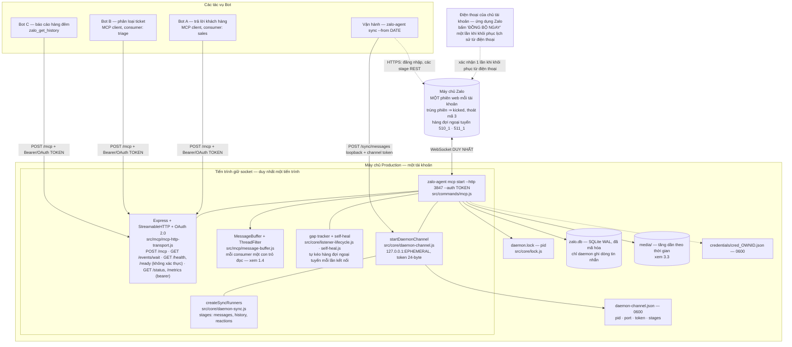

# Triển khai Production — `zalo-agent-cli` + `zalo-mcp` làm autobot thông minh

[English](deployment.md)

**Trạng thái:** cập nhật cho `zalo-agent-cli` `3.0.0` và `zalo-mcp` `2.1.0`: lớp giao thức Zalo Web riêng của engine (không còn zca-js), 36 MCP tool, cơ chế xác nhận trước thao tác phá hủy (`--yes` trên CLI, `confirm` và `confirmMode` qua MCP), các dòng log của bộ giám sát socket, khôi phục theo từng đợt với ba lần kết nối lại, đăng nhập QR chính thức cùng tệp thiết bị tin cậy, HTTPS gốc `--cert`/`--key`, máy chủ ủy quyền OAuth 2.0 / 2.1 tích hợp sẵn, webhook có chữ ký HMAC trên cả `listen` lẫn `mcp start`, long-polling 0% CPU qua `GET /events/wait` + `zalo_wait_for_message`, và quản lý tiến trình nền `-d, --daemon` / `--stop` / `--status`. Viết lần đầu ngày 2026-09-29.
**Giấy phép:** từ bản 2.0.1 phần mềm này được cấp phép theo CC BY-NC-SA 4.0; việc sử dụng trong hoạt động kinh doanh của doanh nghiệp cần giấy phép thương mại riêng (xem [NOTICE](../NOTICE)).
**Đối tượng đọc:** người trực tiếp vận hành hệ thống này trên máy chủ và nhận cảnh báo khi dịch vụ dừng.

**Tài liệu liên quan:**
- Đồng bộ theo yêu cầu chủ tài khoản qua MCP (`zalo_sync` & `zalo_sync_status`): [Tiếng Việt](mcp-sync.vi.md) / [English](mcp-sync.md).
- Ghim đa tài khoản (`--account <ID>` / `ZALO_ACCOUNT`): [Tiếng Việt](account-pinning.vi.md) / [English](account-pinning.md).

Mọi khẳng định kiến trúc bên dưới đều được đối chiếu tới file trong `src/`, hoặc (đối với bề mặt lệnh) tới [`skill/references/command-reference.md`](../skill/references/command-reference.md) — tài liệu thắng thế bất cứ khi nào hai tài liệu mâu thuẫn nhau. Phần [Phụ lục](#phụ-lục--tự-đo-đạc-lại-mọi-thông-số) liệt kê các lệnh để bạn tự đo trên máy chủ của mình.

Hai quy ước dùng xuyên suốt tài liệu:

- `<ownId>` là mã số Zalo (numeric own-id) của tài khoản. Tuyệt đối không ghi ID thật vào file cấu hình được commit, vào issue hay ticket.
- Các khối cảnh báo phân biệt rõ giữa tính năng đã có và đề xuất thiết kế:
  - `> [!NOTE]` — đề xuất thiết kế hoặc ghi chú kiến trúc.
  - `> [!WARNING]` — hành vi thực tế hiện tại cần lưu ý để tránh lỗi vận hành.
  - `> [!CAUTION]` — thao tác có thể gây mất dữ liệu hoặc khiến tài khoản bị khóa/ban.

---

## 0. Bản tóm tắt ngắn gọn

**Mô hình triển khai (Topology).** Chỉ chạy **đúng một** tiến trình giữ kết nối WebSocket cho mỗi tài khoản Zalo: `zalo-agent mcp start --http <port> --auth <token>` (hoặc kèm `--cert`/`--key` cho HTTPS). Tiến trình đó giữ WebSocket duy nhất được phép của tài khoản, giữ `daemon.lock`, công bố `daemon-channel.json`, và là tiến trình duy nhất ghi thêm dòng tin nhắn vào `zalo.db` khi đang chạy: tin nhắn trực tiếp (live), luồng tự bù khoảng hở (self-heal) từ hàng đợi ngoại tuyến của Zalo, tiến trình khôi phục `zalo-agent sync` và lệnh `msg history` đều chạy bên trong nó. Mọi tác vụ bot là **client** của tiến trình này: các MCP client gọi qua `POST /mcp` (giao thức HTTP/HTTPS hoàn toàn phi trạng thái cho phép nhiều client gọi đồng thời, và mỗi bot giữ con trỏ đọc riêng bằng tham số `consumer`), và các lệnh CLI ngắn hạn chuyển tiếp những tác vụ cần socket vào daemon qua kênh loopback. Không có bot nào tự mở WebSocket thứ hai.

**Ràng buộc lớn nhất.** Zalo chỉ cho phép một phiên web trên mỗi tài khoản; phiên trùng lặp sẽ bị đóng với mã `3000`, và cả `listen` lẫn `mcp start` đều coi đó là điểm kết thúc: chúng nhả lock và thoát với mã `3`, không kết nối lại, vì hai client cùng kết nối lại sẽ đá nhau mãi. Một phiên đăng nhập mà Zalo liên tục từ chối (ba lần bị từ chối liên tiếp) kết thúc daemon với mã `4`. Mở một tab trình duyệt Zalo Web cũng tính là một phiên. Đây là quy tắc từ phía máy chủ Zalo, không thể cấu hình bỏ qua.

**Những gì nhiều bot dùng chung một server có sẵn hôm nay.** Nhiều bot có thể dùng chung một server an toàn cho cả việc đọc lẫn gửi: `zalo_mark_read` chỉ dịch chuyển con trỏ của đúng `consumer` đang gọi và không xóa bất kỳ tin nhắn nào khỏi bộ đệm. Về chiều nhận tin (inbound), bot có thể dùng long-polling 0% CPU (`zalo_wait_for_message` hoặc `GET /events/wait`), nhận webhook đẩy (`-w, --webhook <url>` kèm `--webhook-secret`), hoặc polling theo con trỏ (`zalo_get_messages`). Hỗ trợ xác thực đa client qua OAuth 2.0 (`oauth.clients[]`) và Bearer token. Xem §1.4.

**Wrapper chỉ chạy đúng phiên bản engine mà nó cài đặt.** Một thư mục cài đặt `zalo-mcp` chạy phiên bản `@ardennguyen/zalo-agent-cli` nằm trong `node_modules/` của nó; lệnh `update` của wrapper sẽ cài `@ardennguyen/zalo-agent-cli@latest`. Trên máy chủ, bạn có thể dùng `zalo-mcp` hoặc cài đặt trực tiếp engine `@ardennguyen/zalo-agent-cli`.

**Lựa chọn LLM backend.** Đánh giá thực tế (không phải phép đo từ mã nguồn): Claude qua API trong một tổ chức (organization) thuộc sở hữu của công ty là lựa chọn tốt nhất cho luồng hội thoại tiếng Việt giao tiếp với khách hàng. Xem §6 để biết lý do chi tiết và giải pháp thay thế cho từng loại tác vụ.

---

## 1. Bài toán cốt lõi: một socket, nhiều bot

### 1.1 Ràng buộc trong mã nguồn

| Thực tế | Vị trí trong code |
|---|---|
| Một phiên web mỗi tài khoản; phiên trùng (khung `cmd 3000`, khung `error_code 600` hoặc HTTP 600) là điểm kết thúc | `AGENTS.md` §13; bộ giám sát socket (`src/zalo/socket.js`) vào trạng thái cuối `kicked` và không kết nối lại gì |
| `listen` thoát với mã `3` khi bị đá | `src/commands/listen.js`, callback `onKicked` đưa cho socket host (`src/core/socket-host.js`): `dropLock()` (dừng channel, nhả lock), rồi `process.exit(EXIT_CODE.KICKED)` |
| `mcp start` thoát với mã `3` khi bị đá | `src/commands/mcp.js`, cùng callback `onKicked`: `dropLock();` rồi `process.exit(EXIT_CODE.KICKED);` |
| Cả hai thoát với mã `4` khi Zalo liên tục từ chối phiên đã lưu | callback `onRevoked` của socket host, sau ba lần đăng nhập bị từ chối liên tiếp; đăng nhập thất bại vì không có mạng thì được hỏi lại, chậm dần, bao lâu cũng được |
| `listen` và `mcp start` loại trừ lẫn nhau | Cả hai đều gọi `acquireLock(accountDir)` trước khi mở cơ sở dữ liệu và thoát ngay nếu không lấy được khóa |
| Khóa là file PID được tạo nguyên tử (atomic) | `src/core/lock.js` `acquireLock`: `fs.writeFileSync(lockPath, process.pid.toString(), { flag: "wx" })`, tự thu hồi khóa cũ nếu kiểm tra `isProcessAlive` (`process.kill(pid, 0)`) thấy tiến trình đã chết |

Vì vậy, quyết định triển khai đầu tiên là bắt buộc: **bạn chỉ có duy nhất một tiến trình giữ socket cho mỗi tài khoản, và đó là `listen` hoặc `mcp start`, không bao giờ chạy cả hai cùng lúc.**

> [!WARNING]
> `listen` và `mcp start` là hai điểm vào của cùng một socket, và `AGENTS.md` §13 coi mọi sự bất đối xứng về lưu trữ/bù khoảng hở giữa chúng là lỗi. Tuy nhiên, chúng phục vụ các giao diện tiêu thụ khác nhau:
>
> | Tính năng | `listen` | `mcp start` |
> |---|---|---|
> | Bề mặt 36 MCP tools (`src/mcp/mcp-tools.js`) | không | **có** |
> | HTTP / HTTPS `/health`, `/ready`, `/status`, `/metrics`, `/events/wait`, các endpoint OAuth 2.0 | không | **có** (khi có `--http`) |
> | Đẩy sự kiện qua `-w, --webhook <url>` + `--webhook-secret <secret>` | **có** | **có** |
> | Lưu trữ JSONL (`--save <dir>`) | **có** | không |
> | In sự kiện ra stdout (`--events`, `--filter`, `--no-self`), `--auto-accept` | **có** | không |
> | Thông báo cho chủ tài khoản (`notify.*`, xem §7.2) | không | **có** |
> | Theo dõi khoảng hở kết nối (`sync_gaps`) | có | có (`createGapTracker` trong `src/core/listener-lifecycle.js`) |
> | Tự động bù khoảng hở (self-heal) từ hàng đợi ngoại tuyến mỗi lần kết nối (`--no-self-heal` để tắt) | có | có |
> | Gửi báo nhận `delivered` (`--no-delivered-receipts` để tắt); cập nhật trạng thái đã đọc từ thiết bị khác | có | có |
> | Kênh daemon loopback (`/send-attachments`, `/sync/messages`, `/sync/reactions`, `/sync/history`, `/stop`) | có | có |
> | Quản lý daemon chạy nền (`-d, --daemon`, `--stop`, `--status`) | có | có (`-d` cần `--http`) |
> | Luồng ghi log | thông báo ra stdout, chẩn đoán `[listen]` ra stderr | toàn bộ ra stderr |
>
> Chọn `mcp start` khi dùng MCP bots (kèm hỗ trợ webhook và long-polling), hoặc chọn `listen` khi chỉ cần đẩy toàn bộ các loại sự kiện ra webhook/JSONL thuần CLI.

> [!NOTE]
> **Các MCP tools của `mcp start` tự động đi theo phiên đăng nhập mới sau khi re-login.** Khi bộ giám sát không giữ được socket trên phiên hiện tại (Zalo từ chối phiên, hoặc sau 8 lần thử liên tiếp vẫn không có socket dùng được), socket host tự xử lý bên trong tiến trình: `clearSession()`, sau đó đăng nhập, tạo đối tượng API mới (`loginWithCredentials` trong `src/core/zalo-client.js`). Các handler của listener, self-heal, daemon channel, trình tải media và cả 36 MCP tools đều đi qua `liveApi(getApi)` (`src/core/live-api.js`) nên luôn gọi đúng phiên hiện hành. Trong vài giây đang re-login, lệnh gọi tool sẽ báo `"The Zalo session is logging in again after a dropped connection; try again in a few seconds."`

### 1.2 Bản chất của `daemon-channel.js`

`src/core/daemon-channel.js` là **một máy chủ HTTP loopback do tiến trình giữ socket vận hành để phục vụ các tiến trình khác cần dùng socket nhưng không được phép tự mở socket mới:**

- `startDaemonChannel({ getApi, accountDir, onLog, runners, lock })` lắng nghe tại `server.listen(0, "127.0.0.1")`: cổng ngẫu nhiên (ephemeral), chỉ trên loopback, không bao giờ mở ra `0.0.0.0`.
- Ghi file `daemon-channel.json` (`{ pid, port, token, stages }`) với quyền `{ mode: 0o600 }`. Token dài 24 byte ngẫu nhiên (`randomBytes(24).toString("hex")`), truyền trong thân JSON và được kiểm tra bằng `timingSafeEqual`.
- Năm route `POST`: `/send-attachments`, `/sync/messages`, `/sync/reactions`, `/sync/history` và `/stop` (dùng cho lệnh dừng an toàn `--stop`). `/sync/history` phục vụ `msg history` khi daemon đang chạy: daemon tải và ghi vào DB, còn tiến trình CLI chỉ hiển thị kết quả (`src/core/history-fetch.js`).
- `getDaemonChannel(accountDir)` đọc thông tin kênh và **xóa ngay lập tức nếu `process.kill(pid, 0)` báo PID không còn sống**, tránh việc kết nối vào cổng chết.
- `createStageLock()` đảm bảo tại một thời điểm chỉ có một stage chạy trên socket. Nếu một stage khác đang chạy, yêu cầu mới nhận mã `409` kèm tên stage đang bận và thời điểm bắt đầu.
- Tiến trình đồng bộ truyền luồng NDJSON qua kết nối chunked: `{"t":"event"}` cho mỗi bước tiến độ, `{"t":"ping"}` mỗi 20 giây, và kết thúc bằng `{"t":"done"}` hoặc `{"t":"error"}`.

### 1.3 Mô hình này có mở rộng cho N consumer được không?

**Với chiều gửi đi (outbound): Có.**

- Giao thức MCP HTTP hoàn toàn **phi trạng thái (stateless)**: mỗi yêu cầu `POST /mcp` đều được xử lý độc lập, cho phép nhiều bot gọi song song.
- Các route trên kênh loopback là request/response (`/send-attachments`) hoặc thực thi tuần tự qua khóa stage (`/sync/*`).

**Với chiều nhận tin (inbound): Hỗ trợ cả long-polling 0% CPU, webhook push và cursor polling.**

| Cơ chế | Số consumer | Dùng được với `mcp start`? | Đánh giá thực tế |
|---|---|---|---|
| MCP tool `zalo_wait_for_message` hoặc `GET /events/wait?timeout=300&since=<cursor>` | N | **có** | Long-polling 0% CPU: trả về ngay lập tức (`0 ms`) nếu trong buffer đã có tin mới hơn `since`, hoặc chờ đến khi có tin nhắn tiếp theo. `limit` (1–100, mặc định 1) trả về tối đa chừng đó tin trong một lần gọi và `settle` (ms) chờ nốt phần còn lại của một đợt tin: xả một đống tồn chỉ tốn một lần gọi cho mỗi `limit` tin thay vì mỗi tin một lần |
| Polling `zalo_get_messages` qua `POST /mcp`, mỗi bot một tên `consumer` | N | **có** | Hoạt động tốt: mỗi consumer có con trỏ đọc riêng (§1.4a). Buffer nằm trong RAM và giới hạn bởi `limits.bufferMaxSize` / `limits.bufferMaxAge` |
| `listen` hoặc `mcp start` `-w, --webhook <url> [--webhook-secret <secret>]` | **1** URL | **có** | Hộp thư đi bền vững (`webhook-outbox.db` trong thư mục tài khoản, được mã hóa như `zalo.db`): ghi xuống đĩa trước, giao theo thứ tự và ít nhất một lần, 10 giây mỗi POST, thử lại với thời gian chờ tăng dần (1 giây nhân đôi đến 5 phút) khi bên nhận hỏng, chuyển vào dead-letter khi bên nhận trả 400 / 413 / 422 hoặc sau 24 giờ (`ZALO_WEBHOOK_MAX_AGE`), có thể gộp nhiều sự kiện mỗi POST (`ZALO_WEBHOOK_BATCH_SIZE`). Hỗ trợ ký `Authorization: Bearer <secret>` + `X-Zalo-Signature: sha256=<hmac>`. Các tin nhắn do self-heal khôi phục cũng được đẩy kèm `catchUp: true`. Xem tồn đọng: `zalo-agent mcp webhook status` |
| `listen --save <dir>` JSONL | N trình đọc | **không** | Ghi nối tiếp từng sự kiện vào một file cho mỗi `threadId`. Rất tốt để lưu trữ kiểm toán (audit) |
| `zalo-agent --json db query "<SQL>"` (trước đây: đọc trực tiếp `zalo.db`) | N | **không** | Từ 3.0.0 file đã được mã hóa (SQLCipher, [security.vi.md](security.vi.md)): `sqlite3`, `better-sqlite3` và DB Browser gặp `file is not a database`. `db query` chạy một câu lệnh chỉ đọc cho bot (kết nối chỉ đọc với `query_only`; từ chối lệnh ghi, `ATTACH` và các pragma khóa; mặc định 1000 dòng), chạy song song với daemon. Chat ẩn bị loại ra, trừ khi có `--include-hidden` và mã PIN chat ẩn (nhập ở dấu nhắc, hoặc `--pin-stdin`). Với công cụ BI: `db export --out <file> --plaintext --yes`, một bản chụp đã giải mã mà mọi công cụ SQLite đều mở được (chat ẩn cũng bị loại ra như vậy). Hoặc các công cụ MCP: `zalo_get_history` / `zalo_search_messages` |

### 1.4 Nhiều bot trên một server: những gì đã có và những gì cần lưu ý

**(a) Con trỏ đọc riêng cho từng consumer (`src/mcp/message-buffer.js`, `src/mcp/mcp-tools.js`):**

- `zalo_get_messages`, `zalo_list_threads` và `zalo_mark_read` nhận tham số tùy chọn `consumer`: chuỗi từ 1 đến 64 ký tự thuộc `A–Z a–z 0–9 . _ : @ -`. Nếu bỏ qua, mặc định là `default`.
- `zalo_mark_read` chỉ đẩy con trỏ của đúng consumer đó tiến lên (không bao giờ lùi) và **không xóa tin nhắn nào**; tin nhắn chỉ rời khỏi buffer khi vượt quá `bufferMaxSize` mỗi hội thoại (mặc định 500) hoặc cũ hơn `bufferMaxAge` (mặc định `2h`).

Những điểm cần lưu ý:

1. **Con trỏ là toàn cục trên mọi hội thoại (`_globalCursor`).** Khi một consumer gọi `zalo_mark_read` tại một giá trị cursor, mọi tin nhắn có cursor `<=` giá trị đó ở tất cả các hội thoại đều được tính là đã đọc đối với consumer đó.
2. **Tên consumer là tự khai báo.** Dùng để phối hợp giữa các bot nội bộ chứ không phải rào chắn phân quyền.
3. **Lưu tối đa 256 consumer trong bộ nhớ (`MAX_CONSUMERS`).**
4. **Buffer chỉ nằm trong RAM.** Khi khởi động lại daemon, buffer và các con trỏ trong RAM sẽ trống, nhưng toàn bộ tin nhắn đã được lưu bền vững trong `zalo.db` trước khi đưa vào buffer.

### 1.5 Chuyện gì xảy ra nếu có hai tiến trình cùng ghi vào cơ sở dữ liệu?

> [!NOTE]
> **Từ 3.0.0 `zalo.db` được mã hóa** (SQLCipher v4 dưới khóa data của tài khoản, [security.vi.md](security.vi.md)). Phần dưới về trình đọc và trình ghi vẫn đúng cho các tiến trình của chính CLI, vốn mở file bằng khóa. Tiến trình bên ngoài CLI không mở được file nữa: đọc trực tiếp như hướng dẫn của 2.x giờ sẽ gặp `file is not a database`; thay vào đó hãy chạy `zalo-agent db query`.

1. **`daemon.lock` bảo vệ chống mở WebSocket thứ hai**, trong khi các lệnh đồng bộ qua socket và `msg history` tự động định tuyến qua daemon đang chạy.
2. **SQLite WAL điều phối truy cập đĩa.** Nhiều tiến trình **đọc** của CLI cùng lúc hoàn toàn an toàn. Nhưng nếu một tiến trình khác giữ khóa ghi quá 5 giây (`busy_timeout` 5000 ms mà `openDatabase()` trong `src/core/sqlite.js` đặt), tiến trình daemon có thể gặp lỗi `SQLITE_BUSY` hoặc bị nghẽn vòng lặp sự kiện (event loop), dẫn đến trễ nhịp keepalive của WebSocket Zalo.

> [!CAUTION]
> **Quy tắc cho mọi tiến trình ngoài daemon giữ socket:** đừng tự mở `zalo.db`: từ 3.0.0 file được mã hóa, trình đọc không có khóa sẽ gặp `file is not a database`. Hãy đọc qua `zalo-agent --json db query "<SQL>"` (SQL chỉ đọc), các công cụ MCP hoặc đầu ra `--json` của CLI; với công cụ khác, `zalo-agent db export --out <file> --plaintext --yes` ghi ra một bản chụp đã giải mã (mọi tin nhắn trong bộ nhớ đệm, kể cả chat ẩn: hãy bảo vệ nó như chính cơ sở dữ liệu). Nếu bot của bạn cần ghi trạng thái riêng, hãy ghi vào một file cơ sở dữ liệu riêng của bot.

---

## 2. Kiến trúc tham chiếu



---

## 3. Định cỡ phần cứng và hệ điều hành

### 3.1 Node.js và hệ điều hành

- **Node.js 22.19 trở lên.**
- **Linux (x64 hoặc arm64) hoặc Windows/macOS.** Trên Linux, `systemd` giúp quản lý khởi động lại, nhật ký và tín hiệu dừng; ngoài ra bạn cũng có thể dùng trực tiếp cờ chạy nền `-d, --daemon`, `--status`, `--stop` tích hợp sẵn trên mọi hệ điều hành.
- Lớp giao thức của engine là mã của chính dự án (`src/zalo/`), nên khi cài từ npm không có bước vá hay `prepare` nào; từ 3.0.0 cũng không phụ thuộc nào chạy script cài đặt: driver SQLite `better-sqlite3-multiple-ciphers` 13.0.3 (bản fork của `better-sqlite3` có mã hóa khi lưu) mang sẵn binary dựng sẵn cho Linux (glibc và musl), macOS và Windows trên x64 và arm64, và `allowScripts` trong `package.json` ghi nó là `false`. Máy chủ không phải biên dịch gì, nên không cần công cụ build.

### 3.2 CPU và RAM

| Thông số | Tối thiểu | Khuyến nghị | Lý do |
|---|---|---|---|
| vCPU | 2 | 4 | Quá trình khôi phục lịch sử giải mã (`libzproto` WASM), giải nén Zstd và ghi hàng loạt trên cùng vòng lặp sự kiện phục vụ socket |
| RAM | 1 GB | 2–4 GB | `ThreadNameCache.init()` nạp danh sách nhóm và bạn bè lúc khởi động; `MessageBuffer` giữ tối đa 500 tin mỗi hội thoại trong 2 giờ; đỉnh RAM rơi vào lúc chạy `sync` lịch sử lớn |
| Swap | — | Có, ≥1 GB | Tránh bị OOM kill gây gián đoạn kết nối ngoài ý muốn |

> [!CAUTION]
> **Không chạy chung một mô hình LLM cục bộ chỉ dùng CPU (như Ollama không có GPU) trên cùng máy chủ với tiến trình giữ socket.** Việc chiếm dụng 100% CPU sẽ làm nghẽn vòng lặp sự kiện của Node và làm rớt kết nối WebSocket Zalo.

### 3.3 Dung lượng đĩa — thư mục media chiếm phần lớn dung lượng

Số liệu đo thực tế trên một tài khoản sau **36 ngày** vận hành liên tục:

| Thành phần | Dung lượng đo được | Tốc độ tăng ước tính |
|---|---|---|
| `media/` | ~1.6 GB (~830 tệp) | **~44 MB/ngày**, ~1.3 GB/tháng, **~16 GB/năm** mỗi tài khoản |
| Kích thước tệp media trung bình | ~1.9 MB | — |
| `zalo.db` | ~11 MB cho ~14.000 tin nhắn | **~800 bytes/tin nhắn** |
| `zalo.db-wal` | ~4 MB | Tự động checkpoint theo mặc định của SQLite |

Khuyến nghị dung lượng đĩa: **tối thiểu 40 GB** (nếu có lịch dọn dẹp media định kỳ) hoặc **100 GB+** (nếu lưu nhiều tài khoản hoặc giữ media lâu dài).

Công cụ dọn dẹp media có sẵn và không gửi bất kỳ yêu cầu nào tới Zalo:

```bash
zalo-agent sync-media --prune 90 --dry-run   # xem trước những tệp sẽ xóa
zalo-agent sync-media --prune 90             # xóa tệp media đã tải cũ hơn 90 ngày (giữ nguyên văn bản trong zalo.db)
zalo-agent sync-media --prune all            # xóa toàn bộ tệp media đã tải
zalo-agent sync-media --prune-orphans        # xóa media của các hội thoại tài khoản không còn tham gia
```

> [!WARNING]
> **Media mặc định nằm tại `accounts/<ownId>/media/<threadId>/` (hoặc `--media-dir` / `ZALO_MEDIA_DIR`, hoặc `media.downloadDir` trong `mcp-config.json`).** Một thư mục media tùy chỉnh nằm ngoài `accounts/<ownId>/` sẽ **không** bị xóa khi chạy `logout --purge`, `account remove` hay `logout --delete-history`. Nếu bạn cấu hình thư mục media riêng, hãy chủ động xóa thư mục đó khi gỡ bỏ tài khoản. Từ 3.0.0 mọi file trong đó được niêm phong bằng khóa media của tài khoản ([security.vi.md](security.vi.md)), nên khi tài khoản (cùng keyring của nó) đã bị gỡ thì phần còn lại không đọc được nữa; thư mục dùng chung cho nhiều tài khoản giữ file của mỗi tài khoản dưới khóa riêng của tài khoản đó.

### 3.4 Disk I/O cho SQLite WAL

- **Bắt buộc dùng ổ SSD/NVMe cục bộ cho `~/.zalo-agent-cli/`.** Không đặt cơ sở dữ liệu SQLite WAL trên ổ mạng (NFS, SMB/CIFS, EFS).
- Giữ `zalo.db`, `zalo.db-wal` và `zalo.db-shm` trên cùng một phân vùng đĩa.

---

## 4. Cài đặt và vận hành

### 4.1 Cài đặt và đăng nhập

Xem [`INSTALLATION.vi.md`](../INSTALLATION.vi.md) / [`INSTALLATION.md`](../INSTALLATION.md) để cài đặt qua wrapper `zalo-mcp`, hoặc cài trực tiếp engine:

```bash
npm view @ardennguyen/zalo-agent-cli versions
sudo npm install -g @ardennguyen/zalo-agent-cli@<version>
command -v zalo-agent
```

Đăng nhập lần đầu **bằng tài khoản người dùng chạy dịch vụ (không chạy từ shell root/Administrator)**:

```bash
sudo -u zalo -H zalo-agent login
sudo -u zalo -H zalo-agent status
```

Mã QR được lưu tại `~/.zalo-agent-cli/qr.png` và phục vụ tại **`http://127.0.0.1:18927/qr` (chỉ loopback)**. Từ máy trạm, bạn có thể tạo đường hầm SSH: `ssh -L 18927:127.0.0.1:18927 <host>`, sau đó mở `http://localhost:18927/qr` và quét bằng ứng dụng Zalo. Trang báo khi đăng nhập thành công hay thất bại. Mỗi mã dùng được 100 giây: khi chạy ở terminal, mã hết hạn chỉ được thay khi bạn yêu cầu (nhấn Enter, hoặc **Lấy mã mới** trên trang), và lệnh kết thúc nếu sau 5 phút không ai yêu cầu; khi chạy không có terminal (`--json`, dịch vụ, `&`), lệnh hiện tối đa 5 mã rồi kết thúc với `Login timed out`.

Phương án không cần quét QR trên server: trên máy đã đăng nhập, chạy `zalo-agent account export --yes` để xuất file thông tin phiên (quyền `0600`), chuyển file qua kênh mã hóa lên server và chạy `zalo-agent login --credentials <file>`, sau đó xóa file tạm và chạy `zalo-agent logout --no-remote` trên máy cũ.

### 4.2 Chạy nền (`-d, --daemon`) hoặc qua `systemd`

**Cách 1: Dùng trình quản lý daemon tích hợp sẵn (Linux, macOS, Windows):**

```bash
# Khởi chạy ngầm trong nền (tự động kiểm tra daemon.lock và daemon-channel.json)
zalo-agent mcp start --account <ownId> --http 3100 --host 0.0.0.0 \
  --cert /path/to/fullchain.pem --key /path/to/privkey.pem -d

# Kiểm tra trạng thái và dừng an toàn
zalo-agent mcp start --account <ownId> --status
zalo-agent mcp start --account <ownId> --stop
```

**Cách 2: Dùng `systemd` trên Linux (`/etc/systemd/system/zalo-mcp.service`):**

```ini
[Unit]
Description=Zalo MCP server (socket holder for one Zalo account)
Documentation=https://github.com/ardennguyen/zalo-agent-cli
After=network-online.target
Wants=network-online.target
StartLimitIntervalSec=600
StartLimitBurst=5

[Service]
Type=simple
User=zalo
Group=zalo
WorkingDirectory=/home/zalo
UMask=0077

EnvironmentFile=/etc/zalo-agent/mcp.env
Environment=NODE_ENV=production
Environment=ZALO_AGENT_NO_UPDATE_CHECK=1

ExecStartPre=/usr/bin/test -n "${ZALO_MCP_AUTH_TOKEN}"
ExecStart=/usr/bin/zalo-agent mcp start --http ${ZALO_MCP_HTTP_PORT} --host 127.0.0.1

# QUAN TRỌNG: SIGINT là tín hiệu dừng chuẩn mà `mcp start` và `listen` bắt để ghi nhận
# `lastConnectedAt`, xả các biên nhận delivered và xóa sạch `daemon.lock` + `daemon-channel.json`.
KillSignal=SIGINT
TimeoutStopSec=30

Restart=always
RestartSec=15
# Exit 3: một phiên khác đã lấy tài khoản. Exit 4: Zalo liên tục từ chối phiên đã lưu.
# Khởi động lại không sửa được cả hai, nên giữ unit ở trạng thái dừng.
RestartPreventExitStatus=3 4

StandardOutput=journal
StandardError=journal
SyslogIdentifier=zalo-mcp

NoNewPrivileges=yes
PrivateTmp=yes
ProtectSystem=strict
ProtectHome=read-only
ReadWritePaths=/home/zalo/.zalo-agent-cli
ProtectKernelTunables=yes
ProtectControlGroups=yes
RestrictSUIDSGID=yes
LockPersonality=yes

[Install]
WantedBy=multi-user.target
```

`/etc/zalo-agent/mcp.env` (quyền `0600`):

```ini
ZALO_MCP_HTTP_PORT=3847
ZALO_MCP_AUTH_TOKEN=<64 ký tự hex từ lệnh: openssl rand -hex 32>
```

> [!TIP]
> Truyền token qua biến môi trường `ZALO_MCP_AUTH_TOKEN` (hoặc `ZALO_MCP_AUTH_TOKEN_<ownId>` trong `~/.zalo-agent-cli/.env` / `EnvironmentFile`) giúp giữ bí mật token, không để lộ trên dòng lệnh `ps` / `/proc/<pid>/cmdline` như khi truyền trực tiếp `--auth <token>`.

### 4.3 Nhật ký (Logs) và các dòng cần chú ý

- **Mức log.** `--log-level` / `ZALO_LOG_LEVEL[_<ownId>]` là `error`, `warn`, `info` (mặc định) hoặc `debug`. `debug` thêm các dòng tăng theo lưu lượng: một dòng cho mỗi HTTP request (kèm địa chỉ và user agent của bên gọi), một dòng cho mỗi tin nhắn daemon xử lý (`[mcp] Buffered …`; ở `listen` là mọi dòng sự kiện, có cả nội dung tin nhắn). Ở mức `info` các dòng này không được ghi, nên log của một daemon bận chỉ nói về thay đổi trạng thái và nội dung tin nhắn riêng tư không lọt vào log. Các dòng còn lại được phân loại theo câu chữ (lỗi hoặc từ chối là `error`, `WARNING` / `⚠` là `warn`). Daemon chạy nền ghi qua bộ lọc này vào `daemon.log`; chạy foreground chỉ lọc stderr khi có yêu cầu mức hoặc định dạng. Tiến trình chỉ *khởi chạy* `-d` không bao giờ bị lọc.
- **Dấu thời gian, JSON.** Mỗi dòng `daemon.log` bắt đầu bằng thời gian ISO. `ZALO_LOG_FORMAT=json` ghi mỗi dòng một đối tượng JSON (`{"ts","level","account","msg"}`) cho công cụ thu log.
- **Xoay vòng (rotation).** `daemon.log` xoay theo dung lượng, `daemon.log` → `daemon.log.1` → … → `daemon.log.<keep>`: `ZALO_LOG_MAX_SIZE` (mặc định `50m`, tối thiểu `4k`) và `ZALO_LOG_KEEP` (mặc định 3; 0 là bắt đầu lại từ đầu). File mới mở đầu bằng dòng `log rotated`. Trên Windows việc đổi tên có thể bị từ chối khi có chương trình khác (`tail`, trình soạn thảo) đang mở file; daemon khi đó tiếp tục ghi vào file cũ và thử lại sau thêm một megabyte.

| Dòng log | Ý nghĩa | Hành động cần làm |
|---|---|---|
| `[mcp] Another Zalo session took this account (<via>). Not reconnecting: that would evict it in turn.` (`listen`: cùng nội dung với `[listen]`; có thể kèm dòng `Zalo says why: …`) | Có người mở Zalo Web trên trình duyệt hoặc một tiến trình khác chiếm phiên; phiên mới thắng và daemon dừng lại | Đóng phiên kia trước khi khởi động lại |
| `[mcp] The login was refused (3 of 3): <reason>` | Đăng nhập lại sau khi Zalo từ chối phiên bị từ chối 3 lần liên tiếp: thông tin đăng nhập đã chết và daemon dừng. Còn `The login failed (<reason>); asking again.` là lỗi mạng hoặc máy chủ: daemon vẫn tiếp tục hỏi, không thoát | Bị từ chối: chạy lại `zalo-agent login` (khởi động lại bằng `systemd` không giúp được). Lỗi mạng: không cần làm gì trừ khi kéo dài hàng giờ |
| `[mcp] Logged in again. Restarting the socket.` (sau `Zalo refused this session (<kind>, code N). Logging in again.`) | Tự đăng nhập lại thành công sau khi Zalo từ chối phiên | Hệ thống sẽ tự ghi nhận khoảng hở và chạy self-heal |
| `[mcp] Daemon channel unavailable: <reason>` | Không mở được kênh loopback `startDaemonChannel` | Khởi động lại tiến trình |
| `[mcp] self-heal: recovered N message(s) (…); covered since <time>; closed N gap(s).` | Đã tự động kéo xong tin nhắn bị lỡ từ hàng đợi ngoại tuyến của Zalo | Không cần làm gì thêm trừ khi có dòng `stays pending` theo sau |
| `[mcp] self-heal: … stays pending (…) — close it with: zalo-agent sync --from <date>` | Khoảng thời gian mất kết nối vượt quá phạm vi hàng đợi ngoại tuyến của Zalo | Chạy lệnh `zalo-agent sync --from <date>` được in ra (hoặc `zalo_sync`) và bấm xác nhận trên điện thoại (§4.5) |
| `[mcp] message not stored: <reason>` | Một tin nhắn trực tiếp không ghi được vào SQLite | Kiểm tra ngay dung lượng đĩa hoặc tiến trình tranh chấp khóa ghi (§1.5) |
| `[mcp] Disconnected (code: N). Auto-retrying... (socket was up 37m00s; stage in progress: messages for 5m00s; …)`, rồi `[mcp] Reconnecting in 5.0s (reason 1006, attempt 1)` | Socket bị đóng. Phần trong ngoặc cho biết socket đã sống bao lâu, giai đoạn sync nào đang giữ nó và tiến trình có bị nghẽn không. Mã 1006 không có khung đóng: bộ giám sát thử lại theo bảng của chính Zalo (nghỉ một lúc, đổi endpoint sau nhiều lần lỗi) | Khoảng hở được ghi nhận khi socket trở lại và self-heal kéo bù. Dòng `blocked` ngay trước đó (bên dưới) chỉ ra lỗi nằm ở tiến trình này chứ không phải mạng |
| `[mcp] [sync:messages] started (days=90 …)`, rồi `+4m05s progress: batch 3/50 — …` theo từng giai đoạn, `still running: +…, last progress … ago` mỗi phút, và `finished in …` hoặc `failed after …: <thông điệp> (code N)` | Một giai đoạn sync do daemon chạy (`zalo-agent sync`, `msg history`, tool `zalo_sync`) ghi ra đúng thứ `zalo-agent sync` in khi chạy trực tiếp. Tin nhắn live đến trong lúc đó được gộp (`stored N live event(s)`) | Dòng `still running` mà "last progress" cứ tăng là đang đứng, không phải đang làm việc |
| `[mcp] event loop was blocked for 6.2s while the messages stage was running: …` | Tiến trình quá bận (giải mã và ghi một lượng lớn tin nhắn) nên không trả lời được socket | Có thể kéo theo close 1006 vì ping của socket không được trả lời. Chia khoảng thời gian (`--days`, `--from`) thành các lần chạy ngắn hơn để mỗi lần nhỏ hơn |
| `[mcp] [sync:messages] the socket was lost mid-stage; waiting up to 120s for the daemon to reconnect`, rồi `the daemon reconnected after …s; resuming the stage` hoặc `did not reconnect within 120s; the stage ends with what it has` | Restore mất socket. Daemon tự đăng nhập lại; giai đoạn chỉ chờ rồi yêu cầu lại các batch chưa về (tối đa 3 lần mỗi restore). Zalo có thể yêu cầu thêm một lần chạm trên điện thoại | Nếu kết thúc với "what it has", chạy `zalo-agent sync --from <date>` cho phần còn lại |
| `[mcp] user-info: batch 3/12 (100 id(s)) failed: code N: <thông điệp của Zalo> [looks like a rate limit]`, rồi `waiting …ms, then retrying` và `stopped after batch … (Zalo is limiting these lookups)` | Zalo từ chối tra cứu hồ sơ (tên người gửi không phải bạn bè). Tiến trình chờ, thử lại rồi dừng thay vì lặp lại lỗi cho mọi batch; các tên chưa lấy được giữ nguyên là id đến lần restore sau | Gửi dòng `code N: …` nếu còn lặp lại. `ZALO_SYNC_NAME_REFRESH_MAX` (mặc định 500) giới hạn số tên DM không phải bạn bè được làm mới mỗi restore |

### 4.4 Bảo trì định kỳ (Scheduled maintenance)

Tạo timer `systemd` chạy vào giờ thấp điểm để dọn các tệp media cũ (ví dụ giữ 90 ngày):

```ini
# /etc/systemd/system/zalo-media-prune.service
[Service]
Type=oneshot
User=zalo
UMask=0077
Environment=ZALO_AGENT_NO_UPDATE_CHECK=1
ExecStart=/usr/bin/zalo-agent sync-media --prune 90
```

```ini
# /etc/systemd/system/zalo-media-prune.timer
[Timer]
OnCalendar=Sun 03:00
Persistent=true
[Install]
WantedBy=timers.target
```

### 4.5 Khởi động lại mà không mất tin nhắn

- Mọi khoảng thời gian socket ngắt kết nối (từ 1 giây trở lên) đều được ghi vào bảng `sync_gaps`.
- Ngay khi kết nối lại và hoàn tất bắt tay xác thực (cmd 1), tiến trình tự động chạy **self-heal** (`src/core/self-heal.js`): hỏi các hàng đợi ngoại tuyến của Zalo (`510_1` cho 1-1, `511_1` cho nhóm) để lấy toàn bộ tin nhắn phát sinh sau tin mới nhất đang có trong `zalo.db`, không cần chạm vào điện thoại.
- Nếu khoảng gián đoạn quá dài khiến hàng đợi ngoại tuyến không còn giữ đủ tin, phần còn thiếu sẽ giữ trạng thái `pending` và in ra đúng lệnh `zalo-agent sync --from <YYYY-MM-DD>` cần chạy. Khi bạn chạy lệnh đó, quá trình khôi phục sẽ đi qua kênh loopback của daemon đang chạy mà **không cần dừng daemon**.

### 4.6 Sao lưu (Backup)

Sao lưu toàn bộ thư mục `~/.zalo-agent-cli/` và giữ nguyên phân quyền file (`0600` cho `accounts.json` và `credentials/cred_<ownId>.json`). `accounts.json` được ghi nguyên tử dưới khóa `accounts.json.lock` (bỏ qua file khóa này khi sao lưu) và bản trước đó được giữ ở `accounts.json.bak`; `accounts/<ownId>/webhook-outbox.db` chứa các sự kiện đang chờ gửi tới webhook (được mã hóa, cùng keyring) nên cần sao lưu cùng tài khoản:

- Loại trừ `qr.png`, `daemon.lock` và `daemon-channel.json` (các file trạng thái runtime tạm thời).
- Đừng copy `zalo.db` khi daemon đang ghi (file sẽ bị rách): hãy dừng dịch vụ, hoặc chụp snapshot hệ thống file của cả thư mục. Từ 3.0.0 `sqlite3 zalo.db ".backup …"` không mở được file đã mã hóa và API backup của driver từ chối nó; **`zalo-agent db backup --out <file>`** ghi ra một bản sao trực tuyến, đã mã hóa và đã kiểm tra (bản chụp nhất quán trong lúc daemon chạy; không bao giờ ghi đè file có sẵn). **Bản sao hay bản sao lưu của `zalo.db` chỉ mở được cùng `keyring.json` của nó và đúng bộ cung cấp khóa** ([security.vi.md](security.vi.md) §7).
- Luôn mã hóa bản sao lưu vì bên trong chứa thông tin phiên đăng nhập và toàn bộ lịch sử tin nhắn.

### 4.7 Giám sát (Monitoring)

Một daemon tự báo cáo tình trạng theo bốn cách. Ba cách đầu là route HTTP của `mcp start --http`; cách xem bằng CLI dùng được cả cho `listen` (không có cổng HTTP) — `src/core/daemon-health.js`.

| Route | Xác thực | Trả lời |
|---|---|---|
| `GET /health` | không | Còn sống hay không: `status` (luôn `"ok"` khi Express còn trả lời), `uptime`, `threads`, và socket: `socket` (`starting`, `up`, `down`, `stopping`, cùng ba trạng thái cho biết vì sao socket chưa lên: `maintenance` (Zalo đang bảo trì, daemon chờ), `relogin` (Zalo từ chối phiên, daemon đang đăng nhập lại) và `kicked` (phiên khác đã chiếm tài khoản; daemon sẽ không kết nối lại)) cùng `ready` |
| `GET /ready` | không | **200 chỉ khi socket Zalo đang kết nối**, ngược lại 503 kèm `{ready, socket}`: dành cho load balancer hoặc bộ giám sát cần ngừng giao việc cho tài khoản đang offline |
| `GET /status` | bearer | Toàn bộ thông tin dưới đây, dạng JSON |
| `GET /metrics` | bearer | Cũng thông tin đó dạng văn bản Prometheus: `zalo_up`, `zalo_socket_*`, `zalo_last_event_age_seconds`, `zalo_webhook_*`, `zalo_coverage_gaps_pending`, `zalo_session_days_left` (số ngày đến khi phiên đã lưu hết hạn), `zalo_buffer_*`, `zalo_process_*`, `zalo_eventloop_lag_*` |
| `zalo-agent mcp start --status` / `listen --status` | cục bộ | Cùng bản chụp đó, in ra (`--json` cho script) |

`/status` gồm: socket (trạng thái, đã bao lâu, số lần kết nối lại, mã đóng gần nhất), tuổi của sự kiện và tin nhắn gần nhất, số tin đến và số sự kiện theo loại, số khoảng hở chưa khôi phục, stage đồng bộ đang chạy, hộp thư đi webhook (đang chờ, dead-letter, chờ lâu nhất, lỗi gần nhất, đã giao), bộ đệm live, bộ nhớ, độ trễ event loop, và danh sách `warnings` kèm `status: "degraded"` khi có điều cần chú ý (socket mất từ 2 phút, tồn đọng webhook quá 5 phút, có dead-letter, khoảng hở chưa khôi phục, treo từ 3 giây).

```bash
curl -s http://127.0.0.1:3847/health
# {"status":"ok","uptime":123,"threads":5,"socket":"up","ready":true}
curl -s -o /dev/null -w '%{http_code}\n' http://127.0.0.1:3847/ready          # 200, hoặc 503 khi socket đang mất
curl -s -H "Authorization: Bearer $ZALO_MCP_AUTH_TOKEN" http://127.0.0.1:3847/metrics | head
```

Cấu hình scrape Prometheus và luật cảnh báo có trong [`config-samples/monitoring/`](config-samples/monitoring/): một job cho mỗi tài khoản (mỗi daemon có token riêng) và mười luật: không truy cập được, socket mất, kết nối lại liên tục, tài khoản đang kết nối nhưng im lặng, tồn đọng webhook, dead-letter, khoảng hở chưa khôi phục, event loop bị treo, bộ nhớ, và vừa khởi động lại. **Đừng công bố `/metrics` hay `/status` qua reverse proxy**; hãy scrape từ bên trong mạng.

> [!NOTE]
> **`status: "ok"` trong `/health` chỉ là liveness.** Nó vẫn `ok` khi socket đang mất. Hãy đọc `socket` / `ready`, hoặc dùng `/ready`.

> [!WARNING]
> **Daemon đang chạy chưa chắc là tài khoản khỏe.** Các route trên đã bao phủ socket, webhook và khoảng hở. Hãy cảnh báo thêm các điểm sau:
>
> 1. Trạng thái tiến trình (`systemctl is-active zalo-mcp` hoặc `zalo-agent mcp start --status`).
> 2. Các dòng lỗi nghiêm trọng trong log (§4.3).
> 3. Thời điểm tin nhắn mới nhất trong `zalo.db`:
>    ```bash
>    zalo-agent --account <ownId> --json db query \
>      "select (strftime('%s','now')*1000 - max(timestamp))/60000 as minutes from messages"
>    ```
> 4. Số khoảng hở đang chờ xử lý (`zalo_coverage` hoặc `select count(*) from sync_gaps where status='pending';`).
>
> `db query` đọc song song với daemon đang chạy và không cần đăng nhập (từ 3.0.0 `zalo.db` được mã hóa nên `sqlite3` không chạy được các truy vấn ở mục 3 và 4; server đang chạy cũng trả lời qua `zalo_coverage`, `zalo_sync_status`).

---

### 4.8 Nhiều tài khoản: các lệnh fleet

Một tài khoản là một daemon (§1), nên một trăm tài khoản là một trăm daemon, mỗi cái có port, token và unit riêng. `zalo-agent fleet` làm những việc người vận hành thường phải tự viết script (`src/core/fleet.js`, `src/commands/fleet.js`):

| Lệnh | Tác dụng |
|---|---|
| `fleet generate --out <dir> [--base-port N] [--domain <host>] [--user --home --bin]` | Ghi systemd template unit, `common.env`, mỗi tài khoản một `accounts/<id>.env` chứa port và **token 256-bit tự sinh** (quyền `600`, không bao giờ in ra), bảng port, và nếu có `--domain` thì cả Caddyfile phục vụ mọi tài khoản dưới `/a/<id>/` và trả 404 cho `/metrics`, `/status`. File đã có không bị ghi đè (`--force` thay các file không chứa bí mật; token đang dùng được giữ trừ khi `--rotate-tokens`). Cùng các file với `docs/config-samples/`; một test giữ hai bên khớp nhau. |
| `fleet ports [--base N]` | Port của từng tài khoản, lưu trong `fleet.json`. Port gán một lần và không bao giờ đổi; tài khoản mới lấy port trống thấp nhất. |
| `fleet status [accounts…] [--check] [--json]` | Một bảng cho mọi tài khoản, hỏi qua kênh loopback của từng daemon (không cần port hay token): trạng thái, pid, socket và tuổi của nó, sự kiện gần nhất, hàng đợi webhook và dead-letter, khoảng hở, bộ nhớ. Trạng thái: `ok`, `degraded` (có cảnh báo: tồn đọng, dead-letter, khoảng hở), `starting`, `maintenance` (daemon chờ Zalo hoạt động lại), `relogin` (đang đăng nhập lại sau khi phiên bị từ chối), `kicked` (phiên khác đã chiếm tài khoản: khởi động lại chỉ làm phiên kia bị đá ra; cũng hiện cho daemon đã thoát vì bị đá, nhờ file `kicked.json` nó để lại trong thư mục tài khoản cho đến lần kết nối kế tiếp hoặc lần đăng nhập lại, kèm `kicked.via` và lý do Zalo đưa ra trong `--json`), `down` (socket mất từ 3 phút, `--down-for`), `unresponsive` (có daemon giữ khóa nhưng không trả lời), `stopped`. `--check` thoát mã 1 trừ khi mọi tài khoản đều `ok` hoặc `degraded`. |
| `fleet start [accounts…] [--batch 5] [--stagger 15] [--env-dir <dir>] [--listen] [--dry-run]` | Khởi động các daemon chưa chạy, **theo từng lô được xáo trộn** và nghỉ giữa các lô, để các tài khoản được cài cùng lúc không đăng nhập cùng lúc. `--env-dir` cấp cho mỗi daemon file `<id>.env` riêng (token, webhook) mà không đặt bí mật lên dòng lệnh. |
| `fleet restart [accounts…] [--unhealthy] [--all]` | Dừng rồi khởi động các tài khoản được nêu, hoặc với `--unhealthy` chỉ những tài khoản `down` hoặc `unresponsive` (khởi động lại không sửa được bên nhận webhook nên tồn đọng được để yên). `fleet restart` trần không khởi động lại gì cả. |
| `fleet stop [accounts…]` | Tắt êm từng daemon. |

**Rải thời điểm khởi động ngay trong daemon.** Mỗi lần khởi động đều đăng nhập và nạp danh sách bạn bè, nhóm, nên một đội daemon khởi động lại cùng lúc sẽ làm tất cả cùng một khoảnh khắc. `ZALO_START_JITTER=30` làm daemon chờ ngẫu nhiên 0–30 giây trước khi đăng nhập, và `ZALO_LOGIN_SLOTS=3` cho phép tối đa ba daemon trên máy nằm giữa "sắp đăng nhập" và "đã nạp xong danh sách" (slot là các file trong `<config dir>/login-slots/`; daemon vượt giới hạn sẽ chờ, và cứ tiếp tục sau `ZALO_LOGIN_SLOT_WAIT`, mặc định 900 giây, để một slot bị kẹt không giữ tài khoản offline; slot của daemon đã chết được thu hồi). Cả hai tắt theo mặc định và dùng được dưới bất kỳ trình giám sát nào. Log daemon ghi `start-up jitter: waiting …`, `waiting for a login slot` và `got login slot …`.

Dưới systemd, unit đã rải thời điểm khởi động (`sleep $((RANDOM % 30))`) và tự khởi động lại daemon chết; `fleet start`/`restart` dành cho máy không có systemd (server Windows, container, laptop) và cho việc chủ động khởi động lại một phần đội tài khoản. `fleet status --check` hợp với cron; Prometheus (§4.7) hợp với cảnh báo.

---

## 5. Bảo mật (Security)

### 5.1 Rủi ro khóa tài khoản — hãy thiết kế sẵn phương án dự phòng

1. **Không bao giờ dùng tài khoản Zalo cá nhân chính cho autobot.** Hãy dùng một tài khoản chuyên biệt và gán proxy cố định riêng (`1:1`).
2. **Sử dụng Official Account API (`oa …`) khi bài toán phù hợp**: API chính thức v3.0 dùng OAuth 2.0, lưu thông tin xác thực riêng tại `~/.zalo-agent/oa-credentials.json`, hoàn toàn không có rủi ro bị khóa tài khoản.
3. **Giới hạn tốc độ gửi tin (rate-limit) ở tầng bot.** Không để vòng lặp lỗi của bot bắn hàng trăm tin nhắn liên tiếp vào một nhóm.

### 5.2 Bảo vệ dữ liệu lưu trữ trên đĩa

Từ 3.0.0, cơ sở dữ liệu tin nhắn `zalo.db` và hàng đợi webhook `webhook-outbox.db` được **mã hóa** (SQLCipher v4), còn phiên đăng nhập đã lưu, danh tính thiết bị tin cậy, các phiên điện thoại của một lần khôi phục và văn bản chuyển từ tin nhắn thoại được **niêm phong** (AES-256-GCM) bằng khóa riêng của từng tài khoản, và chỉ bộ cung cấp khóa của máy (DPAPI, systemd-creds, KMS, …) mở được các khóa đó; có thể bật thêm một lớp khóa thứ hai cần một lần đăng nhập Zalo còn hiệu lực. Chọn bộ cung cấp khóa cho server, phạm vi bảo vệ và các bước khi bị lộ: **[security.vi.md](security.vi.md)**. Khi sao lưu, giữ `accounts/<ownId>/keyring.json` cùng bản sao với `credentials/` và `zalo.db`: thiếu nó, cả thông tin đăng nhập lẫn cơ sở dữ liệu tin nhắn đều không mở được.

- Giữ quyền `0600` cho `accounts.json`, `credentials/cred_<ownId>.json` và `daemon-channel.json`; đặt `UMask=0077` cho tiến trình dịch vụ.
- Bật mã hóa toàn bộ ổ đĩa (Full-Disk Encryption) trên máy chủ và mã hóa các bản sao lưu.
- `zalo-agent logout` (kể cả `--purge`) đăng xuất thiết bị khỏi Zalo đúng như Zalo Web: sáu lệnh gọi, rồi thử đăng nhập lại bằng phiên đã lưu một lần; chỉ khi Zalo từ chối phiên đó mới báo "đã đăng xuất". Nếu dùng `--keep-session` (cách cũ trước v3.0) thì chỉ khóa phiên bị kết thúc; khi đó, để kết thúc hoàn toàn phiên đăng nhập từ phía máy chủ Zalo, hãy mở ứng dụng Zalo trên điện thoại và gỡ phiên Web khỏi danh sách thiết bị đã đăng nhập.

### 5.3 Xác thực MCP (Bearer Token, OAuth 2.0 / 2.1 và TLS/HTTPS)

- Khi mở kết nối qua mạng (`--host 0.0.0.0`), **bắt buộc** phải cấu hình xác thực (`--auth <token>` / `ZALO_MCP_AUTH_TOKEN[_<ownId>]` và/hoặc OAuth 2.0 `oauth.clients[]`) và bật HTTPS (`--cert <fullchain.pem> --key <privkey.pem>` hoặc qua reverse proxy).
- Trên máy chủ không có giao diện đồ họa, hãy đặt `"media": {"autoOpen": false}` trong `mcp-config.json` để `zalo_view_media` chỉ tải và trả về đường dẫn file trên server chứ không gọi trình xem ảnh của hệ điều hành.

### 5.4 Chủ quyền dữ liệu (Data residency)

Mọi lệnh gọi gửi nội dung hội thoại từ `zalo.db` sang mô hình AI đều là một lần truyền dữ liệu. Đảm bảo sử dụng tài khoản/tổ chức API thuộc sở hữu của doanh nghiệp với chính sách bảo mật dữ liệu rõ ràng, không dùng API key cá nhân cho dữ liệu công ty.


### 5.5 Triển khai CRM / SaaS: không có terminal, không có kết nối lâu dài

Khi engine là backend của một module CRM hoặc một dịch vụ được host, chủ tài khoản không bao giờ thấy terminal, và MCP chạy qua HTTP stateless (mỗi `POST /mcp` là một server mới). Từ đó:

- **Mỗi tài khoản một process.** Chạy fleet (`fleet start`): mỗi tài khoản là một process `mcp start --http` với port riêng. Reverse proxy định tuyến theo tài khoản (một tên miền hoặc một tiền tố đường dẫn cho mỗi tài khoản) tới đúng process đó, cho `/mcp`, `/events/wait` và `/zalo/secure/`. Cho mỗi tài khoản địa chỉ công khai của nó qua `publicUrl` (`ZALO_MCP_PUBLIC_URL_<ownId>`, hoặc `accounts.<ownId>.publicUrl`), kèm tiền tố đường dẫn làm base path khi proxy định tuyến theo đường dẫn (`https://zalo.example.com/a/<ownId>`, proxy bỏ tiền tố đi): OAuth issuer và mọi link server đưa ra đều được dựng từ đó, không bao giờ từ header `Host` của request.
- **Trang nhập bảo mật.** Mọi thứ một người phải gõ hoặc duyệt, mã PIN trò chuyện ẩn hay một lần duyệt của `confirmMode: "human"`, là một trang dùng một lần tại `/zalo/secure/<token>` trên cùng port. Kết quả của tool có `secureUrl`, `ticketExpiresAt` và `retryWith.ticket` (`pinRequired` hoặc `confirmationRequired`); CRM hiện link cho chủ tài khoản, họ mở bằng trình duyệt bất kỳ, rồi CRM gọi lại với `ticket`. Token là 128 bit ngẫu nhiên, sống 5 phút, gắn với tài khoản, thao tác và đối tượng của nó, và chỉ dùng được một lần. Đặt `publicUrl` (hoặc `ZALO_MCP_PUBLIC_URL[_<ownId>]`, hoặc `--public-url`) là địa chỉ `https://` công khai mà proxy phục vụ tài khoản đó, để link mở được từ bên ngoài (không đặt thì link là địa chỉ của chính server); bản thân trang không cần bearer token, trả `Cache-Control: no-store`, không tải tài nguyên bên ngoài, không bao giờ ghi lại PIN đã gõ, và token bị che trong log request. Kết thúc TLS ở proxy: PIN đi qua mạng ở dạng đó.
- **Đăng nhập tài khoản từ trình duyệt.** `zalo-agent login --public-url https://zalo.example.com` (hoặc `ZALO_MCP_PUBLIC_URL`, hoặc `publicUrl` trong `mcp-config.json`; không dùng các tên issuer cũ) in trang QR dưới dạng `https://zalo.example.com/zalo/qr/<token dùng một lần>` thay cho địa chỉ localhost. Lệnh login phục vụ trang đó trên port QR của nó (18927 nếu không có `--qr-port`, trên loopback nếu không có `--qr-url`), nên proxy phải định tuyến `/zalo/qr/` tới port đó: các mẫu proxy internet đã làm vậy. Token là 128 bit ngẫu nhiên, sống trong lúc còn mã QR trên màn hình (khoảng hai phút sau mã mới nhất) và hết khi lệnh login kết thúc; trang trả `Cache-Control: no-store`, một CSP chỉ cho phép ảnh, style, script và các lần hỏi trạng thái của chính nó, `X-Frame-Options: DENY`, `Referrer-Policy: no-referrer` và `nosniff`, và token bị che trong log request của MCP. Mã QR là một token đăng nhập: ai mở link kịp lúc và quét được là đăng nhập được vào tài khoản, nên chỉ đưa link cho chủ tài khoản. `mcp start` không bao giờ tự bắt đầu đăng nhập QR (nó cần một phiên đăng nhập đã lưu); server HTTP của nó gắn cùng route `/zalo/qr/<token>` đứng trước bước kiểm tra bearer, giống trang bảo mật, và trả 404 khi chưa có lần đăng nhập nào trong process đó cấp token.
- **Ticket nằm trong bộ nhớ của process.** Khởi động lại sẽ quên mọi ticket đang mở (người dùng yêu cầu lại), và process thứ hai của cùng tài khoản không thấy ticket của process thứ nhất: đừng cân bằng tải một tài khoản qua nhiều process.
- **Link media.** `zalo_view_media` gửi video hoặc file (và ảnh hay tin nhắn thoại lớn hơn `media.inlineMaxBytes`) dưới dạng link, `<publicUrl>/zalo/media/<token>`, phục vụ trên cùng port từ file đã mã hóa, mỗi lần một khoảng byte (tua video được; `206`, `416`). Token là 128 bit ngẫu nhiên giữ trong bộ nhớ, gắn với tài khoản, tin nhắn và file, sống `media.linkTtl` (10 phút); nó hết hiệu lực khi tài khoản đăng xuất hoặc bị đá, khi trò chuyện của nó bị ẩn, khi rekey, và khi process dừng (`410`). `media.linkAuth` quyết định ai được tải: `bearer` (mặc định khi `publicUrl` là máy khác) còn cần `Authorization` của chính server này (`--auth`, `ZALO_MCP_AUTH_TOKEN`, hoặc token OAuth), nên link dán ở chỗ khác là vô dụng; `capability` (mặc định trên loopback) chỉ cần link, và khi ra ngoài máy này thì tối đa `media.capability.maxClients` địa chỉ client (3) cho mỗi link, mỗi địa chỉ trong `media.capability.ttl` (15 phút) kể từ yêu cầu đầu tiên; nâng cả hai theo tài khoản (`accounts.<ownId>.media.capability`) cho gói cần nhiều hơn. Ra ngoài loopback thì link chỉ là `https` (theo luật của `publicUrl`); máy chủ LAN dùng `http` thường không phát link được, nên media của nó đi inline hoặc tempfile. Mọi phản hồi có `Cache-Control: no-store`, `nosniff`, `Referrer-Policy: no-referrer` và `Content-Security-Policy: default-src 'none'; sandbox`; kiểu không nằm trong danh sách media được phép thì là tải xuống (`application/octet-stream`, `Content-Disposition: attachment`). Theo từng địa chỉ client: `media.linkRateLimit` yêu cầu mỗi phút (60) và 10 token lạ mỗi phút, sau đó `429`; tối đa 4 lượt tải cùng lúc cho một link. Dòng access log che token và bỏ query, `Authorization` và `Referer`. Sau reverse proxy, đặt `trustedProxies: ["127.0.0.1"]` (hoặc `ZALO_MCP_TRUSTED_PROXIES`) để địa chỉ client lấy từ `X-Forwarded-For`; không đặt thì engine không tin header chuyển tiếp nào và mọi client đều là proxy. Đừng nén `/zalo/media/` ở proxy (làm hỏng range): các mẫu Caddy và nginx đã bỏ qua nó. Khi chạy stdio, link được phục vụ trên một listener `127.0.0.1` khởi động ở lần dùng đầu.
- **PIN không bao giờ tới AI.** Nó không phải input của tool (`allowPinArgument` giữ `false` trừ khi client không phải AI và log của nó đáng tin), được kiểm tra trong bộ nhớ với mã băm Zalo trả cho phiên, không bao giờ được lưu hay ghi log, và 6 lần sai PIN bắt đầu thời gian chờ tăng dần; tệp trạng thái chỉ chứa số lần và thời điểm.
- **Chính sách theo từng triển khai**, mỗi cái có biến theo tài khoản: `confirmMode` / `ZALO_MCP_CONFIRM_MODE` (`human` nay chạy được qua HTTP nhờ trang duyệt), `hiddenChats` / `ZALO_MCP_HIDDEN_CHATS` (mặc định `exclude`; `contentless` gửi sự kiện webhook không có thread id hay nội dung; `include` giao trò chuyện ẩn cho agent), `allowPinArgument` / `ZALO_MCP_ALLOW_PIN_ARGUMENT`, `publicUrl` / `ZALO_MCP_PUBLIC_URL` (một địa chỉ cho endpoint MCP, OAuth issuer và các trang dùng một lần; `oauth.issuerUrl` / `ZALO_MCP_ISSUER_URL` / `--issuer-url` là tên cũ đã deprecated), `approval.secret` / `ZALO_MCP_APPROVAL_SECRET`, `approval.deliver` / `ZALO_MCP_APPROVAL_DELIVER`. Mẫu: [`config-samples/env/crm-backend.env`](config-samples/env/crm-backend.env), [`config-samples/mcp-config/crm-backend.json`](config-samples/mcp-config/crm-backend.json).
- **Duyệt ngay trong giao diện của CRM (`approval.deliver: "webhook"`).** Link đưa cho agent trong kết quả tool có thể bị chính agent đó mở nếu nó duyệt web được. Vì vậy với CRM, hãy gửi link cho CRM:
  1. Đặt `approval.deliver` là `webhook` (hoặc `ZALO_MCP_APPROVAL_DELIVER=webhook`), cùng URL và secret webhook như cho tin nhắn.
  2. Một lệnh gọi được bảo vệ dưới `confirmMode: "human"` (hoặc một lệnh cần mã PIN trò chuyện ẩn) khiến server POST `{event: "approval_requested", accountId, kind: "confirm"|"pin"|"pin-change", action, wouldDo, target, secureUrl, expiresAt, approverSecret}` tới webhook. Sự kiện được xếp vào outbox bền vững và ký (`Authorization: Bearer`, `X-Zalo-Signature`) như mọi sự kiện khác.
  3. Kết quả của tool không có link: `{error, confirmationRequired hoặc pinRequired: true, approvalPending: true, ticket, ticketExpiresAt, deliveredTo: "webhook", retryWith: {ticket}}`. `ticket` là một token nhận riêng, không phải token của trang, nên không gì trong kết quả mở được trang.
  4. CRM hiện `wouldDo` và một nút mở `secureUrl` cho một người đã đăng nhập (chủ tài khoản, hoặc người duyệt thay họ), người đó duyệt hoặc từ chối ở đó trước `expiresAt` (5 phút).
  5. CRM, hoặc agent khi được báo, gọi lại đúng lệnh đó với `ticket`. Lệnh chạy một lần; ticket đã bị từ chối, hết hạn hoặc đã dùng sẽ bị từ chối và không gì được gửi.

  `both` vừa gửi sự kiện vừa giữ link trong kết quả. Khi chưa cấu hình webhook, `webhook` từ chối mọi trang (đóng an toàn) và `mcp start` cảnh báo lúc khởi động.
- **Đổi chính sách không cần khởi động lại (admin API).** `.env` / `EnvironmentFile` dành cho những gì process cần để khởi động (port, địa chỉ bind, `publicUrl`, bộ cung cấp khóa, tham chiếu tới thông tin xác thực admin). Những gì console đổi trong lúc các tài khoản đang chạy (confirm mode, trò chuyện ẩn, duyệt, cách giao media và link, webhook, hạn mức dung lượng, thời gian lưu giữ) là **chính sách chạy**: các tệp niêm phong theo tài khoản (`<accountDir>/policy.json`) và theo tenant (`<configDir>/tenants/<tenantId>.json`), có số phiên bản, đặt trên các tệp và biến môi trường, được đọc ở mỗi lần gọi tool ([configuration.vi.md](configuration.vi.md)). Console ghi qua `GET|PUT|PATCH /zalo/admin/policy[/<ownId>|/tenants/<id>]` với `If-Match: "<rev>"` và đọc `GET /zalo/admin/usage`, bằng **thông tin xác thực riêng**: token admin (`zalo-agent policy token --rotate` chỉ giữ mã băm, niêm phong; hoặc `ZALO_MCP_ADMIN_TOKEN_FILE` từ credential của systemd hay mount giải mã bằng KMS) hoặc chứng chỉ client (`ZALO_MCP_ADMIN_CLIENT_CA`, kèm `--cert`/`--key`). Bearer token và token OAuth của agent bị từ chối ở đó, nên agent không bao giờ tự nâng giới hạn của mình. Ở proxy, chỉ cho `/zalo/admin/` đi từ mạng của console (hoặc không mở ra ngoài, và gọi từng host từ bên trong). Khóa cần khởi động lại trả về `422 restartRequired`; mọi thay đổi nằm trong `<configDir>/policy-audit.log` (khóa và rev, không có giá trị). Công cụ quản lý cấu hình có thể thả tệp JSON thường thay vào đó: daemon đang chạy kiểm tra, niêm phong, và giữ chính sách hợp lệ cuối cùng nếu tệp sai. Với nhiều host, engine không giữ trạng thái gì về host khác: console gọi admin API của từng host (hoặc agent cấu hình của host đó thả tệp).
- **Hạn mức dung lượng theo tài khoản và theo tenant.** Đặt `quota.account.limit` cho từng tài khoản, hoặc `quota.tenant.limit` của tenant cùng `quota.tenant.accounts`, trong chính sách chạy ([configuration.vi.md](configuration.vi.md)). Khi vượt giới hạn, tài khoản vẫn tiếp tục lưu đệm (CRM vẫn chạy); sự kiện `storage_quota` (`warn`, `over`, `grace_ending`, `purged`, `ok`) được gửi tới webhook, và sau `quota.graceDays` (45) daemon xóa media cũ nhất, rồi tin nhắn cũ nhất, cho tới khi về dưới giới hạn. **Tenant trải trên nhiều host:** mỗi engine chỉ cộng các tài khoản nó chạy, nên console là nguồn sự thật: nó đọc `GET /zalo/admin/usage` của mọi host (và các sự kiện) rồi đẩy giới hạn theo từng tài khoản (`quota.account.limit`) sao cho tổng bằng giới hạn của tenant. Quy tắc theo tuổi (`retention.*`) và `db purge` / `db usage` bổ sung cho việc này.
- **Bí mật người duyệt khi link đi qua agent.** `approval.secret` khiến trang duyệt hỏi điều chỉ người đó có: `password` (mật khẩu người duyệt đặt bằng `zalo-agent mcp approver set` trên server, gõ ở lời nhắc ẩn hoặc truyền qua `--stdin`; chỉ lưu dạng băm scrypt có salt, trong thư mục tài khoản), `pin` (mã PIN trò chuyện ẩn của tài khoản), hoặc `none`. Mặc định `auto` hỏi mật khẩu người duyệt khi đã đặt và link đi qua agent, còn lại không hỏi gì: kết quả khi đó ghi `approverSecret: false`, và `mcp start` cảnh báo một lần dưới `confirmMode: "human"`. Nhập sai bí mật bị tính vào cùng thời gian chờ như PIN. Trang PIN không cần thêm bí mật: agent không biết PIN.

---

## 6. Đánh giá các lựa chọn LLM Backend

Bảng dưới đây là đánh giá thực tế cho bài toán hội thoại công việc tiếng Việt (xen lẫn thuật ngữ sản phẩm/kỹ thuật Anh–Việt):

| Tiêu chí | Claude — Anthropic API | Claude Code | Gemini — Vertex AI / Google | OpenClaw | Ollama + OpenWebUI |
|---|---|---|---|---|---|
| **Bản chất** | Model API | Agentic harness trên cùng mô hình Claude | Model API trên Google Cloud | Cổng định tuyến agent tự host | Runtime chạy mô hình mở tại chỗ |
| **Chất lượng tiếng Việt** | **Tốt nhất cho tiếng Việt công việc**: xưng hô (`anh/chị/em`), ngữ cảnh lịch sự và thuật ngữ pha trộn VN/EN | Cùng mô hình, cùng chất lượng | **Rất tốt**, cạnh tranh trực tiếp ở hầu hết tác vụ phản hồi khách hàng | Phụ thuộc vào mô hình phía sau | **Yếu hơn rõ rệt** ở các mô hình nhỏ 7B–14B khi trả lời trực tiếp khách hàng |
| **Khuyến nghị sử dụng** | **Luồng bot chính giao tiếp khách hàng** (qua tổ chức API của công ty) | Tự động hóa vận hành/dev hoặc trợ lý cá nhân | Phân loại, tóm tắt, định tuyến lưu lượng lớn hoặc kết nối qua Gemini Connected Apps (OAuth 2.0) | Điều phối nhiều mô hình | Chỉ chạy trên máy có GPU riêng cho tác vụ phân loại nội bộ hoặc ẩn danh hóa dữ liệu nhạy cảm (PII redaction) trước khi gửi ra ngoài |

---

## 7. Mô hình vận hành "Autobot thông minh"

### 7.1 Tri thức (Knowledge) nằm ở đâu?

`zalo-agent-cli` là tầng truyền dẫn và bộ nhớ đệm tin nhắn Zalo. Tầng tri thức nằm ở phía bot (consumer) với 3 lớp:

1. **Bộ nhớ hội thoại (`zalo.db`):** tra cứu qua `zalo_search_messages`, `zalo_get_history`, `zalo_list_conversations`, hoặc truy vấn SQL chỉ đọc qua `zalo-agent --json db query "<SQL>"` (từ 3.0.0 file đã mã hóa, bot không tự mở được nữa).
2. **Tài liệu nghiệp vụ / SOP / bảng giá:** lưu ở thư mục riêng của bot (tuyệt đối **không** đặt bên trong `~/.zalo-agent-cli/` để tránh bị xóa khi chạy `logout --purge`).
3. **Quy tắc cố định trong System Prompt:** thông tin công ty, người phụ trách chuyển tiếp (escalation), giờ làm việc, quy tắc từ chối trả lời khi không chắc chắn.

### 7.2 Kiểm soát phạm vi hoạt động của bot

1. **Giới hạn hội thoại được phép đọc:** cấu hình `watchThreads` trong `mcp-config.json` (hoặc theo từng tài khoản trong `accounts["<ownId>"].watchThreads`).
2. **Tôn trọng trạng thái người thật đã xử lý:** kiểm tra `readOnZalo` trên tin nhắn hoặc `readState` trên hội thoại để biết người dùng đã trực tiếp xem/xử lý trên điện thoại hay chưa.
3. **Đặt ngưỡng kiểm duyệt và giới hạn tốc độ gửi (rate-limit)** trước khi gọi `zalo_send_message`.
4. **Đặt tên `consumer` riêng cho từng bot** khi nhiều bot cùng đọc từ một MCP server.

---

## Phụ lục — Tự đo đạc lại mọi thông số

```bash
# Kiểm tra yêu cầu phiên bản Node.js
node -p "require('./package.json').engines.node"

# Kiểm tra phiên bản engine đang chạy trong zalo-mcp và trên npm
node -p "require('./node_modules/@ardennguyen/zalo-agent-cli/package.json').version"
npm view @ardennguyen/zalo-agent-cli versions
npm view @ardennguyen/zalo-mcp version dependencies

# Đo dung lượng đĩa của từng tài khoản (Linux/macOS)
du -sh ~/.zalo-agent-cli/accounts/<ownId>/media
find ~/.zalo-agent-cli/accounts/<ownId>/media -type f | wc -l
ls -l  ~/.zalo-agent-cli/accounts/<ownId>/zalo.db*

# Thống kê nội dung cache và khoảng hở (chế độ chỉ đọc). Từ 3.0.0 zalo.db được mã hóa nên sqlite3
# không mở được: db query đọc nó (cục bộ, không cần đăng nhập, an toàn khi daemon đang chạy).
zalo-agent --account <ownId> db query "
  select (select count(*) from messages)                                  as messages,
         (select count(*) from threads)                                   as threads,
         (select count(*) from messages where localPath is not null)      as media_rows,
         (select count(*) from messages where mediaPrunedAt is not null)  as media_pruned,
         (select count(*) from sync_gaps)                                 as gaps_total,
         (select count(*) from sync_gaps where status='pending')          as gaps_pending,
         (select (max(timestamp)-min(timestamp))/86400000 from messages)  as span_days"

# Kiểm tra trạng thái daemon và health check
zalo-agent mcp start --account <ownId> --status
curl -s http://127.0.0.1:3847/health
```
